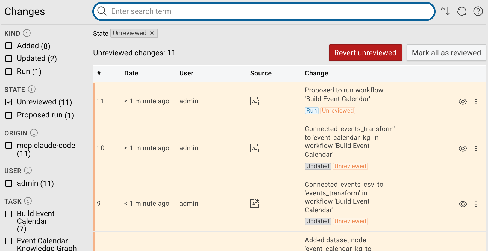
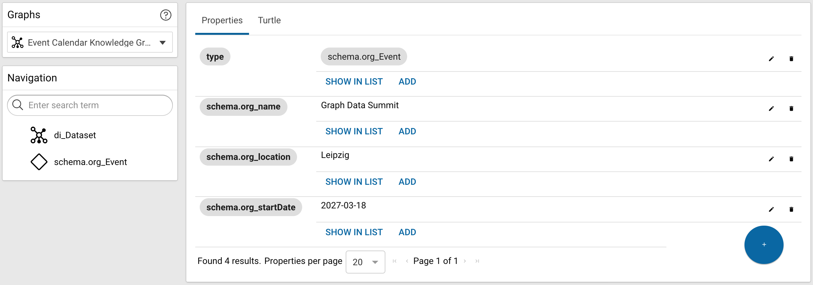

# Build a knowledge graph with an AI agent

## Introduction

In agentic knowledge graph engineering, an AI agent does the authoring work in eccenca Corporate Memory, and a person sets the rules and reviews the result.
This tutorial applies the [Agent Integration](../../automate/agent-integration/index.md) guide to one complete Build project, from a CSV file to a populated knowledge graph.

The agent works through the Build MCP server:

- It creates a project, uploads the source file, and creates a CSV dataset, a Knowledge Graph dataset, a transformation and a workflow.
- It requests a run of the workflow, which is held back until its changes are reviewed.
- After the review, it runs the workflow, and the result is checked in Explore.

Claude Code is the example agent.
The instruction file, the task and the review work the same way with other agents that support MCP.

## Prerequisites

- [Claude Code](https://code.claude.com/docs) is installed.
- The Build MCP server allows changes, and the review gate is enabled, which is the default, see [Allow changes through the Build MCP server](../../automate/agent-integration/index.md#allow-changes-through-the-build-mcp-server).
- The account that the agent uses can create projects in Build and write graphs, see [Permissions of the agent](../../automate/agent-integration/index.md#permissions-of-the-agent).
- An empty working folder for the agent.

## 1 Connect the agent

Register the Build MCP server in Claude Code as described in the [recipe for Claude Code](../../automate/agent-integration/index.md#recipes).
The OAuth sign-in needs a deployment that is reachable over HTTPS.
For a deployment that is reachable only over HTTP, register the server with a bearer token, see [Choose a method](../../automate/agent-integration/index.md#choose-a-method).

Run `claude mcp list` in the working folder to check the registration.
The entry `cmem-build` is marked as connected.

## 2 Write the instructions for the agent

The instruction file tells the agent how to work with Corporate Memory in this folder and what the result has to look like, see [Instructions for the agent](../../automate/agent-integration/index.md#instructions-for-the-agent).
Claude Code reads `CLAUDE.md`; other agents read a file such as `AGENTS.md`.

Create the following two files in the working folder:

```text title="events.csv"
id,name,start_date,city
E-201,Graph Data Summit,2027-03-18,Leipzig
E-202,Open Linked Data Day,2027-05-06,Utrecht
E-203,Semantic Integration Workshop,2027-09-23,Lyon
```

```markdown title="CLAUDE.md"
# Event Calendar

Work with eccenca Corporate Memory only through the MCP server `cmem-build`.

- Create the Build project with the ID `event-calendar` and the label `Event Calendar`.
- Write the result into the graph `https://example.org/event-calendar/`.
- Each row of `events.csv` becomes a `https://schema.org/Event` with the IRI `https://example.org/event/{id}`.
- Map `name` to `https://schema.org/name`, `start_date` to `https://schema.org/startDate` as a date, and `city` to `https://schema.org/location`.
- Do not delete anything without asking.
```

Without these rules, the agent chooses the project ID, the graph, the IRIs and the target properties itself.

## 3 Give the agent the task

1. Start Claude Code in the working folder without its shell tool, so that it reaches Corporate Memory only through the Build MCP server:

    ```shell-session
    claude --disallowedTools Bash
    ```

2. Enter the task:

    ```text
    Build the project described in CLAUDE.md from events.csv in this folder:
    upload the file, create a CSV dataset that reads it, a Knowledge Graph dataset for the result,
    a transformation and a workflow that runs the transformation. Then run the workflow.
    ```

3. Allow each tool call that the agent asks for.
    Claude Code asks before every call that is not allowed in advance, also before calls that only read.

The agent reads `events.csv`, creates the project **Event Calendar** with the following contents, and checks the transformation with a preview:

- The file `events.csv`
- A CSV dataset that reads `events.csv`
- A Knowledge Graph dataset that writes into `https://example.org/event-calendar/`
- A transformation that maps each row to a `https://schema.org/Event` as the instructions describe
- A workflow that runs the transformation from the CSV dataset into the Knowledge Graph dataset

The agent chooses the IDs and labels of the datasets, the transformation and the workflow, so they can differ from run to run.

Then the agent requests the run of the workflow.
The Build MCP server holds the run back as a proposed run, and the agent passes on a link to the **Changes** view of the project and asks for a review.

## 4 Review the changes

Open the link from the agent, or open the project **Event Calendar** and click **Review changes** on the **Changes** card.
The **Changes** view lists every step of the agent as an unreviewed change, from the uploaded file to the proposed run.

{ class="bordered" }

Check the changes, revert the ones that are not wanted, and click **Mark all as reviewed**.
The tutorial [Review the changes of an AI agent](../review-agent-changes/index.md) describes the review in detail.

## 5 Let the agent run the workflow

Tell the agent in the same conversation that the review is done, for example:

```text
I reviewed your changes in the Changes view and marked them as reviewed. Run the workflow again.
```

The agent requests the run again, and this time the Build MCP server runs the workflow.
The agent reports the result of the run, here three events written into `https://example.org/event-calendar/`.
The Build MCP server does not query graphs, so the agent reports what the execution report says, not what the graph contains.

## 6 Check the result in Explore

1. Open **Knowledge graphs** under **EXPLORE** in the main navigation.
2. Select the graph of the Knowledge Graph dataset in the **Graphs** list, here **Event Calendar Knowledge Graph**.
    The label comes from the dataset that the agent created.
3. Select the class `schema.org_Event` under **Navigation**.
    The list shows the three events `E_201`, `E_202` and `E_203`.
4. Click an event to see its properties.

{ class="bordered" }

Explore shows `schema.org_Event` and `schema.org_name` instead of labels, because the deployment has no schema.org vocabulary installed.

## Related

- [Agent Integration](../../automate/agent-integration/index.md) describes the control mechanisms, the authentication and the permissions of an agent.
- [Review the changes of an AI agent](../review-agent-changes/index.md) walks through a review with a reverted change.
- [Change Journal](../change-journal/index.md) describes the journal, the revert and the review.
