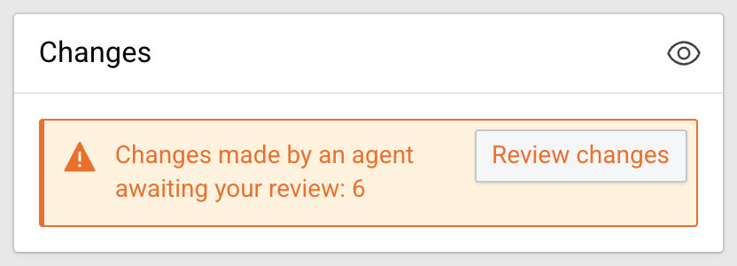
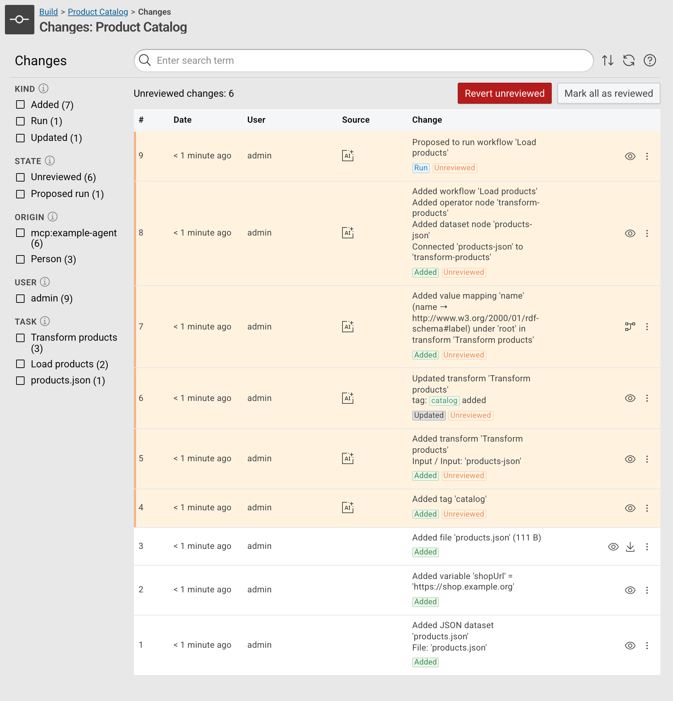
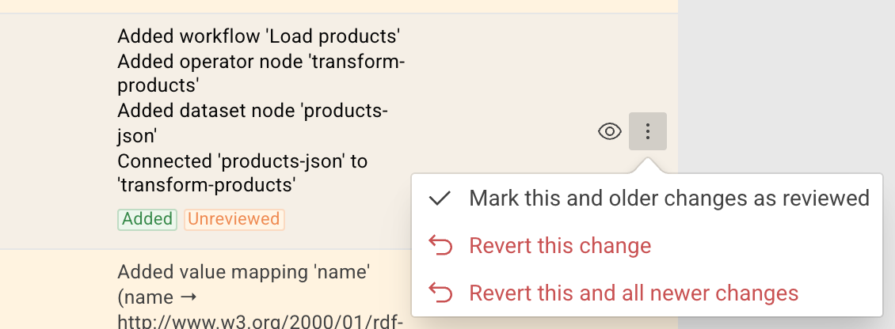

# Change journal

## Introduction

The change journal records the changes to a Build project in eccenca Corporate Memory.
Each entry states who made the change, when, from which client and what it changed.

The journal serves two purposes:

- **Undo changes:** Almost every change can be reverted from the journal, whether it was made in the user interface, through the REST API or by an agent.
- **Review the work of agents:** An agent that works on a project through the [Build MCP server](../../automate/agent-integration/index.md#mcp), such as the [Companion](../../explore-and-author/companion/index.md) or an external agent, changes it without asking for each step.
    Its changes stay marked as unreviewed until a person reviews them.

Everyone who can open a project sees its change journal and can review and revert its changes.

!!! info "Availability"

    The change journal is available starting with Corporate Memory version 26.3.

## Recorded changes

The journal records changes to the content of a project:

- Tasks that are added, updated or removed, including datasets, transformations and workflows
- Single mapping rules, and the nodes and connections of a workflow
- Project variables
- Tags
- Uploaded and deleted files
- Workflow runs, and workflow runs proposed by an agent

Project settings such as the label or the prefixes of the project are not recorded.

## Open the change journal

The **Changes** card on the project view summarizes the journal.
It states the number of recorded changes and how many changes made by an agent await review.

{ class="bordered" width="50%" }

Open the journal in one of the following ways:

- Click :eccenca-item-viewdetails: in the header of the **Changes** card.
- Click **Review changes** in the **Changes** card, if changes await review.
- Click :eccenca-item-moremenu: in the header of the project and select **Changes**.

The **Changes** view of the project opens.

{ class="bordered" }

## Find a change

The journal lists the changes newest first.
Each row shows:

- **#:** the sequence number of the change in the project
- **Date:** when the change was made
- **User:** the account that made the change
- **Source:** an icon if the change was made by an agent; hover over the icon to see the client name.
    A change made by the Companion also shows its chat as a tag such as **C1**; click the tag to filter the list by this chat.
- **Change:** a summary of the change, the details of what it changed, and tags for its kind and state

The icons at the end of a row open what the change refers to:

- :eccenca-item-viewdetails: opens the task or the project.
- :eccenca-application-mapping: opens a mapping rule in the mapping editor.
- :eccenca-item-download: downloads an added file.
- A workflow run additionally links its execution report.
- **Open companion conversation** opens the chat of a change made by the Companion in the Companion panel.

To narrow down the list, use the following controls:

- Enter a term in the search field to search the change summaries.
- Select values in the facets on the left: **KIND** (for example **Added**, **Updated**, **Run**), **STATE** (for example **Unreviewed**, **Proposed run**), **ORIGIN** (**Person** or the client name of an agent), **USER**, **TASK** and **CONVERSATION** (the Companion chat that made the change).
- Click :eccenca-list-sort: to change the sort order.
- Click :eccenca-item-reload: to load changes made since the list was opened.
- Click :eccenca-item-question: to open a description of the change journal.

## Revert a change

A revert undoes exactly what a change did.
For example, reverting the addition of a mapping rule removes this rule and nothing else.

To revert a change, follow these steps:

1. Click :eccenca-item-moremenu: in the row of the change.
2. Select one of the following entries:
    - **Revert this change** reverts the selected change only.
    - **Revert this and all newer changes** returns the project to the state before the selected change.

    { class="bordered" width="70%" }

3. Click **Revert** to confirm.

The revert is recorded as a new change.
Reverting this new change redoes the original change.

A change can be reverted as long as what it changed is still as the change left it.
Otherwise, the revert entry is disabled, and its tooltip states the reason, for example that a newer change modified the task or that another task references it.
Reverting the newer changes first can make the revert possible again.

A revert of several changes skips the changes that cannot be reverted and stops at the first conflict.
The result lists the reverted changes.

!!! warning "Some changes cannot be reverted"

    A workflow run cannot be reverted.
    Data that a run wrote, for example to a file, a Knowledge Graph or an external database, remains after the changes that the run used are reverted.
    Overwriting or deleting a file cannot be reverted either.

## Review changes made by an agent

Changes that an agent makes through the Build MCP server are marked as **Unreviewed**.
The journal highlights them and states their number above the list.
The MCP server offers no tool to mark changes as reviewed, so an agent cannot approve its own work.

To review the changes, follow these steps:

1. Click **Review changes** in the **Changes** card of the project.
2. Check each unreviewed change, and revert the changes that are not wanted, as described in [Revert a change](#revert-a-change).
3. Mark the remaining changes as reviewed:
    - Click **Mark all as reviewed** to mark all listed changes as reviewed.
        Click :eccenca-item-reload: before, to include changes made since the list was opened.
    - Alternatively, click :eccenca-item-moremenu: in the row of a change and select **Mark this and older changes as reviewed**.
        This marks the selected change and all older changes, and leaves the newer changes for later.
4. Click **Confirm**.

To reject all unreviewed changes at once, click **Revert unreviewed** and then **Revert**.
The changes are reverted newest first.

The tutorial [Review the changes of an AI agent](../review-agent-changes/index.md) walks through a review from the request of the agent to the approved workflow run.
The tutorial [Build a knowledge graph with an AI agent](../agentic-knowledge-graph-engineering/index.md) shows the review as part of a complete project that an agent builds.

### Changes made by the Companion

While the Companion changes a project, a panel below the chat counts the unreviewed changes:

- **Changes from this conversation** — the changes that the Companion made in this chat
- **Other changes awaiting review** — the unreviewed changes of the project from other sources
- A link that lists the unreviewed changes of the project
- A link that lists only the changes of this chat

The links open the **Changes** view, filtered accordingly.
When a workflow run is held back for review, the answer of the Companion links **Review changes**.

### Workflow runs proposed by an agent

While the review gate is enabled, which is the default, an agent does not run a workflow while unreviewed changes exist, because a run would use these changes and its results cannot be reverted.
Instead, the request is recorded as a change of the state **Proposed run**, and the agent is asked to wait for the review.

- After all changes are marked as reviewed, the next request of the agent runs the workflow.
    The run is recorded with a link to its execution report.
- Reverting the proposed run rejects it.

## Configuration and API

The journal of a project is stored on the file system of Build and survives a restart.
A project export contains the journal by default.
The project export endpoints accept the parameter `exportChangeJournal=false` to leave it out.

Administrators configure the journal and the review gate for agents in the Build configuration (`dataintegration.conf`):

`workspace.changes.plugin`

:   Selects where the journal is kept: `fileChangeJournal` on the file system, `inMemoryChangeJournal` in memory for the most recent changes only, or `emptyChangeJournal` to disable the journal together with the review.

`workspace.changes.fileChangeJournal.dir`

:   The directory of the file-based journal.

`com.eccenca.di.assistant.McpConfig.reviewGate`

:   Makes workflow runs requested through the MCP server wait for review, as described in [Workflow runs proposed by an agent](#workflow-runs-proposed-by-an-agent).
    The default is `true`.
    While the review gate is enabled, the MCP server does not offer the `resource_delete` tool, because deleting a file cannot be reverted.
    Set it to `false` for automation without a reviewer: workflow runs then execute right away, and `resource_delete` is available.

The journal of a project is also available through the REST API under `/api/workspace/projects/{project}/changes`.
See the [Build (DataIntegration) API documentation](../../develop/dataintegration-apis/index.md) for details.
