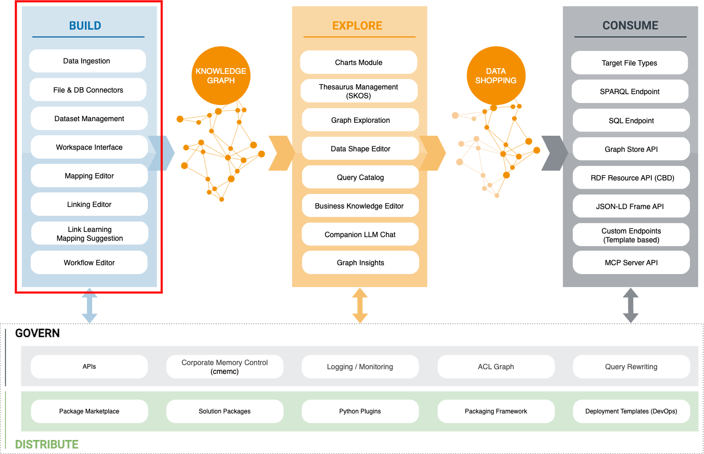

!!! info inline end ""

    

# :material-star: Build

The Build stage turns source data from files, databases, APIs, and streams into an Enterprise Knowledge Graph.

**:octicons-people-24: Intended audience:** Linked Data Experts

- :material-lightbulb-outline: Foundations

    ---

    Understand the workspace and the concepts behind it.

    - [Introduction to the User Interface](introduction-to-the-user-interface/index.md) --- The **Build** workspace, its projects and its tasks.
    - [Cool IRIs](cool-iris/index.md) --- Define the identifiers of the nodes and edges in a Knowledge Graph.
    - [Define Prefixes / Namespaces](define-prefixes-namespaces/index.md) --- Abbreviate IRIs with prefixed names.
    - [Rule Operators](rule-operators/index.md) --- The operators that make up linking and transformation rules.
    - [Spark](spark/index.md) --- Apache Spark and its integration in **Build**.

- :material-list-status: Tutorials

    ---

    Follow an example from start to finish.

    - [Build a mapping with the Mapping Creator](mapping-creator-tutorial/index.md) --- Map a hierarchical XML file to a vocabulary with the visual editor and its AI-generated suggestions.
    - [Lift Data from Tabular Data](lift-data-from-tabular-data-such-as-csv-xslx-or-database-tables/index.md) --- Build a Knowledge Graph from CSV, XLSX or database tables.
    - [Lift data from JSON and XML sources](lift-data-from-json-and-xml-sources/index.md) --- Build a Knowledge Graph from hierarchical files.
    - [Extracting data from a Web API](extracting-data-from-a-web-api/index.md) --- Build a Knowledge Graph from a Web API response.
    - [Incremental Database Loading](loading-jdbc-datasets-incrementally/index.md) --- Load a relational database table incrementally through a JDBC dataset.
    - [Connect to Snowflake](snowflake-tutorial/index.md) --- Lift and link data from a Snowflake cloud warehouse.
    - [Build Knowledge Graphs from Kafka Topics](kafka-consumer/index.md) --- Consume Kafka topics and lift event streams.
    - [Evaluate Jinja Template and Send an Email Message](evaluate-template/index.md) --- Fill a template from a graph and send it after a workflow execution.
    - [Link Intrusion Detection Systems to Open-Source INTelligence](tutorial-how-to-link-ids-to-osint/index.md) --- Link IDS data to OSINT sources.

- :material-wrench-outline: Guides

    ---

    Use a feature in a project.

    - [Mapping Creator](mapping-creator/index.md) --- Create and manage mappings on a visual canvas.
    - [Active learning](active-learning/index.md) --- Learn a linking rule from interactively labeled record pairs.
    - [Rule Blocks](rule-blocks/index.md) --- Build reusable transformation sequences, referenced from transformation and linking rules and managed centrally.
    - [Workflows](workflows/index.md) --- Orchestrate datasets and tasks, and reconfigure tasks during execution.
    - [Variables](variables/index.md) --- Define and reuse global, project and execution variables.
    - [Project Access Control](project-access-control/index.md) --- Restrict a project to the members of selected user groups.

- :material-book-open-variant-outline: Reference

    ---

    Look up tasks, operators and supported services.

    - [Task and Operator Reference](reference/index.md) --- Tasks and operators of the **Build** workspace.
    - [Integrations](integrations/index.md) --- Services and applications that integrate with eccenca Corporate Memory.

