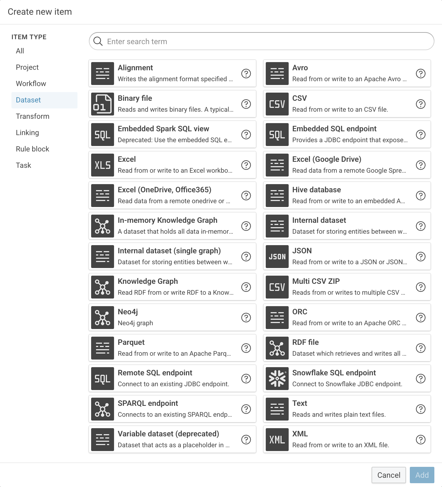
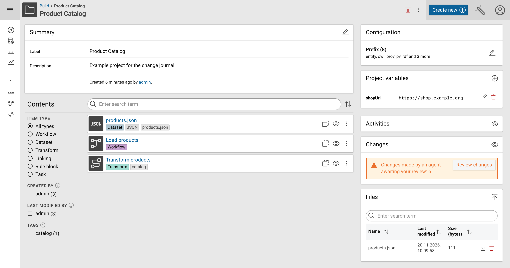
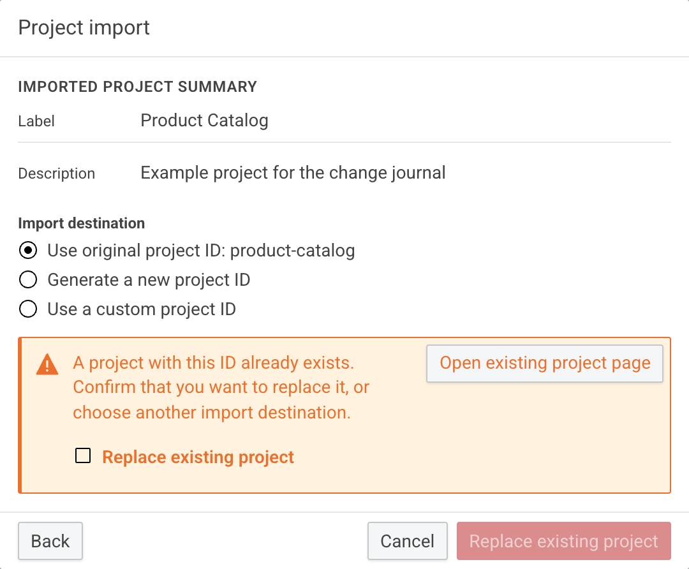
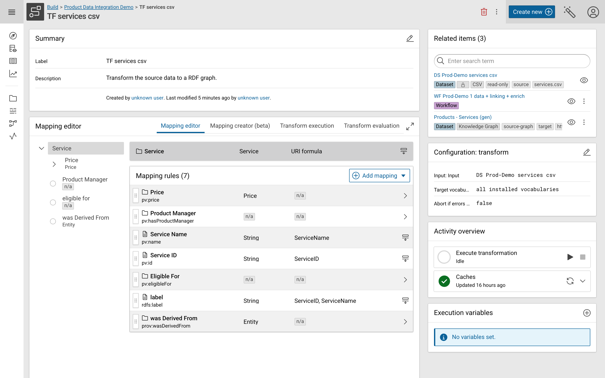
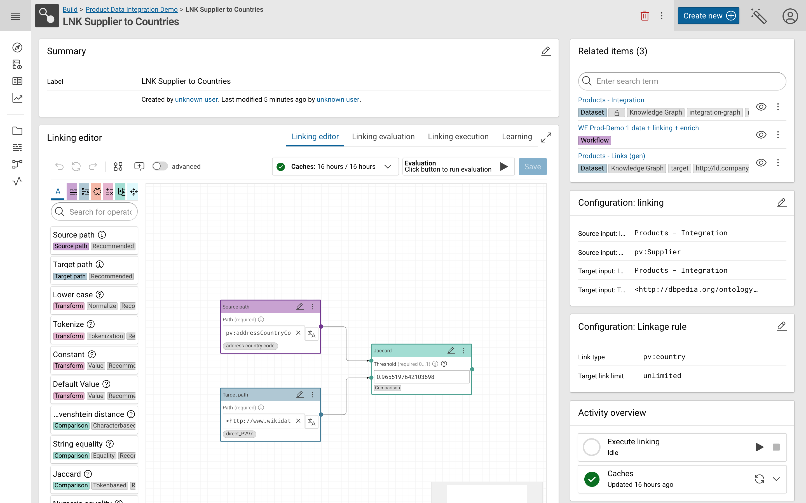

# Introduction to the user interface

This introduction to Build in eccenca Corporate Memory covers the workbench, the projects and the views of datasets, tasks and workflows.

## Workbench

The workbench is the entry point to Build.
It lists the projects and the items in them.

{ class="bordered" }

The facet **ITEM TYPE** on the left filters the list by the type of item:

- **Project:** groups the datasets, tasks and workflows that belong together.
- **Workflow:** connects datasets and tasks and runs them in order, see [Workflows](#workflows).
- **Dataset:** a source or a destination of data, such as a file or an endpoint, see [Datasets](#datasets).
- **Transform:** maps the entities of an input dataset to a target schema, see [Transform tasks](#transform-tasks).
- **Linking:** compares the entities of two datasets and generates links between them, see [Linking tasks](#linking-tasks).
- **Rule block:** a reusable part of mapping or linkage rules, see [Rule Blocks](../rule-blocks/index.md).
- **Task:** any other task, such as an operator that runs in a workflow.

The search field searches all projects in the workbench, and the items of one project in the project view.

Click **Create new** in the header to create any kind of Build item.
The **Create new item** dialog groups the item types under **ITEM TYPE**: **Project**, **Workflow**, **Dataset**, **Transform**, **Linking**, **Rule block** and **Task**.

{ class="bordered" width="70%" }

## Projects

The project is the main concept to structure the work in Build.
In the workbench, projects are created, imported, exported and deleted.

Each project is self-contained and holds all relevant parts, such as the following:

- the **files** that hold the source data
- the **datasets** that provide uniform access to different kinds of data resources
- **transformation tasks** to transform datasets, for example from one format or schema to another
- **linking tasks** to integrate different datasets
- **workflows** to orchestrate the different tasks
- definitions of **URI prefixes** used in the project

Click **Create new** in the header of a project to add datasets, tasks and workflows to it.
Selecting an item opens its view, where its rules or its workflow are defined, see [Item views](#item-views).

### Project view

Selecting a project in the workbench opens the project view.

{ class="bordered" }

The project view shows the following areas:

- **Summary:** the label and description of the project
- **Contents:** the items of the project, with a search field and facets
- **Configuration:** the prefixes of the project
- **Project variables:** the [variables](../variables/index.md) of the project
- **Activities:** the activities of the project and their state
- **Changes:** the number of recorded changes and of changes made by an agent that await review, see [Change journal](../change-journal/index.md)
- **Files:** the files uploaded to the project

### Import a project

A project exported as a project file can be imported into the workbench.
To import a project, follow these steps:

1. Click **Create new** in the header.
2. Select **Project** and click **Add**.
3. Click **Import project file**.
4. Upload the project file.
    The **Project import** dialog shows the label and the description of the imported project.
5. Select an **Import destination**:
    - **Use original project ID** imports the project under the identifier stored in the project file.
    - **Generate a new project ID** imports the project under a new identifier.
    - **Use a custom project ID** imports the project under the identifier entered in the **Project identifier** field.

    { class="bordered" width="70%" }

6. Click **Import project**.

If a project with the selected identifier already exists, the dialog shows a warning.
Select **Replace existing project** and click **Replace existing project** to overwrite the existing project, or select another import destination.
Click **Open existing project page** to inspect the existing project first.

## Item views

Selecting a dataset, a task or a workflow in a project or in the search results opens its view.
The views of all item types share the following parts:

- The header shows :eccenca-item-remove: to delete the item and :eccenca-item-moremenu: with the following actions:
    - **Copy** copies the item into another project.
    - **Clone** creates a new item with the same configuration in the same project.
        Items that the cloned item references are not duplicated.
    - **Show identifier** shows the identifier of the item, the combined project and item identifier, and the URI of the item.
- **Summary:** the label, the description and the tags of the item, and who created and last modified it.
    Click :eccenca-item-edit: to change them.
- **Related items:** the datasets, tasks and workflows that the item uses or that use it.
- **Execution variables:** the [execution variables](../variables/index.md#execution-variables) of the item.

## Datasets

A dataset makes data available to Build: it provides the source or the destination of tasks.
A transform task or a linking task reads entities from a dataset, and writes transformed entities or generated links into a dataset.

{ class="bordered" }

The view of a dataset shows the following areas in addition to the [shared parts](#item-views):

- **Data preview:** the first entities of the dataset.
    For some dataset types, such as Excel, click **Load preview** to load them.
    Click **Start profiling** to collect profiling information on the values.
- **Configuration:** the parameters of the dataset type, for example the file of a file-based dataset.
    Click :eccenca-item-edit: to change them.
- **Activity overview:** the activities of the dataset, such as its caches.

:eccenca-item-moremenu: in the header also offers **Clear dataset**, which empties the dataset.
It is not available for a read-only dataset.

The dataset type decides which kind of data the dataset reads and writes.
Frequently used dataset types include:

- **Knowledge Graph:** reads RDF from or writes RDF to a Knowledge Graph in eccenca Corporate Memory.
- **CSV**, **JSON**, **XML** and **Excel:** read from or write to a file of this format.
- **Multi CSV ZIP:** reads from or writes to several CSV files in one ZIP file.
- **Remote SQL endpoint:** connects to an existing JDBC endpoint.
- **SPARQL endpoint:** connects to an existing SPARQL endpoint.
- **Embedded SQL endpoint:** exposes the results of workflows or transformations as tables that can be queried with SQL.

The [dataset reference](../reference/dataset/index.md) describes every dataset type and its parameters.

## Transform tasks

A transform task maps the entities of a dataset to a target schema with a set of mapping rules, for example to build a Knowledge Graph from a tabular source.

{ class="bordered" }

The view of a transform task shows the following areas in addition to the [shared parts](#item-views):

- The editor area, which :eccenca-toggler-maximize: enlarges, with the following tabs:
    - **Mapping editor** changes the mapping rules.
    - **Mapping creator (beta)** creates and changes mapping rules visually, see [Mapping Creator](../mapping-creator/index.md).
    - **Transform execution** runs the transformation and shows the execution report.
    - **Transform evaluation** shows the entities that the mapping rules produce, to check the rules for issues.
- **Configuration:** the input dataset, the target vocabularies and further parameters of the transformation.
- **Activity overview:** the activities of the transform task, for example **Execute transformation** with :eccenca-item-start: to run it.

To test a transformation on a small part of the data, set **Input limit** under **ADVANCED OPTIONS** in the configuration of the transform task.
Only the first N input entities are transformed, in every execution of the task, including workflow executions and other tasks that read the transformation.
For hierarchical mappings, the limit applies to each level separately.
A parent entity can then reference child entities that were cut, and writing to a JSON or XML dataset fails because a referenced entity is missing.
Leave the field empty to transform all input entities.

## Linking tasks

A linking task compares the entities of two datasets, a source and a target, and generates links between the entities that match.

{ class="bordered" }

The view of a linking task shows the following areas in addition to the [shared parts](#item-views):

- The editor area with the following tabs:
    - **Linking editor** changes the linkage rule, which compares the source and the target entities.
    - **Linking evaluation** evaluates the linkage rule and shows the evaluated links and the reference links.
    - **Linking execution** runs the linking task and shows the execution report.
    - **Learning** suggests a linkage rule from confirmed and rejected example links, see [Active learning](../active-learning/index.md).
- **Configuration:** the source and the target input of the linking task.
- **Configuration: Linkage rule:** the link type and the link limit of the linkage rule.
- **Activity overview:** the activities of the linking task, for example **Execute linking** with :eccenca-item-start: to run it.

The links that a linking task generates are written into an output dataset, or passed on to the next task in a workflow.

## Workflows

A workflow connects datasets and tasks through their inputs and outputs, and runs them in order.
Workflows are used for anything beyond a single task, and can be started on demand, through [cmemc](../../automate/cmemc-command-line-interface/index.md) or by a [scheduler](../../automate/scheduling-workflows/index.md).

{ class="bordered" }

The view of a workflow shows the editor area in addition to the [shared parts](#item-views), with the following tabs:

- **Workflow editor** changes the workflow.
    Drag datasets and tasks from the list on the left into the workflow and connect their ports.
    Click :eccenca-item-start: above the workflow to run it.
- **Workflow report** shows the report of the last run.

See [Workflows](../workflows/index.md) for working with the workflow editor.
