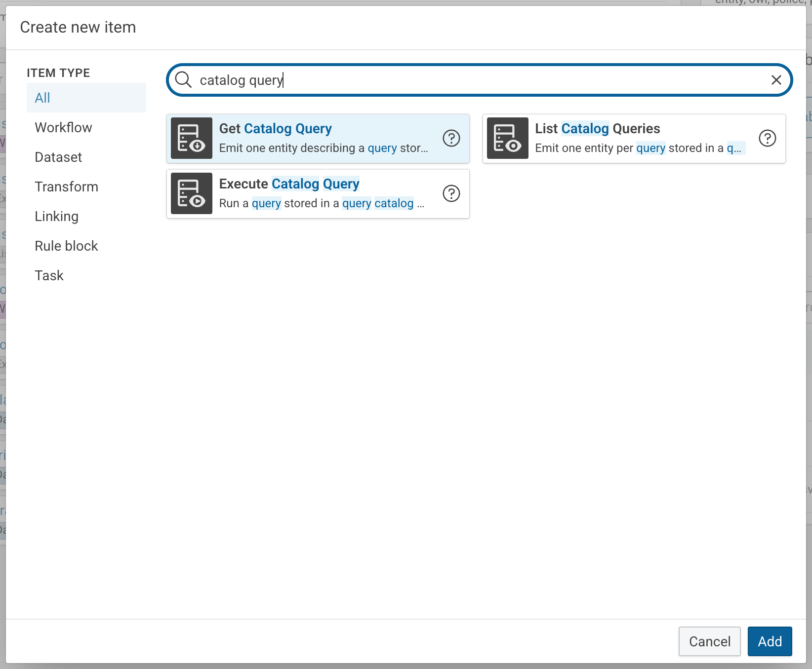
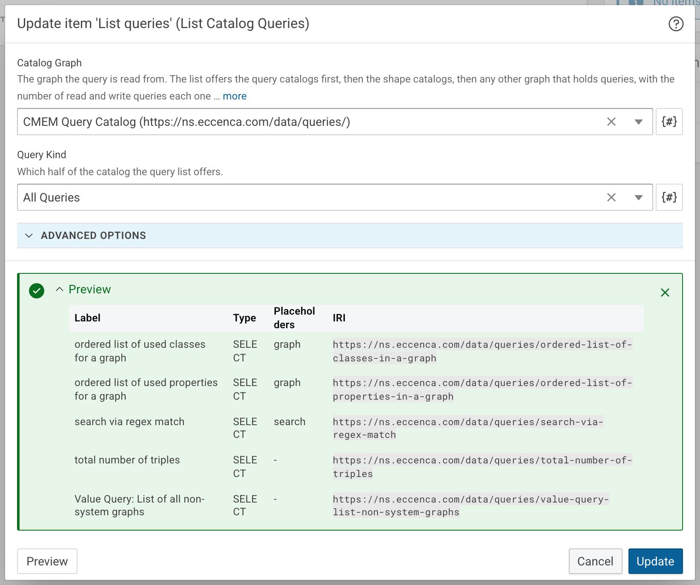
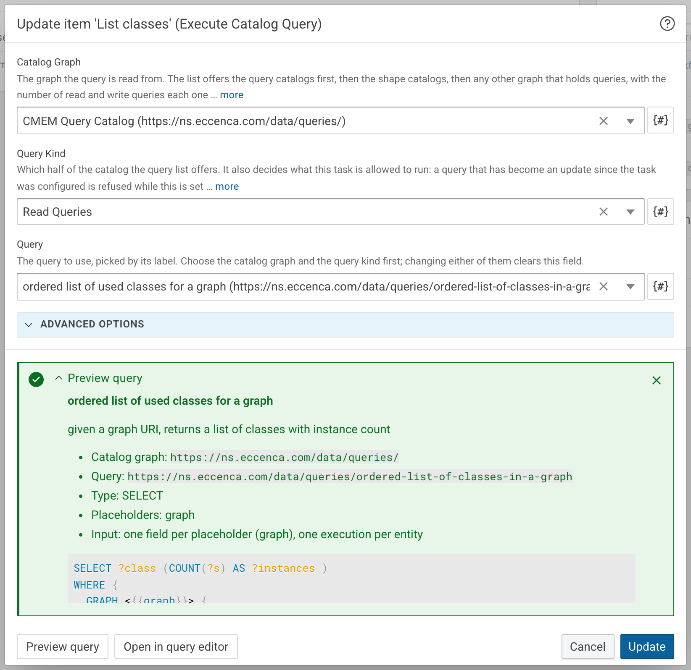
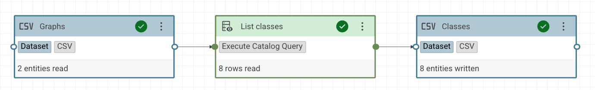

# Run catalog queries in workflows

## Introduction

The [query catalog](../../explore-and-author/query-module/index.md) of eccenca Corporate Memory stores SPARQL queries with a label, a description and optional placeholders.
The [cmem-plugin-querycatalog](https://pypi.org/project/cmem-plugin-querycatalog/) [Python plugin](../../develop/python-plugins/index.md) makes these stored queries available as workflow tasks.
A workflow then references the query in the catalog instead of carrying its own copy of the query text.
A change to the query in the catalog takes effect on the next workflow execution.

The package contains three tasks:

- **List Catalog Queries** emits one entity per query of a catalog graph.
- **Get Catalog Query** emits one entity that describes a single query.
- **Execute Catalog Query** runs a stored query and passes its result to the next task in the workflow.

This tutorial lists the queries of the default query catalog, runs a query without placeholders, and runs a query with a placeholder that is filled from a dataset.

## Prerequisites

- A Build project for the tutorial, for example `tutorial-querycatalog`.
- The queries of the default query catalog `CMEM Query Catalog` (`https://ns.eccenca.com/data/queries/`), which is part of every Corporate Memory deployment.
- The IRI of a graph with instance data in the deployment, used in [step 3](#3-run-a-query-with-a-placeholder).

## Installation

Install the `cmem-plugin-querycatalog` package with cmemc:

```shell-session title="Installing cmem-plugin-querycatalog on the instance 'my-cmem'"
$ cmemc -c my-cmem admin workspace python install cmem-plugin-querycatalog
Install package cmem-plugin-querycatalog ... done
```

Validate the installation by listing the installed plugins.
The output contains the three tasks of the package:

```shell-session
$ cmemc -c my-cmem admin workspace python list-plugins
┏━━━━━━━━━━━━━━━━━━━━━━━━━━━━━━━━━━━━━━━━━━━━━┳━━━━━━━━━━━━━━━━━━━━━━━━━━┳━━━━━━━━━━━━━━━━┳━━━━━━━━━━━━━━━━━━━━━━━┓
┃ ID                                          ┃ Package ID               ┃ Type           ┃ Label                 ┃
┣━━━━━━━━━━━━━━━━━━━━━━━━━━━━━━━━━━━━━━━━━━━━━╋━━━━━━━━━━━━━━━━━━━━━━━━━━╋━━━━━━━━━━━━━━━━╋━━━━━━━━━━━━━━━━━━━━━━━┫
┃ cmem_plugin_querycatalog-ExecuteCatalogQuery ┃ cmem-plugin-querycatalog ┃ WorkflowPlugin ┃ Execute Catalog Query ┃
┃ cmem_plugin_querycatalog-GetCatalogQuery     ┃ cmem-plugin-querycatalog ┃ WorkflowPlugin ┃ Get Catalog Query     ┃
┃ cmem_plugin_querycatalog-ListCatalogQueries  ┃ cmem-plugin-querycatalog ┃ WorkflowPlugin ┃ List Catalog Queries  ┃
┗━━━━━━━━━━━━━━━━━━━━━━━━━━━━━━━━━━━━━━━━━━━━━┻━━━━━━━━━━━━━━━━━━━━━━━━━━┻━━━━━━━━━━━━━━━━┻━━━━━━━━━━━━━━━━━━━━━━━┛
```

## 1 List the queries of a catalog

1. Open the tutorial project and click **Create new**.
2. Enter `catalog query` in the search field, select **List Catalog Queries** and click **Add**.

    { class="bordered" width="70%" }

3. Enter the following values:

    - **Label:** `List queries`
    - **Catalog Graph:** `CMEM Query Catalog`
    - **Query Kind:** `All Queries`

    An entry of the **Catalog Graph** list contains more than the label of the graph.
    Select the entry that starts with `CMEM Query Catalog`.

4. Click **Preview**, then expand the **Preview** result.
    The table shows the label, the type, the placeholders and the IRI of every query in the catalog.

    { class="bordered" width="70%" }

5. Click **Create**.

The **Catalog Graph** list shows the query catalogs first, then the shape catalogs, then any other graph that holds queries.
Each entry starts with the label of the graph, followed by the kind of catalog, the number of read and write queries the graph contains and the graph IRI.
In the same way, an entry of the **Query** list starts with the label of the query and ends with its IRI.
**Query Kind** restricts the entities to `Read Queries` or `Write Queries`, or keeps `All Queries`.

In a workflow, the task emits one entity per query with the values `catalogGraph`, `query`, `label`, `description`, `queryType`, `queryText` and `placeholder`.
The query text is emitted with its placeholders unfilled.

## 2 Run a query without placeholders

The query `total number of triples` counts the triples of every graph and has no placeholders.
A task that runs it does not read any input, so it can start a workflow.
In the workflow editor, the node of the task can still show an input connector.
Leave it unconnected.

1. Create a [CSV dataset](../reference/dataset/csv.md) with the label `Triple counts` and the file name `triple-counts.csv`.
2. Click **Create new**, select **Execute Catalog Query** and click **Add**.
3. Enter the following values:

    - **Label:** `Count triples`
    - **Catalog Graph:** `CMEM Query Catalog`
    - **Query Kind:** `Read Queries`
    - **Query:** `total number of triples`

4. Click **Create**.
5. Create a workflow with the label `Count triples workflow`.
6. Drag **Count triples** and **Triple counts** onto the canvas and connect the output of **Count triples** to the input of **Triple counts**.
7. Click **Save**, then run the workflow.

The `triple-counts.csv` file contains one row per graph, with the columns `graph` and `count`.

The output of the task follows the type of the query:

- A `SELECT` query produces one entity per result row, with one value per projected variable.
- An `ASK` query produces one entity with the value `true` or `false`.
- A `CONSTRUCT` or `DESCRIBE` query produces its statements as quad entities, ready for a task that consumes quads.
- An update query produces no output.

!!! warning

    **Query Kind** restricts what the task runs.
    With `Read Queries`, the task refuses a query that has been changed into an update query in the catalog.
    Select `Write Queries` only for a task that is meant to change data.

## 3 Run a query with a placeholder

The query `ordered list of used classes for a graph` contains the placeholder `{{graph}}`:

```sparql
SELECT ?class (COUNT(?s) AS ?instances )
WHERE {
  GRAPH <{{graph}}> {
    ?s a ?class.
  }
}
GROUP BY ?class
ORDER BY DESC(?instances)
```

**Execute Catalog Query** turns every placeholder into an input field of the task.
The task runs the query once per input entity and passes on the results of all executions together.

1. Create a file `graphs.csv` with a column `graph` and one graph IRI per row.
    Replace the IRIs with graphs that exist in the deployment:

    ```text
    graph
    http://ld.company.org/hardware/
    http://ld.company.org/services/
    ```

2. Create a CSV dataset with the label `Graphs` and upload the `graphs.csv` file.
3. Create a CSV dataset with the label `Classes` and the file name `classes.csv`.
4. Create an **Execute Catalog Query** task with the following values:

    - **Label:** `List classes`
    - **Catalog Graph:** `CMEM Query Catalog`
    - **Query Kind:** `Read Queries`
    - **Query:** `ordered list of used classes for a graph`

5. Click **Preview query** to check the query before creating the task, then expand the **Preview query** result.
    The result shows the query type, its placeholders, the input the task expects and the query text.

    { class="bordered" width="70%" }

6. Click **Create**.
7. Create a workflow with the label `List classes workflow` and connect **Graphs** to **List classes**, and **List classes** to **Classes**.

    { class="bordered" }

8. Click **Save**, then run the workflow.

The `classes.csv` file contains the columns `class` and `instances`, with the rows of both graphs one after another.

!!! note

    The stored query is read again on every execution.
    If a placeholder is added to the query in the catalog after the workflow has been built, the task fails and names the missing input instead of running an incomplete query.

## Look up a single query

**Get Catalog Query** emits the same values as **List Catalog Queries**, for one query only.
With a query selected in the task, it emits one entity and has no input.
With **Query** left empty, it reads `catalogGraph` and `query` from its input and emits one entity per input entity.
**List Catalog Queries** emits these two values first, so the two tasks can be connected directly.
