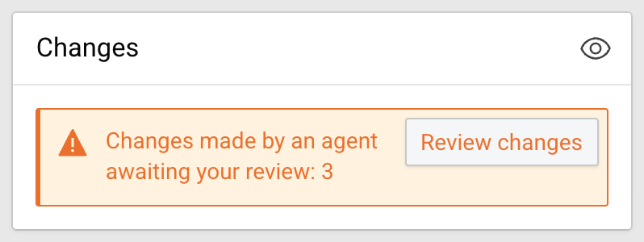
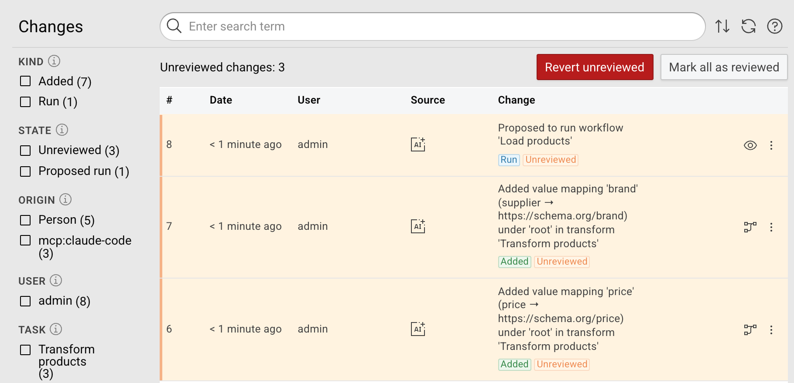
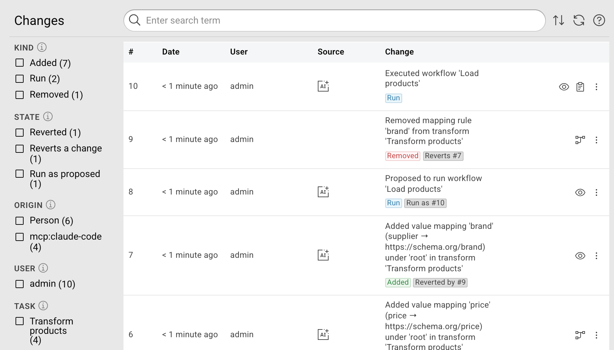

# Review the changes of an AI agent

## Introduction

An AI agent such as Claude Code can change a Build project of eccenca Corporate Memory through the Build MCP server.
Every change of the agent is recorded in the [change journal](../change-journal/index.md) of the project and awaits review.
A workflow run that the agent requests is held back until these changes are reviewed, because the results of a run cannot be reverted.

This tutorial walks through one review from start to end:

- The agent adds two mapping rules to a transformation and requests a run of the workflow.
- The run is held back as a proposed run.
- One mapping rule is reverted, and the remaining changes are marked as reviewed.
- The next request of the agent runs the workflow.

## Prerequisites

- An AI agent is connected to the Build MCP server, see [MCP](../../automate/agent-integration/index.md#mcp).
- The Build MCP server allows changes (`com.eccenca.di.assistant.McpConfig.readOnly = false`), see [Allow changes through the Build MCP server](../../automate/agent-integration/index.md#allow-changes-through-the-build-mcp-server).
- The review gate is enabled, which is the default (`com.eccenca.di.assistant.McpConfig.reviewGate = true`).
- A project with a transformation and a workflow that runs it.
    The tutorial uses the project **Product Feed** with the following contents:

    - The file `products.csv` with the columns `id`, `name`, `price` and `supplier`
    - The CSV dataset **Products (CSV)**, which reads `products.csv`
    - The transformation **Transform products**, which maps the column `name` to `https://schema.org/name`
    - The workflow **Load products**, which runs the transformation and writes the result into the Knowledge Graph dataset **Products (Knowledge Graph)**

    ```text
    id,name,price,supplier
    P-100,Resonator Transformer,0.79,Grant-Nelson
    P-101,Multiplexer Transistor,0.29,Mcpherson Ltd
    P-102,Crystal Oscillator,1.15,Hall-Hodges
    ```

!!! warning "The review covers only changes through the Build MCP server"

    An agent that can also use cmemc or the Build API changes the project and runs workflows without review, with the permissions of its account.
    Such changes are recorded as changes of a person, and a workflow run starts right away.
    Give the agent access to Corporate Memory only through the Build MCP server, and use an account or client with limited permissions, see [Permissions of the agent](../../automate/agent-integration/index.md#permissions-of-the-agent).

## 1 Let the agent change the project

Give the agent a task that changes the project and runs a workflow, for example:

```text
In the project Product Feed, map the columns price and supplier of products.csv
in the transformation Transform products to schema.org properties.
Then run the workflow Load products.
```

In this example, the agent adds two mapping rules: `price`, which maps the column `price` to `https://schema.org/price`, and `brand`, which maps the column `supplier` to `https://schema.org/brand`.
Then it requests the run of **Load products**.

The Build MCP server does not run the workflow.
It records the request as a proposed run and answers that the changes of the agent await review.
The answer contains a link to the **Changes** view of the project and instructs the agent to ask for the review and to request the run again afterwards.
How the agent passes this on depends on the agent.

## 2 Open the review

1. Open the project **Product Feed**.
    The **Changes** card states how many changes made by an agent await review.

    { class="bordered" width="50%" }

2. Click **Review changes**.

The **Changes** view of the project opens.
**Unreviewed changes: 3** above the list counts the changes of the agent: the two mapping rules and the proposed run.
They are highlighted, show an AI icon in the **Source** column and carry the tag **Unreviewed**.
The proposed run carries the tag **Run**.

{ class="bordered" }

Select the client name of the agent under **ORIGIN**, here `mcp:claude-code`, to list only the changes of the agent.
Click :eccenca-application-mapping: in the row of a mapping rule to open the rule in the mapping editor.

## 3 Revert an unwanted change

The column `supplier` holds the company that delivers a part, not its brand, so the mapping rule `brand` is not wanted.

1. Click :eccenca-item-moremenu: in the row of the change **Added value mapping 'brand'**.
2. Select **Revert this change**.
3. Click **Revert**.

The mapping rule `brand` is removed from **Transform products**.
The revert is recorded as a new change with the tag **Reverts #7**, and the reverted change carries the tag **Reverted by #9**.
**Unreviewed changes** drops to `2`.

## 4 Mark the remaining changes as reviewed

1. Click **Mark all as reviewed**.
    The dialog lists the changes to mark, here the proposed run and the mapping rule `price`.
2. Click **Confirm**.

Marking the proposed run as reviewed approves it.
To reject a proposed run instead, revert it before marking the remaining changes as reviewed.

## 5 Let the agent run the workflow

Tell the agent that the review is done and ask it to run the workflow again.

The agent requests the run again, and this time the Build MCP server runs **Load products**.
The change journal records the run as **Executed workflow 'Load products'** with a link to its execution report.
The proposed run carries the tag **Run as #10**.

{ class="bordered" }

The Knowledge Graph now contains the name and the price of each product, and no brand.

## Related

- [Change Journal](../change-journal/index.md) describes the journal, the revert and the review in detail.
- [Agent Integration](../../automate/agent-integration/index.md) describes how to connect an agent and how to limit its permissions.
