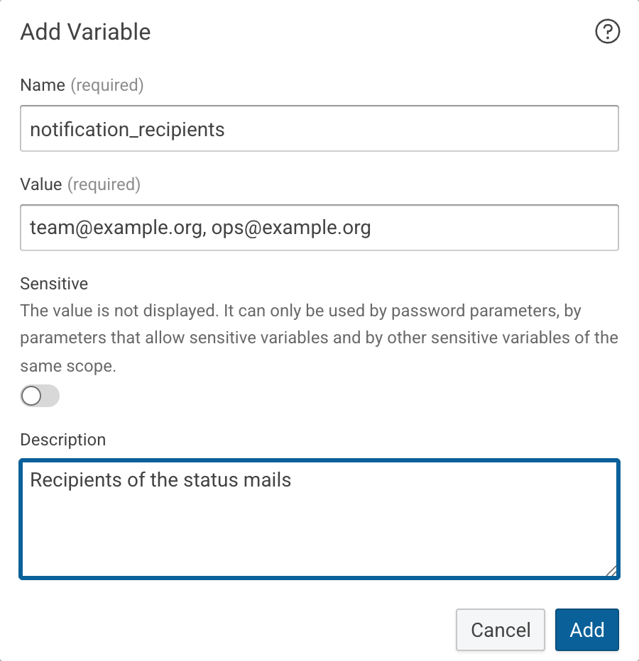
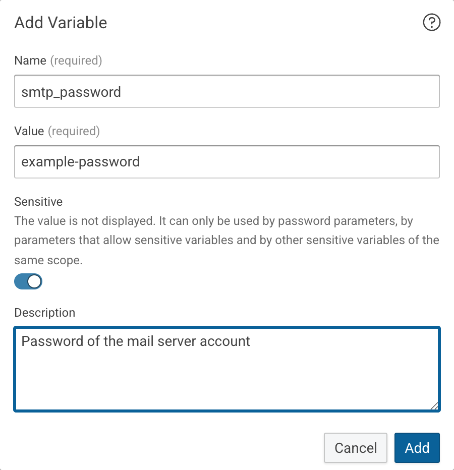
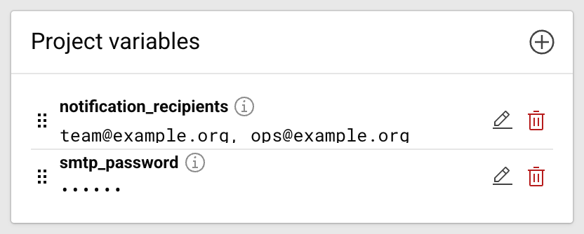
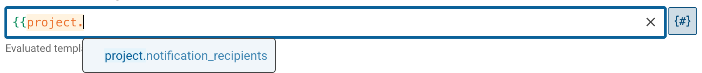
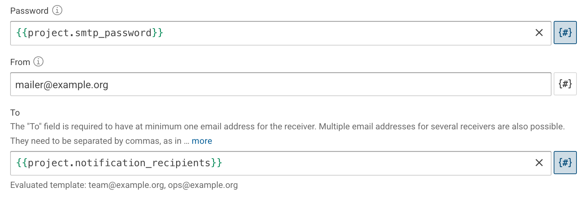
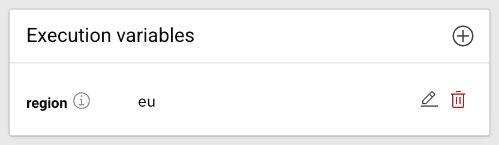

# Build variables

## Introduction

Build variables hold values that tasks of eccenca Corporate Memory reuse, for example host names, file paths, recipient lists or credentials.
A value that is stored once in a variable and referenced in many tasks is changed in one place.

Variables are not typed.
They can be used in most configuration fields that take a text, an integer or a boolean value.

Variables are organized in scopes.
Each scope is addressed by a prefix in a template, for example a project variable named `host` is referenced as `{{project.host}}`.
The following scopes are available:

`Global variables` (`global.`)

:   Defined by an administrator in the Build configuration at deployment time.
    They cannot be changed in the user interface.

`Project variables` (`project.`)

:   Defined in the user interface for a single project.
    They can only be used in the same project and are exported together with it.

`Execution variables` (`execution.`)

:   Defined on an individual task or workflow as defaults, and only available while the execution of that task is running.
    Each run can override them, and they can be changed while the run is in progress.

## Sensitive variables

Global, project and execution variables can be marked as sensitive, for example for passwords and access tokens.
The value of a sensitive variable is stored encrypted.
It is neither displayed in the user interface nor returned by the API, cmemc or the MCP server.

A sensitive variable can only be referenced from the following places:

- Password parameters, for example the **Password** of the **Send email** task
- Parameters that allow sensitive variables, for example **Content** and **HTTP headers** of the **Execute REST requests** task
- The template of another sensitive variable of the same scope

A task that references a sensitive variable in any other parameter cannot be saved.
A variable that is not sensitive cannot be based on a template that references a sensitive variable.

## Global variables

Global variables are defined in the `dataintegration.conf` configuration file:

```conf
###############################################
### Global Variables
###############################################

config.variables = {
  # Template engine
  # Can be disabled by setting: engine = "disabled"
  engine = "jinja"

  global = {
    # Insert global variables here

    # simple notation: key = "value"
    jdbcHost = "my-jdbc-host"

    # more variables …

    # advanced notation: to add `isSensitive` and/or `description`
    jdbcPassword = {
        value = "my-secret-password"
        description = "the JDBC password for my-jdbc-host"
        isSensitive = true
    }

    # more variables …
  }
}
```

The simple notation only sets the value.
The advanced notation additionally sets a `description` and marks the variable as sensitive with `isSensitive = true`.

The value of a sensitive global variable can be given encrypted, as `PASSWORD_PARAMETER:<encrypted value>`:

```conf
    smtpPassword = {
        value = "PASSWORD_PARAMETER:<encrypted value>"
        isSensitive = true
    }
```

Build uses this format for the values of password parameters of tasks.
To get the encrypted form of a value, enter it in a password parameter of a task and read the task through the API.
The value is encrypted with the key `plugin.parameters.password.crypt.key` of the Build configuration, so it is only valid for deployments with the same key.

## Project variables

### Add a project variable

To add a project variable, follow these steps:

1. Open the project in **Build**.
2. In the **Project variables** card, click :eccenca-item-add-artefact:.
3. Enter the following values in the **Add Variable** dialog:
    - **Name:** `notification_recipients`
    - **Value:** `team@example.org, ops@example.org`
    - **Description (optional):** `Recipients of the status mails`

    { class="bordered" width="56%" }

4. Click **Add**.

A variable name consists of uppercase and lowercase letters (`A-Z`, `a-z`), digits (`0-9`) and the underscore (`_`).
It cannot start with a digit.

### Add a sensitive project variable

To add a variable for a password, follow the same steps and switch on **Sensitive**:

- **Name:** `smtp_password`
- **Value:** `example-password`
- **Sensitive:** on
- **Description (optional):** `Password of the mail server account`

{ class="bordered" width="56%" }

The **Project variables** card lists both variables.
The value of the sensitive variable is masked.

{ class="bordered" width="52%" }

Click :eccenca-item-edit: to change a variable, or :eccenca-item-remove: to delete it.
A variable that a task still uses cannot be deleted.

## Use variables in a task

A parameter uses a variable when its value is a template that references the variable.
The following example configures the **Send email** task `Notify team` with the variables from the previous section:

1. Open the task and click :eccenca-item-edit: in the **Configuration** card.
2. Click **{#}** next to the **To** field to switch the field to a template.
3. Enter `{{project.` in the field and select `project.notification_recipients` from the suggestions.
    The suggestions only list variables that the field accepts.

    { class="bordered" }

4. Complete the template to `{{project.notification_recipients}}`.
    The field shows the result below the template as **Evaluated template**.
5. Click **{#}** next to the **Password** field and enter `{{project.smtp_password}}`.
    The result of a sensitive variable is not shown.

    { class="bordered" }

6. Click **Update**.

Click **{#}** again to switch a field back to a direct value.

Project and global variables are resolved when a task is saved.
Execution variables are resolved per run, see [Where execution variables resolve](#where-execution-variables-resolve).

## Execution variables

While project variables are shared across all tasks of a project, execution variables belong to a single task or workflow and exist only during its execution.
They are referenced with the `execution.` prefix, for example `{{execution.myVariable}}`.

Every task, including workflows, transformations, linking tasks, datasets and custom tasks, has an **Execution variables** card in its view.
Execution variables are added, changed and marked as sensitive in the same dialog as project variables.

{ class="bordered" width="52%" }

The values of the card take effect when that task is the one being executed, where they provide the defaults of the execution scope.
A task that only runs as part of a workflow receives its values from the enclosing workflow, so its own card stays unused.

### Where execution variables resolve

Project and global variables are resolved when a task is saved, which is why they can be used in any parameter field that offers **{#}**.
An execution variable only has a value while a run is in progress.
It therefore takes effect in parameters that are evaluated once per execution, such as the template of the **Evaluate template** workflow operator and of the **Evaluate template** transformer.
A reference such as `{{execution.myVariable}}` resolves there to the value of the current run.

A template in an ordinary parameter field behaves differently.
It is resolved when the task is loaded, and the result is kept until the task is loaded again.
An execution variable referenced in such a field does not change the result from run to run and is not a way to parameterize a plugin per execution.
To give a plugin parameter a value that differs per run, use the [config port](../workflows/index.md#workflow-reconfiguration) of the operator.

### Determining the variables of a run

The set of execution variables of a single run is built in three steps:

1. The defaults come from the task that is executed.
   For a workflow run these are the execution variables of the workflow itself.
   The execution variables of the operators, datasets and sub-workflows inside the workflow are not read; they apply when such a task is executed directly.
2. Values given at the start of the run replace defaults of the same name.
   A value given at the start of a run also defines a variable that is not declared on any task.
3. **Set execution variable** operators create or replace entries while the run proceeds.

The resulting set is used by every task of the run, including sub-workflows.
Two consequences follow from this:

- A variable that a task or a sub-workflow inside a workflow references must be defined on the executed workflow itself, or be given at the start of the run.
  There is no fallback to the definition on the inner task.
- Variable names form a single flat set.
  The same name used by two tasks always receives the same value; different values for the same name in different tasks are not possible.

`{{execution.<name>}}` resolves only from the execution scope — there is no fallback to other scopes.
If `<name>` has not been defined as a default, provided or set for the run, the reference cannot be resolved and the execution fails with an error.
To base a default on a project or global variable, give the execution variable a *template* (e.g. `{{project.baseUrl}}/api`); it is resolved when the variable is saved, and the resulting value is used for each run.

!!! note

    The execution variables of a task are stored together with the task (their default values, not any run-specific overrides).
    When the task or its project is exported, they are exported as well.
    The values of a running execution are never persisted and are not shared between runs.

### Pass execution variables when starting a workflow

When a workflow execution is triggered via the REST API, execution variables are provided in one of two ways.

The first is a query parameter per variable, with the reserved prefix `variable-`:

```text
?variable-testVar=World
```

This form works for every endpoint, request content type and request method, including `GET`.

The second is a name/value map under the `executionVariables` key of a JSON request body:

```json
{
  "executionVariables": {
    "testVar": "World"
  }
}
```

Values are strings in both forms.
The request body form is not available on endpoints that accept a replaceable input dataset, because the body of such a request carries the data for that dataset.

Each entry is set in the `execution` scope — overriding a default of the same name defined on the workflow — and can be referenced anywhere in the workflow as `{{execution.<name>}}`.
For instance, an operator configured with the template `{{value}} {{execution.testVar}}` would resolve `execution.testVar` to `World` for that run.

To find out which variables a run of a workflow needs, use one of the following endpoints:

- `GET /api/workflow/executionVariables/{project}/{workflow}` lists the execution variables of a workflow run, whether each one is required, its default, and the tasks that use or set it.
- `GET /api/core/variableTemplate/variables` with the `transitive` flag returns the execution variables of the workflow itself together with those of every task and sub-workflow that may take part in the execution.
    If the same name is defined on several levels, the definition of the enclosing workflow is returned, which is the one that applies during the run.

`GET /api/core/variableTemplate/allVariables` returns the global variables and the variables of all projects and their tasks in one request.
Sensitive variables are listed without their value.
These endpoints are described in the [Build (DataIntegration) API documentation](../../develop/dataintegration-apis/index.md).

### Set execution variables during a workflow run

Execution variables can also be created or updated while a workflow is running.
Two operators in the *Variables* category support this:

- **Set execution variable** (workflow operator) — a standalone workflow node placed between any two nodes; reads a value from its input and writes it to the `execution` scope, passing the input through unchanged.
- **Set execution variable** (transform operator) — a transformer used inside a transformation mapping; writes the first value of its input to the `execution` scope and passes all values through unchanged.

!!! note

    Both operators only have an effect while running inside a workflow execution.

## Manage variables with cmemc

The [`project variable` command group](../../automate/cmemc-command-line-interface/command-reference/project/variable/index.md) of cmemc manages project variables and the execution variables of tasks:

```shell-session
$ cmemc project variable create smtp_password --value example-password --sensitive --project product-catalog
Create variable smtp_password in project product-catalog ... done
$ cmemc project variable create region --value eu --task product-catalog:workflow-products
Create variable region of task workflow-products in project product-catalog ... done
```

- `--sensitive` on `create` and `--sensitive`/`--no-sensitive` on `update` set the sensitive flag.
    `get` refuses to read the value of a sensitive variable, and `list` shows it as `(sensitive)`.
- `--task PROJECT:TASK` on `create` creates an execution variable on a task.
    `get`, `update` and `delete` address an execution variable as `PROJECT:TASK:VARIABLE`.
- `list` also shows the global variables, which are read-only.

The [`workflow` command group](../../automate/cmemc-command-line-interface/command-reference/workflow/index.md) runs workflows with execution variables:

- `workflow variables` lists the execution variables that a workflow run needs.
- `workflow execute` and `workflow io` override the default of an execution variable for one run with `-p`/`--parameter NAME VALUE`, or read the overrides from a JSON file with `--parameter-file`.
    A workflow does not start as long as an execution variable that it requires has no value.

In the following example, the **Evaluate template** task `report-text` of the workflow `workflow-report` references `{{execution.batch_id}}`, and the workflow defines no default for it:

```shell-session
$ cmemc workflow variables product-catalog:workflow-report
┏━━━━━━━━━━┳━━━━━━━━━━┳━━━━━━━━━┳━━━━━━━━━━━━━┳━━━━━━━━┓
┃ Name     ┃ Required ┃ Default ┃ Used by     ┃ Set by ┃
┣━━━━━━━━━━╋━━━━━━━━━━╋━━━━━━━━━╋━━━━━━━━━━━━━╋━━━━━━━━┫
┃ batch_id ┃ yes      ┃         ┃ report-text ┃        ┃
┗━━━━━━━━━━┻━━━━━━━━━━┻━━━━━━━━━┻━━━━━━━━━━━━━┻━━━━━━━━┛
    1 execution variable of https://cmem.example.org
$ cmemc workflow execute product-catalog:workflow-report --wait
Error: Workflow 'product-catalog:workflow-report' needs a value for the execution variable(s) batch_id. Use the --parameter option to provide the value(s) (workflow was not executed).
$ cmemc workflow execute product-catalog:workflow-report -p batch_id 42 --wait
product-catalog:workflow-report ... Started ... Finished (Finished in 9ms, a second ago)
```
