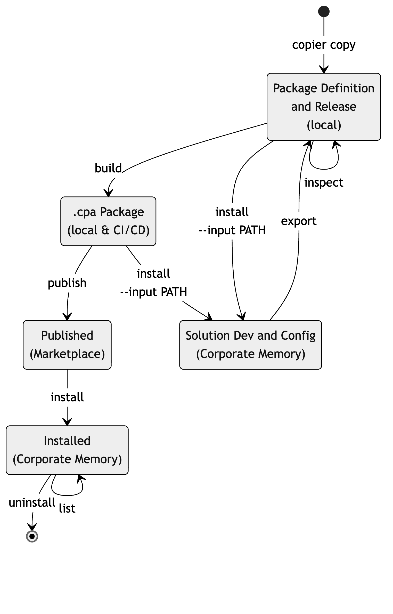

# Development and Publication of Marketplace Packages

## Introduction

Marketplace Packages are archives that bundle content, functionality, and configuration from eccenca Corporate Memory for sharing and reuse.

Each package has its own release cycle.
Packages can be installed and uninstalled during runtime.

In order to support the development and publication of Marketplace Packages, we published a [package-template](https://github.com/eccenca/cmem-package-template).
Please have a look at this template to get started.

This page gives an overview of the concepts you need to understand in order to develop packages.
If you prefer to learn by doing, follow the [step-by-step tutorial](tutorial/index.md), which builds a package with a graph and a Build project from scratch.

## Package Structure

Use the [package-template](https://github.com/eccenca/cmem-package-template) to create the boilerplate for a package repository:

```shell title="Create a package repository from the template"
copier copy gh:eccenca/cmem-package-template my-package
```

The template asks for the following variables:

`package_type`
:   `vocabulary` (default) or `project`, see [Metadata](#metadata).

`package_id`
:   Unique package identifier in lowercase letters, numbers, and hyphens (e.g. `eccenca-supply-chain-vocab`).

`package_name`
:   Human-readable package name (3 - 50 characters).

`package_description`
:   Short description of the package (10 - 150 characters).

`python_dependencies`
:   Comma-separated [Python plugin](../../python-plugins/index.md) dependencies (only asked for `project` packages).

`vocab_dependencies`
:   Comma-separated dependencies on other Marketplace Packages (only asked for `project` packages).
    A `vocabulary` package declares its dependencies on other vocabulary packages directly in the manifest, see [Dependencies](#dependencies).

`github_page`
:   Optional URL of the package repository, used as the base for icons and the homepage link.

The generated repository has two levels:
the top level holds the generic package repository files (changelog, README, license, CI configuration, and a `Taskfile.yaml`), while the nested `{package_id}/` folder is the **package directory** - the actual package content plus its manifest.

### License

!!! info "No publication without license"

    Packages without a license declaration cannot be published to a Corporate Memory Marketplace Server.

Our template will bootstrap your package with an _Apache License 2.0 ([`Apache-2.0`](https://spdx.org/licenses/Apache-2.0.html))_.
See <https://spdx.org/licenses/> if you need a different license.
You can remove a license entirely; however, a package that does not declare a license cannot be published.

### Manifest

The `cpa-manifest.json` in the package directory is the central package definition.
It contains all relevant package metadata and describes the package contents.
It is used to present package details and contents to the `inspect` command<!-- or in the marketplace frontends-->, to install, configure and uninstall all parts of a package.

The manifest follows a JSON Schema, which every Marketplace Server publishes at `/api/manifest`, for example <https://eccenca.market/api/manifest>.
The template sets this URL as the `$schema` of the manifest, so an editor validates and completes the fields.
The schema is the reference for every field and its limits; the following sections describe the parts a package author works with.

#### Metadata

`package_type`
:   `project`
    :   A package that may ship any content, mainly intended to contain Build projects, (instance/data) graphs, SHACL shapes, workspace configuration, query catalogs, etc.

    `vocabulary`
    :   A package that is supposed to contribute vocabulary / ontology contents, such as `rdf:`, `org:`, `sso:`, etc. Such a package may contain multiple vocabularies / ontologies. Packaging related SHACL shapes is reasonable, too.

`package_id`
:   Unique package identifier

`package_version`
:   Semantic version identifier string of the package, see [Versions and revisions](#versions-and-revisions).

`build_timestamp`
:   Optional date and time the package was built, in ISO 8601 format with a timezone offset, e.g. `2026-11-09T10:15:00+00:00`.
    The Marketplace shows it in the package details.

`metadata.name`
:   The package name in English.

`metadata.description`
:   The package description in English.

`metadata.license`
:   The [SPDX license identifier](https://spdx.org/licenses/) of the package, e.g. `Apache-2.0`.

`metadata.comment`
:   A maintainer or publisher comment.

`metadata.agents`
:   Publishers, authors, and contributors of the package.

`metadata.urls`
:   Related links, e.g. the homepage or the issue tracker of the package.

`metadata.tags`
:   Free-text tags used to categorize the package on a Marketplace Server.

`metadata.languages`
:   The languages the package content is available in, as ISO 639-1 codes, e.g. `["en", "de"]`.
    Defaults to `["en"]`.

#### Versions and Revisions

A package version has the form `X.Y.Z`, e.g. `1.2.0`.
The template derives it from the Git tag of the package repository at build time.

A version can carry a packaging revision `X.Y.Z-N`, where `N` counts from `1`, e.g. `1.2.0-1`.
A revision packages the same release again, for example to correct the manifest or a description without a new release of the content.

- A revision ranks above its release and below the next release: `1.2.0` < `1.2.0-1` < `1.2.0-2` < `1.2.1`.
- A [version constraint](#version-constraints) is matched against the release only: `1.2.0-1` satisfies the same constraints as `1.2.0`.

#### Files

A package can contain graphs, Build projects, application views, text files, and images.
These contents are referenced in the `files` section of the `cpa-manifest.json`.

##### Graphs

Use the following structure to include a graph.
`register_as_vocabulary` and `import_into` are optional instructions.
We suggest to organize graphs in a respective sub-folder (here `graphs/`), but this is up to you:

```json
"files": [
    …
    {
        "file_type": "graph",
        "file_path": "graphs/file.ttl",
        "graph_iri": "http://www.example.org/file/",
        "register_as_vocabulary": true,
        "import_into": [
            "http://www.example.org/integration_graph/"
        ]
    },
    …
]
```

##### Projects

Use the following structure to include a project.
We suggest to organize projects in a respective sub-folder (here `projects/`), but this is up to you:

```json
"files": [
    …
    {
        "file_type": "project",
        "file_path": "projects/my-build-project.zip",
        "project_id": "my-build-project"
    },
    …
]
```

##### Application Views

A `project` package can ship [application views](../../../explore-and-author/workspace-configuration/index.md) of Explore.
Export the view with `cmemc admin view export` and declare the resulting JSON file together with the ID of the view:

```json
"files": [
    …
    {
        "file_type": "view",
        "file_path": "views/my-view.json",
        "view_id": "my-view"
    },
    …
]
```

The file holds exactly one view, and its ID is the declared `view_id`.
The view is created after the graphs and projects of the package during installation, and removed before them when the package is uninstalled.
A `vocabulary` package cannot contain application views, and the view `default` cannot be shipped.

##### Texts and Images

Text files and images describe the package itself rather than shipping content.
The template declares `README.md`, `CHANGELOG.md`, and `LICENSE` this way; images are used to represent the package on a Marketplace Server:

```json
"files": [
    …
    {
        "file_type": "text",
        "file_path": "README.md",
        "file_role": "readme"
    },
    {
        "file_path": "icon.png",
        "file_type": "image",
        "file_role": "icon"
    },
    …
]
```

#### Dependencies

Dependencies to other packages or to Python plugins can be declared in the `copier copy` answers.
The dependencies are added to the `cpa-manifest.json` as described in the next sections.

A `project` package can depend on Python plugin packages and on Marketplace Packages of both types.
A `vocabulary` package can depend on other `vocabulary` packages only, for example a vocabulary that imports and extends another one.
A package cannot depend on itself.

##### Python Plugin Packages

Use the following to declare a dependency to a Python plugin:

```json
"dependencies": [
    …
    {
      "dependency_type": "python-package",
      "pypi_id": "cmem-plugin-pyshacl"
    },
    …
]
```

##### Marketplace Packages

Use the following to declare a dependency to another Marketplace Package:

```json
"dependencies": [
    …
    {
      "dependency_type": "marketplace-package",
      "package_id": "w3c-rdfs-vocab"
    },
    …
]
```

##### Version Constraints

A dependency can restrict the versions it accepts with a `version_constraint`:

```json
"dependencies": [
    …
    {
      "dependency_type": "marketplace-package",
      "package_id": "w3c-rdfs-vocab",
      "version_constraint": "^1.2.0"
    },
    {
      "dependency_type": "python-package",
      "pypi_id": "cmem-plugin-pyshacl",
      "version_constraint": ">=5.0.0"
    },
    …
]
```

| Constraint | Meaning | Marketplace Package | Python plugin package |
| ---------- | ------- | ------------------- | --------------------- |
| `>=1.2.0` | Version `1.2.0` or newer. | yes | yes |
| `<=1.2.0` | Version `1.2.0` or older. | yes | yes |
| `^1.2.0` | Version `1.2.0` or newer, as long as the leftmost non-zero part stays the same: `^1.2.0` accepts versions below `2.0.0`, `^0.2.3` below `0.3.0`, and `^0.0.3` below `0.0.4`. | yes | no |
| `*` | Any version, the same as no constraint. | yes | yes |

A dependency carries one constraint.
Other operators, such as `>`, `<` or `==`, and combined ranges are not supported.

During installation, each dependency is installed at the newest version that satisfies all constraints declared on it by the packages involved.
An installed dependency at a satisfying version is left untouched.
See [Dependencies and version constraints](../installation/index.md#dependencies-and-version-constraints) for how an installation handles conflicts.

## Package Development Cycle

!!! info "`cmemc package` reference"

    The [cmemc package command group](../../../automate/cmemc-command-line-interface/command-reference/package/index.md)
    contains all needed commands to support the complete package lifecycle.

Some packages are simply wrapping existing artifacts into a managed structure (e.g. existing vocabulary/ontology).

Most (solution) package development and evolution will be a back and forth between a package repository (making changes to `cpa-manifest.json` in terms of adding/removing dependencies, graph files, or Build project files) and a Corporate Memory (package development) instance.

{ width="50%" }

!!! tip "Task wrappers"

    The generated package repository ships a `Taskfile.yaml` which wraps the commands below into `task import`, `task export`, `task build`, `task check`, `task delete`, and `task publish`.
    The [tutorial](tutorial/index.md) uses these wrappers.

### Install (local) Packages

Use the following command to install a local package folder content (or built `.cpa` file) to a Corporate Memory (package development) instance.

```shell
cmemc package install --input PATH
```

Make changes to graphs, configuration, or Build projects as needed.
Newly created or imported graphs or Build projects need to be registered in `cpa-manifest.json` so they will be fetched by `export`.

### Export Contents into a Package

Use the following command to export the file artifacts declared in `cpa-manifest.json` from a Corporate Memory (package development) instance to a local package folder.

```shell
cmemc package export PACKAGE_ID
```

Run this to initially populate package contents from a solution configuration. You can also use it to update contents after making changes on your Corporate Memory (package development) instance, capturing them for building and releasing as a Marketplace Package.

For version controlled package directories, add `--extract` to store Build projects as extracted directories instead of ZIP archives (the manifest still references the ZIP; `build` and `install` zip it silently).

### Inspect Packages

Review and verify the contents of a package with the following command:

```shell
cmemc package inspect PACKAGE_PATH
```

### Build Packages

During development you can install a package from a local path (plain folder or a `.cpa` package) using the `cmemc package install --input PATH` command.

Use the `cmemc package build` command.
This will build a package archive from a package directory.

This command processes a package directory, validates its content including the manifest, and creates a versioned Corporate Memory package archive (`.cpa`) with the following naming convention: `{package_id}-v{version}.cpa`.

### Publish Packages

Package archives can be published to the Marketplace Server using the `cmemc package publish` command.
After being published packages can be found and installed directly from the Marketplace Server (potential users do not need to have the local package folder or `.cpa` file available).

```shell-session title="publish a package archive"
cmemc package publish my-package-v1.0.0.cpa
```

The published package ID and version are taken from the manifest inside the archive.

The Marketplace Server validates the archive and resolves its dependencies against the packages it hosts.
It refuses a version whose dependencies cannot be resolved and reports one of the following problems:

| Code | Problem |
| ---- | ------- |
| `dependency_not_found` | A dependency, or a package further down the dependency tree, is not published on this Marketplace Server. |
| `dependency_unsatisfiable` | No published version satisfies a constraint, e.g. `>=2.0.0` while only `1.0.0` is published. |
| `dependency_conflict` | The constraints on one package have no version in common. |
| `dependency_depth` | The dependency chain is longer than 20 packages. |

Publish the dependencies of a package before the package itself.

Publishing requires a Marketplace account.
If you do not provide the credentials, cmemc requests them interactively.
For non-interactive use, such as a release pipeline, provide them with the following options or the corresponding environment variables:

| Option | Environment variable | Description |
| ------ | -------------------- | ----------- |
| `--marketplace-url` | `ECCENCA_MARKETPLACE_URL` | Base URL of the Marketplace Server, defaults to `https://eccenca.market`. |
| `--marketplace-account` | `ECCENCA_MARKETPLACE_ACCOUNT` | The Marketplace account which publishes the package. |
| `--marketplace-password` | `ECCENCA_MARKETPLACE_PASSWORD` | The password of this account. |

Like all cmemc configuration keys, these variables can also be set per connection in your [cmemc configuration file](../../../automate/cmemc-command-line-interface/configuration/file-based-configuration/index.md).
