# Marketplace

## Introduction

The Marketplace is the place in eccenca Corporate Memory to find ready-made content and add it to an instance: ontologies and vocabularies, taxonomies, data graphs, Build projects, query catalogs, as well as complete demo and solution setups.

All of this content is delivered as **Marketplace Packages**.
A package is a single, versioned artifact which bundles everything belonging to a solution, together with the packages and plugins it depends on.
Instead of collecting and importing graphs and projects one by one, install a package, and Corporate Memory places all its contents where they belong.

Packages are offered by a **Marketplace Server**, a central repository the Corporate Memory instance is connected to.
The public Marketplace Server operated by eccenca is available at [https://eccenca.market](https://eccenca.market).

The Marketplace has two views:

- **Marketplace** lists the packages offered by the selected Marketplace Server, see [Discover packages](#discover-packages).
- **Installed** lists the packages installed in the Corporate Memory instance and offers their upgrades, see [Manage installed packages](#manage-installed-packages).

!!! info "Availability"

    The Marketplace is available starting with eccenca Corporate Memory version 26.1.

    Opening the Marketplace and installing, upgrading or uninstalling packages requires the `:Marketplace-Frontend` action, plus access to the graphs a package writes to.
    If the **Packages** entry is missing from the navigation menu, or if the **Install** and **Uninstall** buttons do not react, contact the Corporate Memory administrator.
    See [Access Conditions](../../deploy-and-configure/configuration/access-conditions/index.md) for details.
    The settings of the Marketplace service itself are described in [Marketplace configuration](../../deploy-and-configure/configuration/marketplace/index.md).

## Open the Marketplace

To open the Marketplace:

- Click **:material-menu: Open main navigation** in the header.
- Click **:eccenca-module-marketplace: Packages** in the **MARKETPLACE** group.

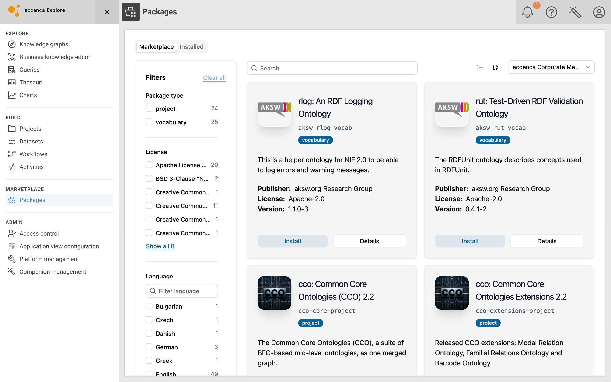{ class="bordered" }

## Discover packages

The **Marketplace** view lists all packages offered by the [selected Marketplace](#select-the-marketplace).

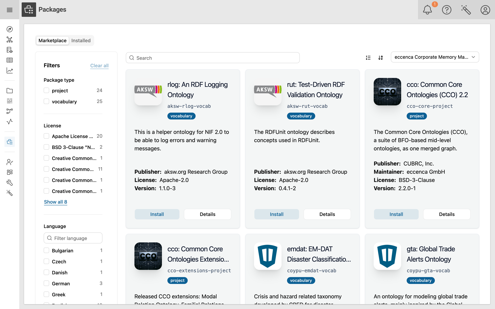{ class="bordered" }

Each package is shown as a card with

- the package icon and name,
- the package identifier, for example `ecc-skos-examples-project`,
- a badge stating the [package type](#package-types) (`vocabulary` or `project`),
- a short description,
- the publisher or the authors, the maintainer if it differs from the publisher, the license and the latest version, and
- the actions **Install** or **Uninstall**, and **Details**.

Below the cards, the list states how many packages are shown, and offers a selection of how many cards to show at once, as well as **Previous** and **Next** to move through the list.

### Filter packages

Use the **Filters** panel on the left to narrow down the list.

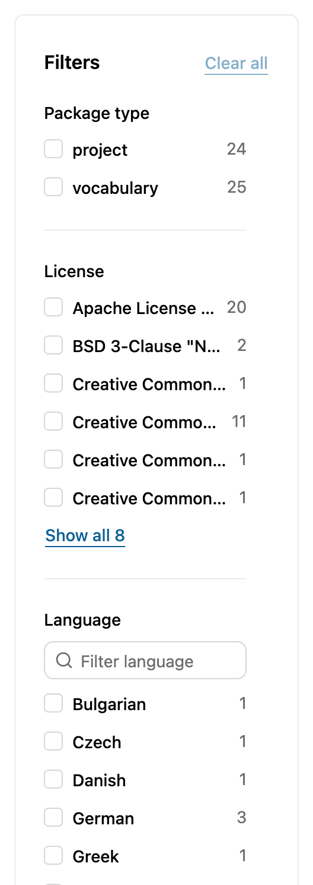{ class="bordered" width="30%" }

Each filter group lists its values with the number of matching packages:

**Package type**
:   Show only `project` or only `vocabulary` packages, see [Package types](#package-types).

**License**
:   Show only packages published under the selected licenses.

**Language**
:   Show only packages with content in the selected languages.
    Type into **Filter language** to find a language in the list.

**Tags**
:   Show only packages with the selected keywords.
    Type into **Filter tags** to find a tag in the list.

Long groups show the first values only.
Click **Show all** to see the complete list, and **Show less** to collapse it again.

Click **Clear all** to remove all selected filters.

### Search and sort

Use the controls above the cards to search and sort the list.

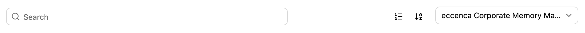{ class="bordered" }

#### :eccenca-module-search: Search

Show only packages whose name or description contains the entered keyword.

#### Sort by

Select the property the cards are sorted by: **ID**, **Name**, **Type**, **Version** or **License**.
Click the button next to it to switch between ascending and descending order.

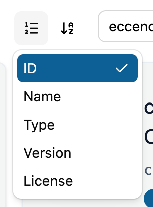{ class="bordered" width="20%" }

#### Select the Marketplace

The drop-down on the right lists all Marketplaces configured for the Corporate Memory instance with their name and URL.
Select one to see its packages.

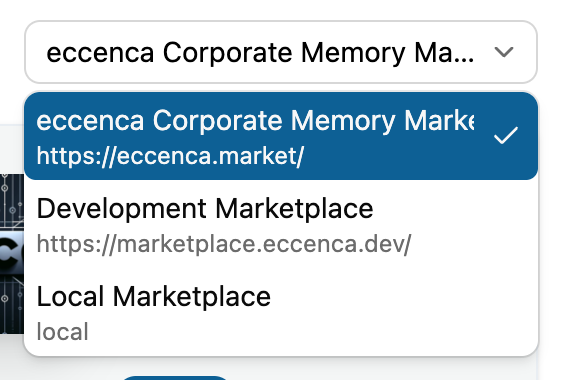{ class="bordered" width="35%" }

If nothing matches the search and the filters, the list states _No packages match the current filters._
Click **Clear all** in the **Filters** panel, and clear the search field, to see the full list again.

### Package types

`vocabulary`
:   Packages which contribute vocabulary / ontology content, such as `rdf:`, `org:` or `sso:`.
    Such a package can contain several vocabularies as well as the matching SHACL shapes.

`project`
:   Packages which can ship any kind of content, mainly Build projects, (instance / data) graphs, SHACL shapes, workspace configuration and query catalogs.
    Demo and solution packages are of this type.

## Inspect a package

Click **Details** on a package card to open the package details.
Use them to check what a package contains and what it pulls in before installing it.

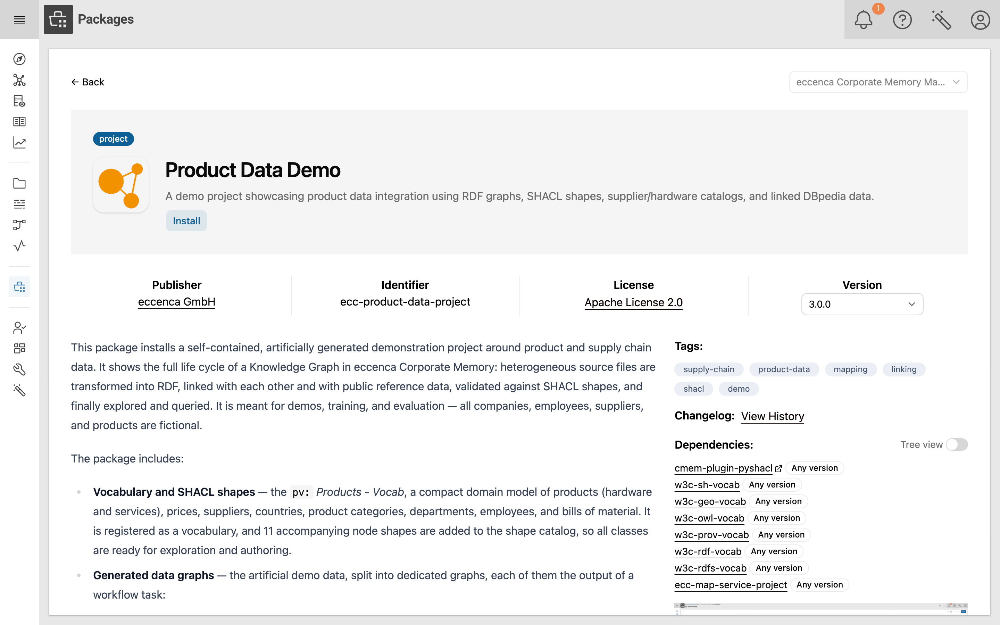{ class="bordered" }

The package details show:

- The package type badge, icon, name and short description, together with the **Install** or **Uninstall** button.
- **Publisher** - the organization or person publishing the package, linked to its homepage if provided.
- **Identifier** - the unique package ID, for example `ecc-product-data-project`.
    This ID is needed when working with [cmemc](#manage-packages-on-the-command-line).
- **License** - the license the package is published under, linked to the license text.
- **Version** - the released version shown.
    Open the list to look at the description, tags and dependencies of another version of this package.
- The long description of the package, describing in detail which graphs, projects, queries and configurations are installed.
- **Tags** - free-text keywords used by the publisher to categorize the package.
- **Changelog** - click **View History** to read the release notes of all versions of this package.
- **Dependencies** - the other Marketplace Packages and [Python plugins](../../develop/python-plugins/index.md) this package needs, see below.
- **External links** - further resources of the package, such as its documentation, if provided.
- Screenshots and further images shipped by the package, if any.

Click **:material-arrow-left: Back** to return to the list.

### Dependencies

The dependencies are installed together with the package.
Each dependency is listed with its version constraint, for example **Any version**.
Click a dependency to open its package details.

Switch on **Tree view** to see, in addition, the version each dependency resolves to.
Python plugins carry an :eccenca-item-info: icon instead: their version is resolved by the Python environment at installation.

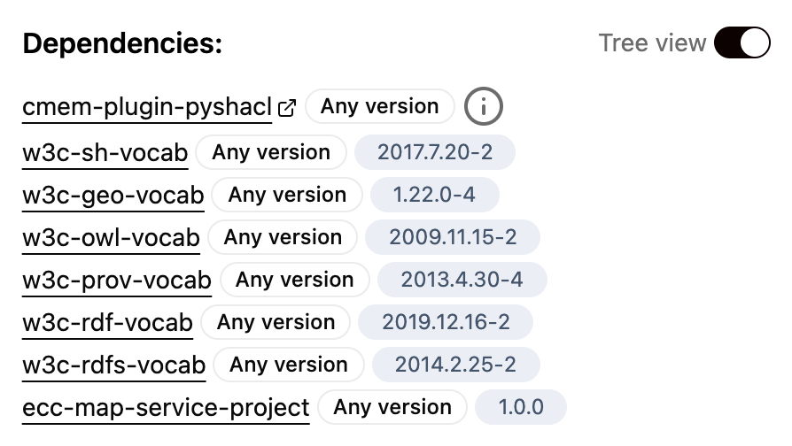{ class="bordered" width="50%" }

## Install a package

To install a package, click **Install**, either on the package card or in the package details.
The package is fetched from the Marketplace Server and installed into the Corporate Memory instance, together with the dependencies listed in its details.

Clicking **Install** starts the installation right away - there is no additional confirmation dialog, so check the package and the version beforehand.
Depending on the size of the package and the number of dependencies, the installation can take a while.
Once it has finished, the card and the package details offer **Uninstall** instead of **Install**.

!!! tip "Installing a specific version"

    The latest version is preselected.
    To install an older one, open the package details, select the version in the **Version** list, and click **Install**.

!!! info "One installation at a time"

    Only one installation can run at a time.
    Starting another one while an installation is still in progress results in an error.
    Wait until the running installation has finished, then start the next one.

## Manage installed packages

Click **Installed** at the top to see the packages installed in the Corporate Memory instance.

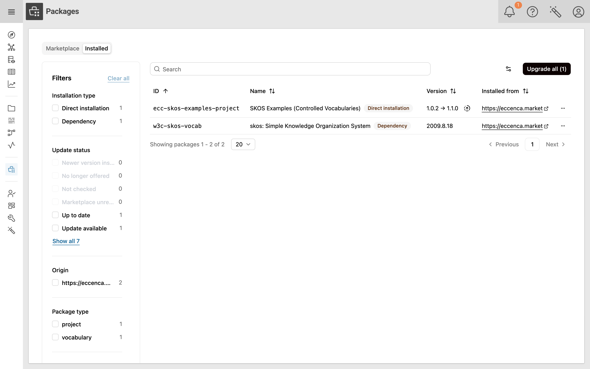{ class="bordered" }

The table lists each installed package with

- **ID** and **Name**,
- a badge stating how it was installed: **Direct installation** for a package installed on its own, **Dependency** for a package installed as a dependency of another one,
- **Version** - the installed version, followed by the available version if there is an update, for example `1.0.2 → 1.1.0`,
- **Installed from** - the Marketplace the package was installed from, and
- the **Actions** menu of the package, opened with **···**.

Click a column header to sort the table by this column.
Click **Columns** to show further columns: **Installed at**, **Installed by** and **Package size**.

The **Filters** panel offers the same groups as the **Marketplace** view, plus:

**Installation type**
:   Show only packages installed directly, or only packages installed as dependencies.

**Update status**
:   Show only packages with the selected status:

- **Up to date** - the installed version is the latest one.
- **Update available** - a newer version is offered, see [Upgrade a package](#upgrade-a-package).
- **Update blocked** - a newer version is offered, but upgrading would break the dependencies of other installed packages.
- **Newer version installed** - the installed version is newer than the version offered by the Marketplace.
- **No longer offered** - the Marketplace does not offer the package anymore.
- **Marketplace unreachable** - the Marketplace the package was installed from cannot be reached.
- **Not checked** - the update status is unknown.

**Origin**
:   Show only packages installed from the selected Marketplace.

### Upgrade a package

When a newer version of an installed package is offered, the **Version** column shows the installed and the available version, for example `1.0.2 → 1.1.0`.
Packages with an update are not marked in the **Marketplace** view: the card shows the latest version and offers **Uninstall**.

To upgrade a package:

- Click **···** in the **Actions** column of the package.
- Click **Upgrade _name_ to _version_**.

    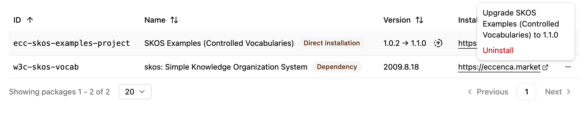{ class="bordered" }

- Click **Confirm** in the **Confirm package upgrade** dialog.

    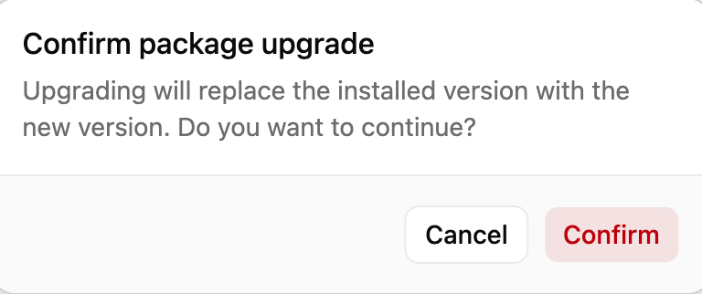{ class="bordered" width="50%" }

The installed version is replaced by the new one.
Once the upgrade has finished, the **Version** column shows the new version.

To upgrade all packages with an available update at once, click **Upgrade all** above the table, and confirm the dialog with **Confirm**.
The button shows the number of packages to upgrade, for example **Upgrade all (1)**.

!!! tip "Keep changes to package contents"

    An upgrade replaces the installed version of the package.
    Export the graphs and Build projects of the package that contain changes to keep before upgrading.

### Change to an older version

The Marketplace does not downgrade an installed package.
As long as a package is installed, its card and its package details only offer **Uninstall**, no matter which version is selected.

To move an installed package to an older version:

- [Uninstall](#uninstall-a-package) the package.
- Select the version in the **Version** list of the package details.
- Click **Install**.

!!! warning "The detour via uninstall removes the package contents"

    Since the package has to be uninstalled first, its contents - including changes to them - are removed before the other version is installed, see [Uninstall a package](#uninstall-a-package).
    Export what to keep beforehand.

    On the command line, `cmemc package install --replace` overwrites an installed package version in place, without uninstalling it first, see [Manage packages on the command line](#manage-packages-on-the-command-line).

## Where the package contents appear

An installed package does not show up as one single item in Corporate Memory.
Its contents surface in the module they belong to:

- **Graphs**, including vocabularies and shapes catalogs, are listed in [**Knowledge Graphs**](../../explore-and-author/graph-exploration/index.md#graphs).
- **Build projects** are imported into [**Projects**](../../build/introduction-to-the-user-interface/index.md#projects).
    When the first project package is installed, Corporate Memory also creates a special project holding all installed files.
    It is managed automatically and removed again once the last package has been uninstalled.
- **Queries** are shipped as a query catalog graph and are therefore available in the [Query module](../../explore-and-author/query-module/index.md).

For a package such as _Product Data Demo_, this means that right after the installation the installed integration graph can be explored, the shipped queries run, and the shipped workflows executed.

## Uninstall a package

To remove a package, click **Uninstall** on the package card or in the package details, or click **···** in the **Actions** column of the package in the **Installed** view and then **Uninstall**.
Confirm the **Confirm action** dialog with **Confirm**.

This removes all contents of the package from the Corporate Memory instance, including the graphs and the Build projects that came with it.

Packages installed as dependencies of the package are uninstalled together with it, including dependencies of dependencies.
A dependency that another installed package still needs remains installed.

!!! warning "Uninstalling removes data"

    Changes to the graphs or Build projects of a package are removed together with the package.
    Export what to keep before uninstalling.

## Manage packages on the command line

Everything described here can also be done with the [cmemc command line interface](../../automate/cmemc-command-line-interface/index.md), which additionally installs packages that are not published on a Marketplace Server, for example a **C**orporate Memory **P**ackage **A**rchive (`.cpa` file) received directly:

```shell-session title="Install a package from the Marketplace Server"
$ cmemc package install ecc-product-data-project
Installing package 'ecc-product-data-project' from marketplace ... done
```

See [Marketplace Packages: Installation and Management](../../develop/marketplace-packages/installation/index.md) for the complete workflow and the [package command group](../../automate/cmemc-command-line-interface/command-reference/package/index.md) for the command reference.

## Build packages

Vocabularies, graphs, Build projects and configurations of a solution can be bundled into a Marketplace Package as well, and then be shared with other teams or published to a Marketplace Server.

See [Marketplace Packages: Development and Publication](../../develop/marketplace-packages/development/index.md) for an overview and the [step-by-step tutorial](../../develop/marketplace-packages/development/tutorial/index.md) to build the first package.
