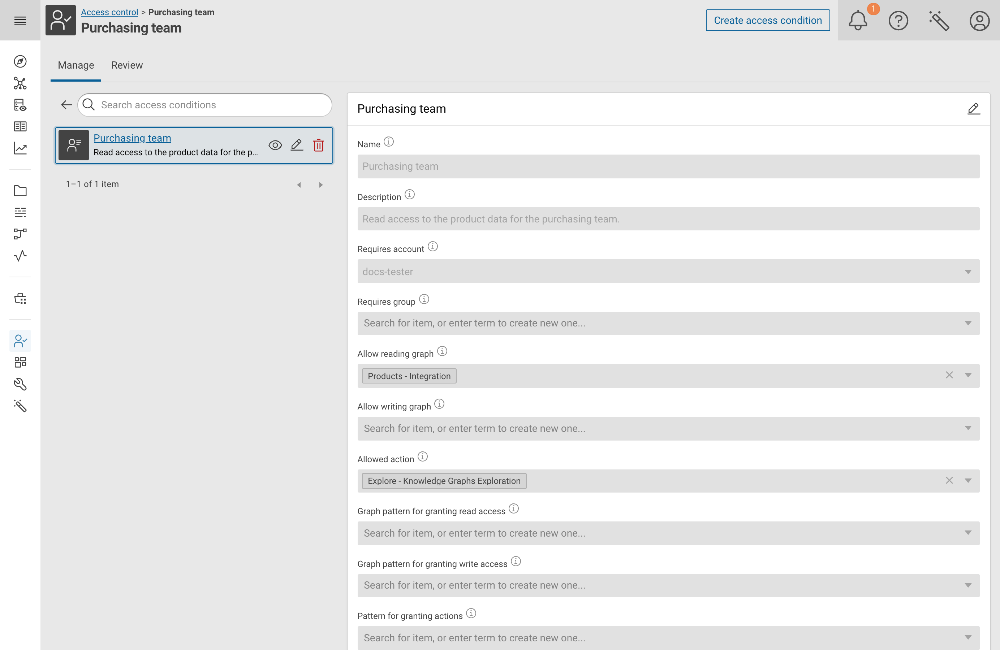
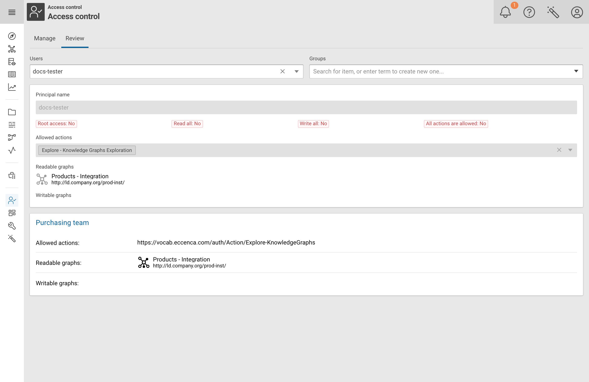

# Access control

## Introduction

**Access control** manages the access conditions of eccenca Corporate Memory.
An access condition states which accounts and groups may read or write which graphs and use which actions.
The attributes of an access condition, dynamic access conditions and the command line interface are described in [Access conditions](../../deploy-and-configure/configuration/access-conditions/index.md).

Open **Access control** in the **ADMIN** section of the main navigation.
The module has two tabs:

- [**Manage**](#manage-access-conditions): create, view, edit and delete access conditions
- [**Review**](#review-effective-rights): the effective access rights of an account

## Access

Managing access conditions needs the action `https://vocab.eccenca.com/auth/Action/ChangeAccessConditions`, see [Access conditions](../../deploy-and-configure/configuration/access-conditions/index.md).
The **Manage** tab lists the access conditions that the account may manage.

!!! warning

    An access condition can grant access to every graph and every action.
    Grant the action `https://vocab.eccenca.com/auth/Action/ChangeAccessConditions` to administrators only.

## Manage access conditions

The **Manage** tab lists the access conditions.
Enter a search term in **Search access conditions** to filter the list.

{ class="bordered" }

Each access condition in the list offers the following actions:

- Click :eccenca-item-viewdetails: to view the access condition.
- Click :eccenca-item-edit: to edit the access condition.
- Click :eccenca-item-remove: to delete the access condition, then confirm with **Delete**.

### Create an access condition

1. Click **Create access condition** in the header.
2. Enter the values of the access condition:

    - **Name** and **Description**
    - **Requires account:** the account the condition applies to
    - **Requires group:** the groups the account must be a member of.
        Enter the name of a group and select **Create new item**.
    - **Allow reading graph** and **Allow writing graph:** the graphs the condition grants read or write access to.
        Enter the IRI of a graph.
        An existing graph is listed with its label, for example `Products - Integration`.
    - **Allowed action:** the actions the condition grants, for example `Explore - Knowledge Graphs Exploration`
    - **Graph pattern for granting read access**, **Graph pattern for granting write access** and **Pattern for granting actions:** the graphs and actions for which the account may manage access conditions itself
    - **Dynamic access condition:** a SPARQL query that computes the grants, see [Dynamic Conditions](../../deploy-and-configure/configuration/access-conditions/index.md#dynamic-conditions)

    An access condition needs at least one grant or a dynamic access condition.
    All requirements of an access condition must be met: several groups in **Requires group** are combined with AND.

3. Click **Save**.

The access condition opens in the view.
Click :eccenca-item-edit: in its header to edit it.

## Review effective rights

The **Review** tab shows the effective access rights of an account, merged from all access conditions that apply to it.

{ class="bordered" }

1. Select the **Review** tab.
2. Select an account in **Users**.
    The review starts once an account is selected.
3. Optionally, enter groups in **Groups**, to review the account as a member of these groups.
    Enter the name of a group and select **Create new item**.

The upper part shows the effective rights:

- **Root access**, **Read all**, **Write all** and **All actions are allowed**
- **Allowed actions**
- **Readable graphs** and **Writable graphs**

Below, each access condition that applies to the account is listed with its **Allowed actions**, **Readable graphs** and **Writable graphs**.

## Related

- [Access conditions](../../deploy-and-configure/configuration/access-conditions/index.md): the attributes of an access condition, dynamic access conditions and typical use cases
- [`cmemc admin acl`](../../automate/cmemc-command-line-interface/command-reference/admin/acl/index.md): manage and review access conditions on the command line
