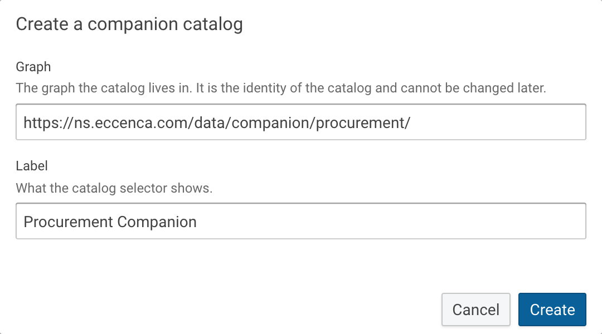
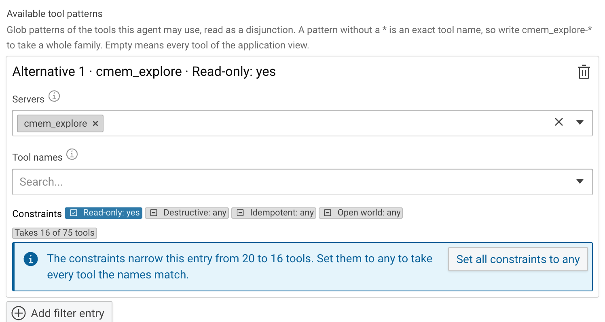
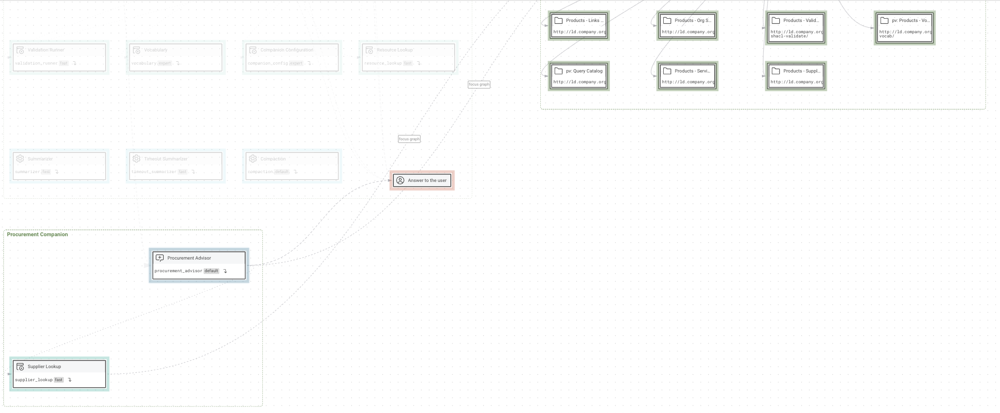
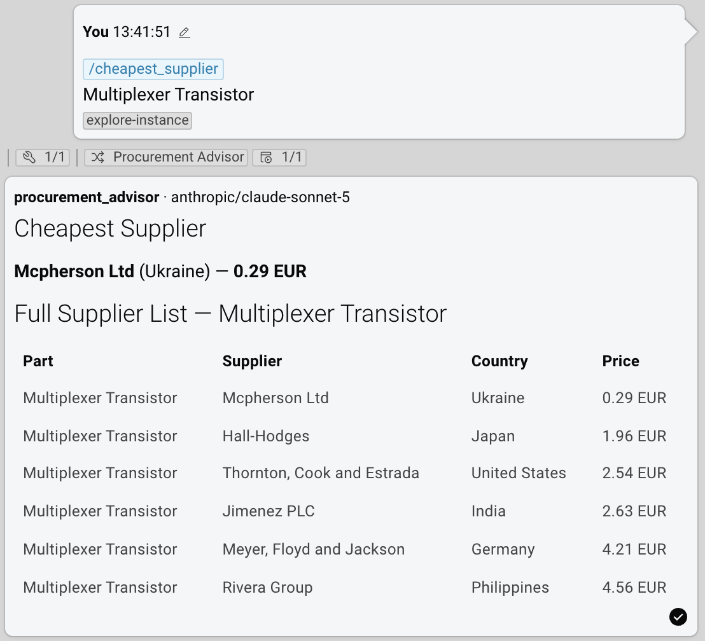

# Build a Companion catalog

!!! info "AI Disclaimer"

    Companion is an AI-based feature.
    AI-generated content may be inaccurate or incomplete.
    Verify important information.

## Introduction

The purchasing team of a fictional hardware company asks the same two questions again and again: who supplies a part, and which supplier is the cheapest?
This tutorial gives the team its own agents in the [Companion](../index.md) of eccenca Corporate Memory, using the module [Companion Management](../management/index.md).

The tutorial builds a small agent network in a catalog of its own:

- The catalog `Procurement Companion` holds everything that the tutorial adds, separate from the shipped catalog.
- The task agent `supplier_lookup` finds the suppliers and prices of one part.
- The interactive agent `procurement_advisor` answers the questions of the purchasing team and starts `supplier_lookup`.
- The skill `/cheapest_supplier` asks for the cheapest supplier of a part with one command.

No routing agent is added.
The shipped routing agent `default_router` has an empty **Handoff agents** list, so it hands a question to any interactive agent whose description fits, including `procurement_advisor`.

Each step starts with a short screen recording of the step.

## Prerequisites

- The Companion is configured for the deployment, see [Configuration](../index.md#configuration).
- The user has the actions `https://vocab.eccenca.com/auth/Action/Explore-Companion-Use` and `https://vocab.eccenca.com/auth/Action/Explore-Companion-Manage`, see [Access](../index.md#access).
- The package **Product Data Demo** (`ecc-product-data-project`) is installed, see [Install a package](../../../distribution/marketplace/index.md#install-a-package).
    It provides the hardware parts, suppliers and prices in the graph `http://ld.company.org/prod-inst/`.

## 1 Create the catalog

A catalog is a graph that holds agents, skills and named models.
The main catalog `Default Companion Catalog Overlay` imports the other catalogs, and the Companion runs the merged result.

<video src="companion-tutorial-create-catalog.webm" poster="companion-tutorial-create-catalog.png" title="Creating the catalog Procurement Companion with the graph https://ns.eccenca.com/data/companion/procurement/ in Companion Management" class="bordered" controls loop muted playsinline preload="metadata"></video>

1. Open **Companion management** under **ADMIN** in the main navigation.
2. Select the **Catalog** tab, then the **Catalogs** tab.
3. Click :eccenca-item-add-artefact: **Add a new catalog** in the header.
4. Enter the following values:

    - **Graph:** `https://ns.eccenca.com/data/companion/procurement/`
    - **Label:** `Procurement Companion`

    The **Label** field is filled from the end of the graph IRI.
    Replace its value.

    { class="bordered" width="70%" }

5. Click **Create**.

The catalog `Procurement Companion` appears under **Catalog graphs**.
The main catalog imports it right away.

## 2 Create the task agent

A task agent is a worker that an interactive agent starts for one piece of work.
Create it first, so that the interactive agent can refer to it.

<video src="companion-tutorial-create-task-agent.webm" poster="companion-tutorial-create-task-agent.png" title="Creating the task agent supplier_lookup in the catalog Procurement Companion, with the model fast, a read-only filter entry for cmem_explore and the focus graph Products - Integration" class="bordered" controls loop muted playsinline preload="metadata"></video>

1. Select the **Agents** tab.
2. Select `Procurement Companion` in the catalog selector next to **Agents**.
    The selector starts with **Default Companion Catalog Overlay (main)**, and a new agent is added to the catalog that it shows.
3. Click :eccenca-item-add-artefact: **Add a new agent** in the header.
4. Select **Task agents** under **Kind of agent**.
    The kind cannot be changed afterwards.
5. Enter `supplier_lookup` in the **Identifier** field and click **Create**.
6. Enter the following values:

    - **Label:** `Supplier Lookup`, filled from the identifier
    - **Description:** `Finds every supplier of a hardware part, with country and price.`
    - **Model:** `fast`
    - **System message:**

        ```text
        You receive the name of a hardware part.
        Find every hardware item with this name in the product data, together with its supplier, the country of the supplier and its price.
        Return the list sorted by price, cheapest first.
        ```

    The interactive agent reads the **Description** to decide when to start the task agent.

7. Under **Available tool patterns**, click **Add filter entry**.
    An agent without a filter entry gets no tools.
8. Select `cmem_explore` in the **Servers** field.
9. Click **Read-only: any** under **Constraints**, so that it shows **Read-only: yes**.
    The entry now takes only the tools of the Explore server that do not change data.

    { class="bordered" width="70%" }

10. Enter `http://ld.company.org/prod-inst/` in the **Focus graphs** field and select **Add new item '<http://ld.company.org/prod-inst/>'**.
    The graph is shown with its label `Products - Integration`.
11. Click **Save changes** in the header.

## 3 Create the interactive agent

An interactive agent fulfills a role in the conversation and answers the user.

<video src="companion-tutorial-create-interactive-agent.webm" poster="companion-tutorial-create-interactive-agent.png" title="Creating the interactive agent procurement_advisor with the model default, a read-only filter entry for cmem_explore, the task agent supplier_lookup and the focus graph Products - Integration" class="bordered" controls loop muted playsinline preload="metadata"></video>

1. Click :eccenca-item-add-artefact: **Add a new agent** in the header, with `Procurement Companion` still selected in the catalog selector.
2. Select **Interactive agents** under **Kind of agent**.
3. Enter `procurement_advisor` in the **Identifier** field and click **Create**.
4. Enter the following values:

    - **Label:** `Procurement Advisor`, filled from the identifier
    - **Description:** `Answers questions of the purchasing team about hardware parts, their suppliers and their prices.`
    - **Model:** `default`
    - **System message:**

        ```text
        You help the purchasing team with questions about hardware parts, their suppliers and their prices.
        Look up the data before you answer and do not guess prices.
        To compare the suppliers of a part, start the supplier_lookup task agent.
        Answer with a short table of part, supplier, country and price.
        ```

    The routing agent reads the **Description** to decide which interactive agent gets a question.

5. Add a filter entry with the server `cmem_explore` and the constraint **Read-only: yes**, as for `supplier_lookup`.
6. Select `supplier_lookup` in the **Task agents** field.
7. Add `http://ld.company.org/prod-inst/` to the **Focus graphs** field, as for `supplier_lookup`.
8. Click **Save changes** in the header.

## 4 Create the skill

A skill is a prompt that a user calls with a slash command in the chat.

<video src="companion-tutorial-create-skill.webm" poster="companion-tutorial-create-skill.png" title="Creating the skill cheapest_supplier with its description and prompt in the catalog Procurement Companion" class="bordered" controls loop muted playsinline preload="metadata"></video>

1. Select the **Skills** tab.
2. Select `Procurement Companion` in the catalog selector next to **Skills**.
3. Click :eccenca-item-add-artefact: **Add a new skill** in the header.
4. Enter `cheapest_supplier` in the **Identifier** field and click **Create**.
5. Enter the following values:

    - **Name:** `cheapest_supplier`, filled from the identifier
    - **Description:** `Finds the cheapest supplier of a hardware part.`
    - **Prompt:**

        ```text
        Find the cheapest supplier of the hardware part the user named.
        Start the supplier_lookup task agent, then name the cheapest supplier with country and price, followed by the complete list.

        The user asked: {{ skill.argument }}
        ```

    `{{ skill.argument }}` holds the text that the user enters after the skill name.
    The **Description** is shown next to the skill in the chat.

6. Click **Save changes** in the header.

## 5 Check the agent network

<video src="companion-tutorial-agent-network.webm" poster="companion-tutorial-agent-network.png" title="Showing the agent network by catalog, enlarging the group Procurement Companion and selecting the Procurement Advisor node" class="bordered" controls loop muted playsinline preload="metadata"></video>

1. Select the **Agent network** tab.
2. Click **By catalog**.
    Each catalog is shown as a group of its own.
3. Enlarge the group **Procurement Companion** with the mouse wheel or the zoom controls in the lower left corner.
    Drag the canvas to move the group into view.
4. Click the **Procurement Advisor** node.

The view highlights what the agent reaches: the task agent **Supplier Lookup**, the focus graph and **Answer to the user**.

{ class="bordered" }

## 6 Ask the Companion

<video src="companion-tutorial-ask-companion.webm" poster="companion-tutorial-ask-companion.png" title="Asking the Companion who supplies the Resonator Transformer, then calling the skill /cheapest_supplier for the Multiplexer Transistor" class="bordered" controls loop muted playsinline preload="metadata"></video>

1. Click :eccenca-application-ai-suggestion: **Chat with the companion** in the application header.
2. Click **New chat**.
3. Enter the following question and press ++enter++:

    ```text
    Who supplies the Resonator Transformer, and which supplier is cheapest?
    ```

The routing agent hands the question over to **Procurement Advisor**, which is named above the answer.
The answer names the agent and its model, for example `procurement_advisor · anthropic/claude-sonnet-5`.
The product data lists six suppliers of the Resonator Transformer, and the cheapest is Grant-Nelson at 0.79 EUR.
The wording of the answer can differ from chat to chat.

Then call the skill:

1. Click **New chat**.
2. Enter `/` in the input field and select `/cheapest_supplier` from the list.
3. Enter `Multiplexer Transistor` after the skill name and press ++enter++.

{ class="bordered" width="50%" }

Both agents only read data, so the chat works in the mode **Read only**.
