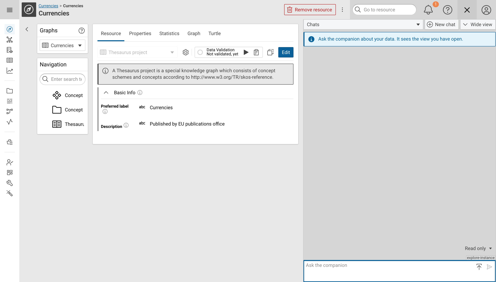
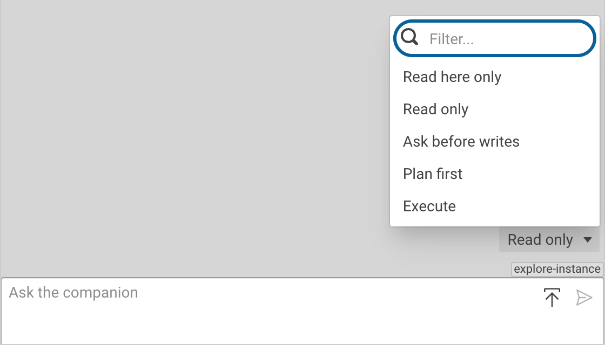
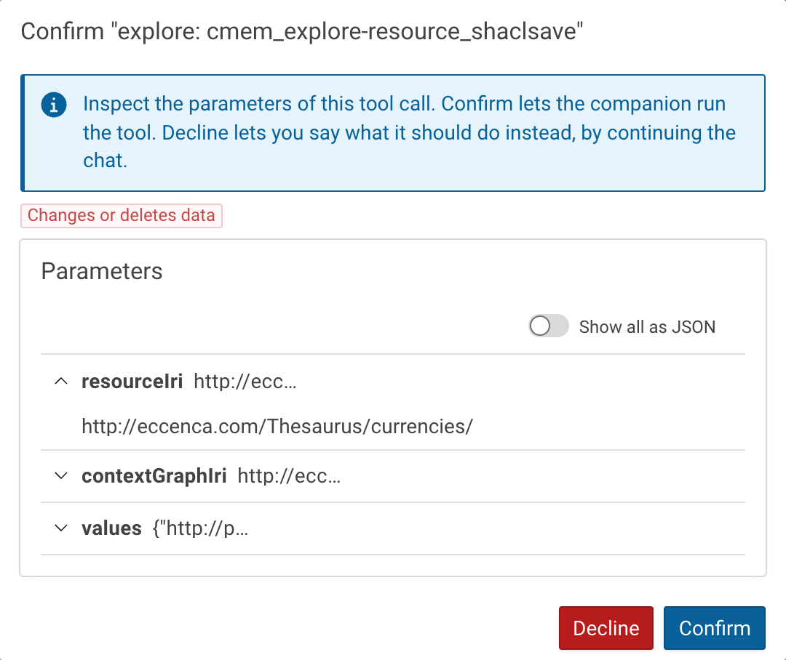
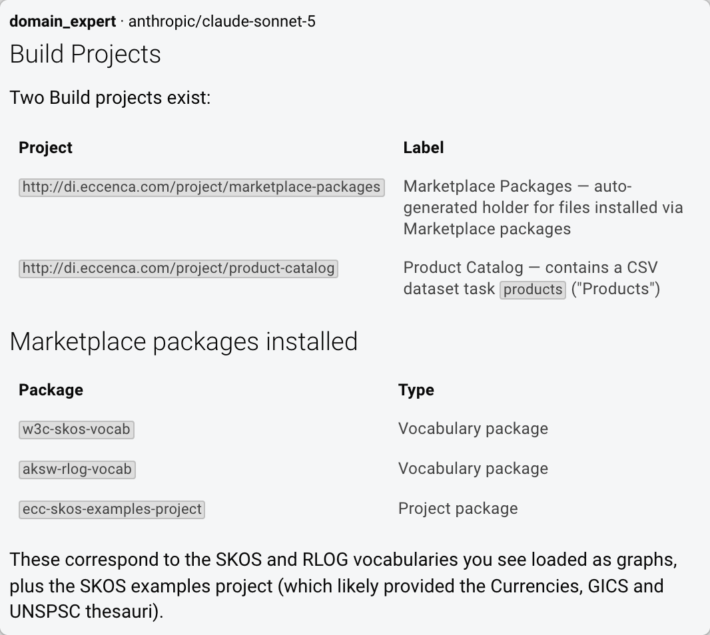

# Companion AI chat

!!! info "AI Disclaimer"

    Companion is an AI-based feature.
    AI-generated content may be inaccurate or incomplete.
    Verify important information.

The Companion is a chat panel in Explore that answers questions about the data in eccenca Corporate Memory and, on request, changes it.
It reads the view that is open, works with graphs, resources, queries, Build projects and Marketplace packages, and asks for a confirmation before it writes anything that the selected mode does not allow on its own.

The Companion requires a [configuration](../index.md#configuration) of the deployment and an [access right](../index.md#access) for the user.
Agents, tools and modes are explained in [How the Companion works](../index.md#how-the-companion-works).

## Open the Companion

Click :eccenca-application-ai-suggestion: **Chat with the companion** in the application header, next to the :eccenca-application-useraccount: user menu.
The Companion panel opens on the right side of the screen.
Click the button again to close the panel.

{ class="bordered" width="70%" }

The panel contains:

- **Chats** to switch to an earlier chat, search for a chat, rename it with :eccenca-item-edit: or delete it with :eccenca-item-remove:
- :eccenca-item-add-artefact: **New chat** to start a new chat
- **Wide view** and **Narrow view** to change the width of the panel
- The messages of the current chat
- The mode selector, see [Modes](#modes)
- The context tag, which names the view the Companion sees
- The input field with :eccenca-item-upload: **Attach a file** and :material-send-variant-outline: **Send the message**

## Ask a question

1. Enter a question in the **Ask the companion** field.
2. Optionally, refer to a resource or a skill:
    - Enter `@` followed by the beginning of a label to search for a resource in the open graph, then select the resource from the list.
    - Enter `/` to list the skills, then select a skill, for example `/summarize_graph`.
3. Optionally, click :eccenca-item-upload: **Attach a file** to add one or more files to the message, or drop them on the panel.
    Files larger than the configured limit, 10 MB by default, are not attached.
4. Click :material-send-variant-outline: **Send the message**, or press ++enter++.

The Companion receives the context of the current view with every message: the view, the application view, the selected resources and graphs.
Click the context tag below the input field, for example `explore-instance`, to see what is sent.
The same tag appears on each sent message.

While the Companion works, a status such as **Thinking** or **Working** is shown above the mode selector.
Click **Stop** to interrupt the answer.

## Modes

The mode decides which tool calls of the Companion run on their own, which need a confirmation, and which are declined.
Select the mode in the drop-down list at the lower right of the chat, above the notice on the AI system.
A new chat starts in **Read only**.

{ class="bordered" width="40%" }

| Mode | Behavior |
| --- | --- |
| **Read here only** | The Companion reads data in this Corporate Memory deployment and does not change anything. Tools that reach outside the deployment, such as a web search or an external MCP server, are declined. |
| **Read only** | The Companion reads data, also with tools that reach outside the deployment, and does not change anything. |
| **Ask before writes** | The Companion reads data and asks for a confirmation before each change. |
| **Plan first** | The Companion writes a plan and presents it for approval before it changes anything. |
| **Execute** | The Companion runs changes without asking for a confirmation. |

A mode that is selected while a chat is open applies with the next message.
Until then, **with next message** is shown next to the mode selector.

### Confirm a change

In **Ask before writes**, and after a plan was approved with **Approve, ask before writes**, the Companion opens a confirmation dialog for each change.
The dialog names the tool and shows the parameters of the tool call.
A tool that the Companion classifies as destructive is marked with **Changes or deletes data**.
Not every tool that changes data carries this mark, for example adding a mapping rule.

{ class="bordered" width="50%" }

1. Check the parameters of the change.
    Expand a parameter to see its full value, or turn on **Show all as JSON**.
    For a change to a resource, the dialog can instead list the values that the change adds and removes.
    Clear the checkbox of each value that must not be written.
2. Click **Confirm** to run the change, or **Decline** to reject it.

After **Decline**, the Companion waits for a message that says what to do instead.

### Approve a plan

In **Plan first**, the Companion reads what it needs and presents a plan.
Tools that write are not available until the plan is approved.

- Click **Approve** to execute the plan without further confirmations.
- Click **Approve, ask before writes** to execute the plan with a confirmation for each change.
- Click **Decline** to reject the plan, and optionally give a reason so that the Companion revises it.

The approval switches the chat to the mode that executes the plan.
While the plan runs, the Companion shows the progress of its tasks, for example `Tasks: 2/5`.

## Answers

{ class="bordered" width="60%" }

Each answer names the agent that wrote it and the model that it used, for example `domain_expert · anthropic/claude-sonnet-5`.
The Companion hands a question over to the agent that fits it, so the agent can change within a chat.

An answer can contain the following interactive elements:

Tool calls
:   :eccenca-item-wrench: shows how many tool calls of the answer are finished, for example `4/4`.
    A declined tool call is marked in red.

Resources
:   Click a resource to open it in :eccenca-application-explore: **Knowledge Graphs**.

Queries
:   Click :eccenca-item-copy: **Copy the query** to copy the query to the clipboard.
    Click :eccenca-application-queries: **Open in Query Editor** to open the query in the **Queries** module.

Build projects, Build tasks and Marketplace packages
:   These items are shown as tags.

To reuse a sent message, click :eccenca-item-edit: **Use as draft** next to its time.
The text of the message replaces the text in the input field.

## Tools

The Companion uses tools to read and change data in Corporate Memory, see [Tools](../index.md#tools).
Each agent uses only the tools that are configured for it in [Companion Management](../management/index.md).
