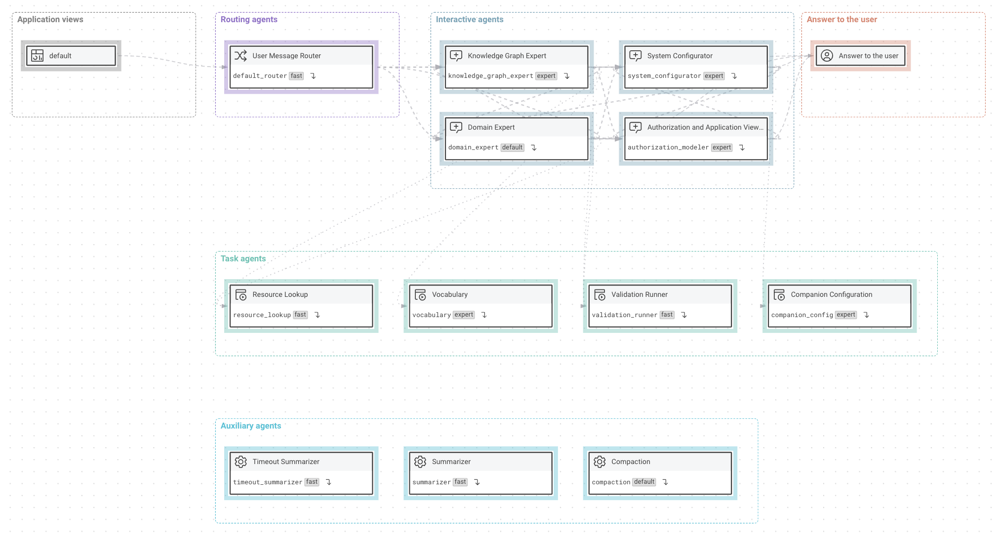
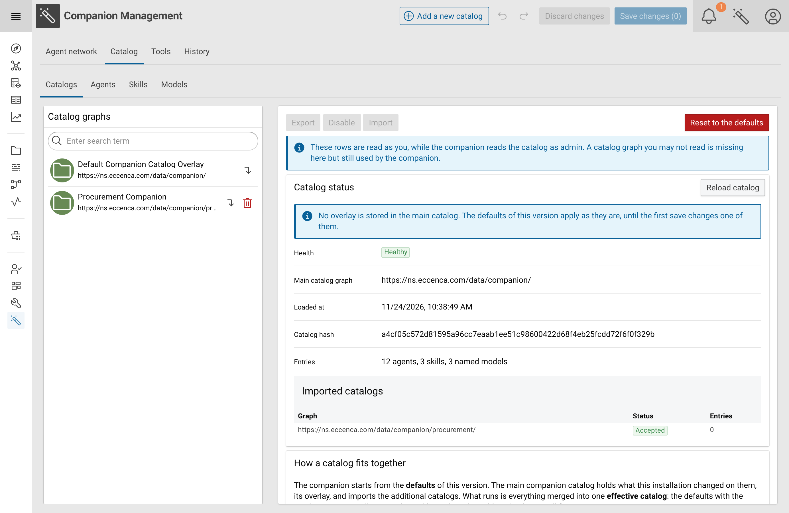
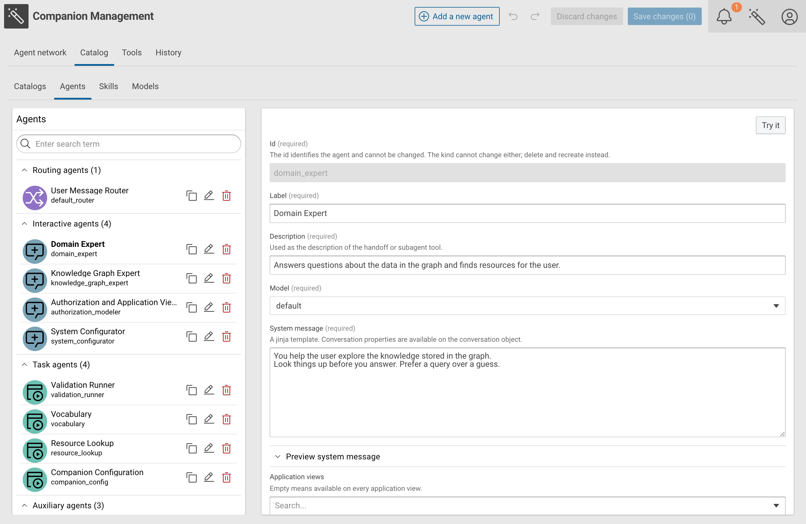

# Companion Management

!!! info "AI Disclaimer"

    Companion is an AI-based feature.
    AI-generated content may be inaccurate or incomplete.
    Verify important information.

The **Companion Management** module configures the Companion of eccenca Corporate Memory.
It shows how agents route a request, holds the catalog of agents, skills and named models, lists the tools an agent can call and keeps the conversations of all users.
The concepts behind these entries are explained in [How the Companion works](../index.md#how-the-companion-works).
For a walkthrough that adds a catalog with two agents and a skill, see [Build a Companion catalog](../build-a-companion-catalog/index.md).

## Prerequisites

- The Companion is configured for the deployment, see [Configuration](../index.md#configuration).
- The user has the action `https://vocab.eccenca.com/auth/Action/Explore-Companion-Manage`, see [Access](../index.md#access).

## Open Companion Management

Click :eccenca-application-ai-suggestion: **Companion management** under **ADMIN** in the main navigation.
The module opens with four tabs:

- **Agent network**
- **Catalog**
- **Tools**
- **History**

## Agent network

The **Agent network** tab shows every path a request can take, not a single conversation.
A request travels from an application view through a routing agent to an interactive agent and back to the user.
Task agents and auxiliary agents are shown below, the graphs that no agent focuses on are shown as **Standalone graphs**.

{ class="bordered" }

Each agent node shows the label, the id and the named model of the agent, for example `domain_expert` with `default`.

- Select **By kind** or **By catalog** to group the nodes by the kind of agent or by the catalog that holds them.
- Click a node to highlight what it reaches.
    Click **Clear selection** to remove the highlight.
- Click **Go to the agent definition** on an agent node to open the agent in the **Catalog** tab.

## Catalog

The **Catalog** tab holds the entries of the catalog in four tabs:

- **Catalogs**
- **Agents**
- **Skills**
- **Models**

Each tab lists the entries on the left and shows the selected entry on the right.
Enter a search term above the list to filter it.

{ class="bordered" }

### Catalogs

The **Catalog graphs** list shows the main catalog graph `Default Companion Catalog Overlay` and the catalog graphs it imports.
Select the main catalog graph to see its **Catalog status**:

- **Health** of the catalog, for example `Healthy`
- **Main catalog graph**
- **Loaded at**, the time the catalog was last loaded
- **Catalog hash**
- **Entries**, the number of agents, skills and named models
- **Imported catalogs**, with the graph, the status and the number of entries of each imported catalog

Select an imported catalog graph to see its **Graph**, **Label in the graph**, **Imports**, **Hash the companion computed**, **Entries the companion read** and **Stored JSON**.

The list contains only the catalog graphs that the current user can read.
The Companion reads the catalog as administrator, so it also uses catalog graphs that are missing from the list.

The following actions apply to the selected catalog graph:

- Click **Export** to download the catalog.
- Click **Import** to load a catalog from a file.
- Click **Disable** to stop importing a catalog graph into the main catalog.
    The Companion no longer uses its agents, skills and named models, and the catalog graph is marked `disabled`.
    Click **Enable** to import it again.
    Both take effect immediately, without **Save changes**.
- Click **Reload catalog** to load the catalog from the graph again.

The following actions apply to a catalog graph in the list:

- Click **Open the agents of this catalog** to open the **Agents** tab with the catalog graph selected.
- Click :eccenca-item-remove: **Delete this catalog graph** to delete an added catalog graph, then confirm with **Delete**.
    The graph is deleted and the main catalog no longer imports it.
    This cannot be undone.
    The main catalog graph cannot be deleted.

Click **Add a new catalog** in the header to add a catalog graph.

!!! warning

    **Reset to the defaults** removes the overlay stored in the main catalog graph, so the defaults of the installed version apply again.
    Agents, skills and named models changed or added in the main catalog are lost.
    Imported catalog graphs are kept.

### Agents

The **Agents** tab lists the agents grouped by kind: **Routing agents**, **Interactive agents**, **Task agents** and **Auxiliary agents**.

{ class="bordered" }

- Select an agent to edit it.
- Click :eccenca-item-clone: **Clone** to create a copy of an agent with a new identifier, in a catalog of choice.
- Click :eccenca-item-edit: **Rename** to change the identifier of an agent.
- Click :eccenca-item-remove: **Delete** to delete an agent.
- Click **Add a new agent** in the header to create an agent.

The kind of an agent is set when the agent is created and cannot be changed afterwards.
To change the kind, delete the agent and create it again.

An agent has the following fields:

- **Id:** the identifier of the agent in lowercase letters, digits and underscores, which is changed only with **Rename**
- **Label**
- **Description:** used as the description of the handoff or subagent tool through which other agents call it
- **Model:** the named model the agent runs on, for example `default`
- **System message:** the instructions of the agent as a Jinja template.
    The properties of the conversation are available on the `conversation` object.
    Expand **Preview system message** to see the rendered message.
- **Application views (optional):** the application views on which the agent is available.
    Without an entry, the agent is available on every application view.
- **Available tool patterns (optional):** glob patterns of the tools the agent may use, for example `cmem_explore-*`.
    A pattern without `*` is an exact tool name.
    The constraints **Read-only**, **Destructive**, **Idempotent** and **Open world** narrow an entry to the tools that declare these hints.
    Without an entry, the agent uses every tool of the application view.
- **Activity verbs (optional):** the words shown in the chat while the agent works, for example `Looking up` or `Querying`
- **Task agents (optional):** the task agents this agent may start
- **Handoff agents (optional):** the interactive agents this agent may hand the conversation to
- **Own personality**, **Own output instructions** and **Own resources rendering:** switches that keep the personality, the output instructions and the resources overview of the catalog out of the system message of this agent
- **Focus graphs (optional):** the graphs the agent focuses on, rendered into an overview for its system message
- **Disabled:** switches the agent off

Click **Try it** to test the agent.

### Skills

The **Skills** tab lists the skills with their name, for example `/summarize_graph`.
A skill has the following fields:

- **Id:** the identifier of the skill, which is changed only with **Rename**
- **Name:** the name the user enters after the slash
- **Description**
- **Prompt:** a Jinja template.
    The text the user enters after the name of the skill is passed to it.
- **Application views (optional):** the application views on which the skill is available
- **Scripts (optional):** supplementary JavaScript stored with the skill
- **Model override (optional):** a named model that replaces the model of the agent.
    A switch of the model prevents prompt caching, so leave this field empty unless the skill needs a different model.
- **Disabled:** switches the skill off

Click **Add a new skill** in the header to create a skill.
The list offers :eccenca-item-clone: **Clone**, :eccenca-item-edit: **Rename** and :eccenca-item-remove: **Delete** as for agents.

### Models

The **Models** tab lists the named models, for example `fast`, `default` and `expert`.
A named model has the following fields:

- **Name:** the name agents reference, in lowercase letters, digits and underscores
- **Provider:** `configured default` uses the provider and the model of the application configuration
- **Model**, **Temperature**, **Max tokens**, **Top P** and **Reasoning effort:** the parameters the model runs with

Click **Test model** to test the named model.
Click **Add a new named model** in the header to create a named model.

### Save changes

Changes to catalogs, agents, skills and named models are collected until they are saved.
**Save changes** shows the number of unsaved changes, for example **Save changes (2)**.

- Click :eccenca-operation-undo: **Undo** or :eccenca-operation-redo: **Redo** to step through the unsaved changes.
- Click **Discard changes** to drop all unsaved changes.
- Click **Save changes** to write the changes into the catalog graph.

As long as the catalog has not been saved, the Companion uses the catalog shipped with Corporate Memory.
The first save writes the catalog into the main catalog graph.

## Tools

The **Tools** tab lists the tools an agent can call, grouped by MCP server, for example **build** with the prefix `cmem_build-*`.
Each tool shows its description, its arguments and the hints it declares about itself, such as `read`, `write` or `open world`.
A required argument is marked with `*`.

A tool that declares no hints counts as changing data, so the Companion asks for a confirmation before it runs the tool.

- Enter a term in **Search tools** to filter the list.
- Click **What this server says about its tools** to read the full description of a server.
- Click **Try it out** to call a tool.

## History

The **History** tab lists **All interactions** of all users with the Companion.
Each entry shows the title, the user, the agent, the number of messages and the time of the last message.

Filter the list with the following fields:

- **Search by name**
- **User:** the account name
- **From** and **To:** the time range
- **Kind:** `Conversations`, `Agent previews` or `System runs`

The following actions apply to a single entry:

- Click **Open** to read the conversation.
- Click **Export** to download the conversation.
- Click **Delete** to delete the conversation.

Click **Back up all** to download all interactions, and **Restore** to load them from a backup.
