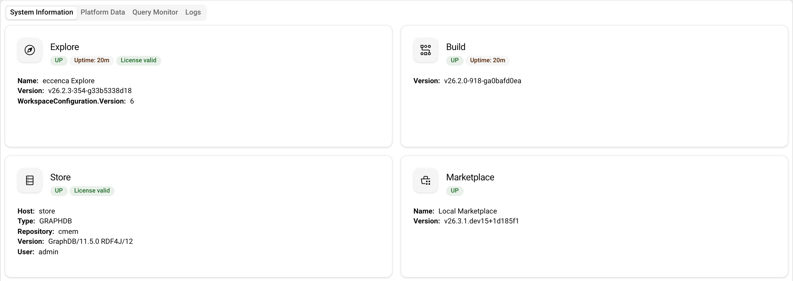
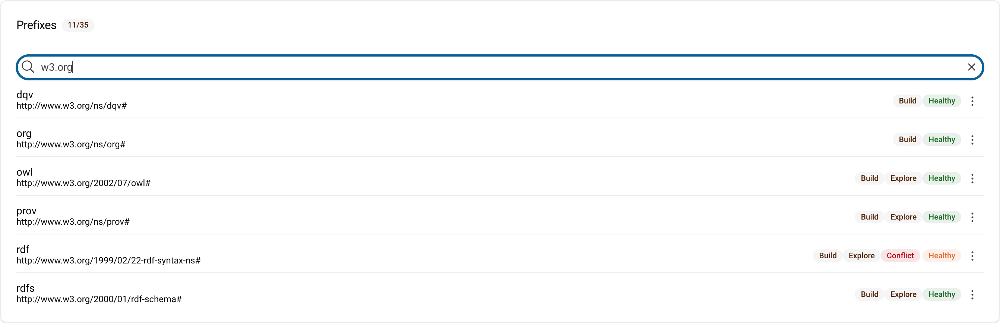
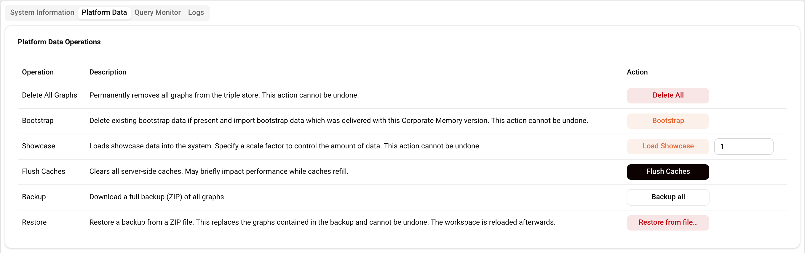
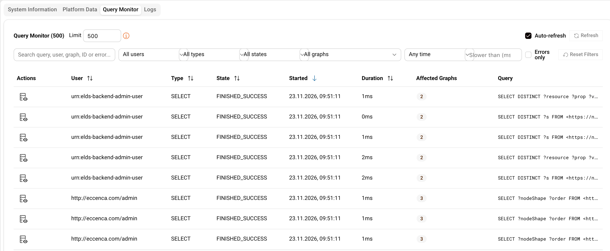
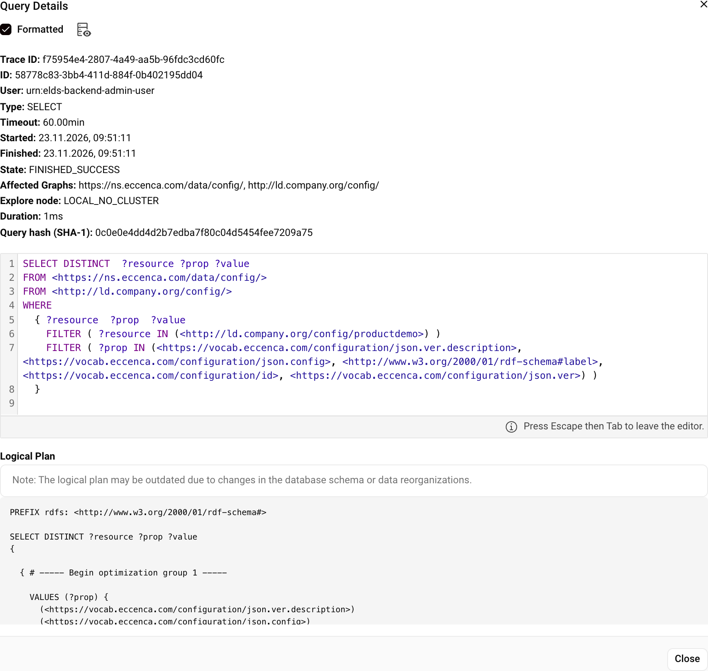
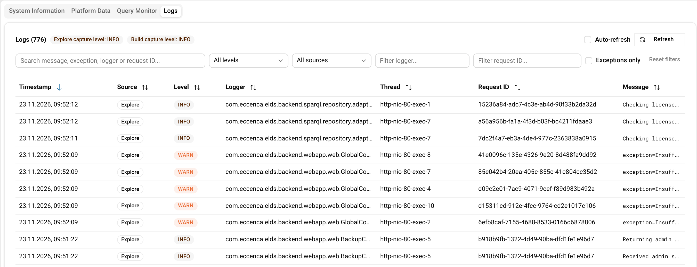

# Platform management

## Introduction

**Platform management** collects administrative views on an eccenca Corporate Memory deployment.
It shows the state and the versions of the components, runs operations on the data of the platform, monitors the SPARQL queries of Explore and reads the log lines of Build and Explore.

Open **Platform management** in the **ADMIN** section of the main navigation.
The module has four tabs:

- [**System Information**](#system-information): state, versions and licenses of the components, system ontologies and prefixes
- [**Platform Data**](#platform-data): delete, bootstrap, back up and restore the graphs of the platform
- [**Query Monitor**](#query-monitor): recent and running SPARQL queries
- [**Logs**](#logs): recent log lines of Build and Explore

The how-to [Troubleshoot a failing request](troubleshoot-a-failing-request/index.md) follows a failing query from its log line through the **Query Monitor** to the query editor.

## Access

Which tabs are shown depends on the actions granted to the account, see [Access conditions](../../deploy-and-configure/configuration/access-conditions/index.md):

- An administrator sees all four tabs.
- An account with the action `https://vocab.eccenca.com/auth/Action/LogRetrieval` sees **Platform management** with the **Logs** tab only.
    The log lines of Build are only shown if the account also has the action `https://vocab.eccenca.com/auth/Action/Build`.

Without these permissions, **Platform management** is not listed in the main navigation.

## System Information

The **System Information** tab shows the state of the deployment.

{ class="bordered" }

**Explore**, **Build**, **Store** and **Marketplace**

:   One card per component.
    Each card shows the state of the component (for example `UP`, `DEGRADED` or `DOWN`), its uptime, its version and, where it applies, the state of its license.
    The **Store** card also shows the host, the type and the repository of the triple store.

**Component HTTP roundtrip time**

:   A chart of the response times of Explore, Build and Marketplace, measured while the tab is open.

**System Ontologies**

:   The system ontologies of the deployment with their versions.
    Hover over the icon next to a version to see whether it matches the version of Explore.

**Prefixes**

:   All prefixes that are defined in the deployment, with their namespace, the sources that declare them (**Build**, **Explore**) and their state.
    Enter a term in the search field to filter the list.

{ class="bordered" }

A prefix declaration has one of the following states:

- **Healthy:** The declaration is valid and part of the prefix map that Corporate Memory uses.
- **Warning:** The declaration is used, but has an issue, for example a namespace that does not end with `/`, `#` or `:`.
- **Conflict:** Another declaration of the same source claims the same prefix or namespace.
    All declarations that claim it are ignored.

Hover over a state to see the declarations and their issues.
Click :eccenca-item-moremenu: on a prefix to open the project or graph that declares it.

## Platform Data

The **Platform Data** tab runs operations on the data of the whole platform.

{ class="bordered" }

Each operation except **Backup all** asks for confirmation before it starts:

| Operation | Action | Effect |
| --- | --- | --- |
| Delete All Graphs | **Delete All** | Permanently removes all graphs from the triple store. Optionally, all Build projects are deleted as well. |
| Bootstrap | **Bootstrap** | Deletes existing bootstrap data if present and imports the bootstrap data delivered with the Corporate Memory version. |
| Showcase | **Load Showcase** | Loads showcase data. The number next to the button is the scale factor that controls the amount of data. |
| Flush Caches | **Flush Caches** | Clears all server-side caches. Performance can be lower while the caches refill. |
| Backup | **Backup all** | Downloads a full backup of all graphs as a ZIP file. |
| Restore | **Restore from file…** | Restores a backup from a ZIP file. The graphs contained in the backup are replaced, and the workspace is reloaded afterwards. |

!!! warning "Operations that cannot be undone"

    **Delete All**, **Bootstrap**, **Load Showcase** and **Restore from file…** change or remove data in the triple store and cannot be undone.
    Click **Backup all** before running one of them on a deployment with data that must be kept.

## Query Monitor

The **Query Monitor** tab lists the recent SPARQL queries of Explore, newest first.

{ class="bordered" }

Each row shows the user, the type, the state, the start time, the duration, the number of affected graphs and the beginning of the query.

- **Limit** sets how many queries are kept in memory.
    A higher value can degrade performance.
- **Auto-refresh** reloads the list continuously.
    Auto-refresh pauses while filters, sorting, pagination or query details are active; click **Refresh** to update the list manually.
- The filters narrow the list down by a search term, the user, the type, the state, the affected graph, the start time and a minimum duration.
    **Errors only** shows failed queries, and **Reset Filters** clears all filters.

Click a row to open **Query Details**.

{ class="bordered" width="64%" }

The dialog shows the trace ID, the user, the type, the timeout, the start and end time, the state, the affected graphs, the Explore node, the duration and a hash of the query.
Below follow the query, formatted when **Formatted** is selected, and the **Logical Plan** of the triple store.
The logical plan may be outdated if the database schema or the data changed since the query ran.

Click :eccenca-application-queries: in a row, or in the dialog, to open the query in the [Query module](../query-module/index.md).
The query is reformatted before it opens.

## Logs

The **Logs** tab shows the most recent log lines of Build and Explore, merged and newest first.

{ class="bordered" }

The lines come from an in-memory buffer in each component, so no access to log files is needed.
Each buffer holds a limited number of lines, and older lines are dropped when it is full.
The labels next to the title show the capture level of each component: lines below this level are not captured.
The capture level is part of the configuration of the component.

- **Auto-refresh** loads new lines every two seconds.
    It pauses on later pages, under another sort order and while a log entry is open.
    **Refresh** loads the lines logged since the last refresh.
- The filters narrow the list down by a search term, the level (the selected level and above), the source, the logger and the request ID.
    **Exceptions only** shows lines with an exception, and **Reset filters** clears all filters.

Click a row to open the **Log entry** with its level, source, instance, logger, thread, request ID, sequence number, message and exception.
Click **Copy** to copy the entry with its context and exception as text.

If the tab cannot show the lines of a component, a message names the component and the reason, for example that log retrieval is disabled in its configuration or that the account is not authorized.
After a component restarts, the view is reset and shows the lines written since the restart.

### Read logs with cmemc and the API

The same lines are available with the [`admin logs` command group](../../automate/cmemc-command-line-interface/command-reference/admin/logs/index.md) of cmemc:

```bash
# the three most recent lines at level WARN or above, of Build and Explore
cmemc admin logs list --filter level WARN --limit 3
# new lines of Build as they arrive
cmemc admin logs list --filter job build --follow
# whether the buffers capture lines, at which level and which time span they cover
cmemc admin logs status
```

The REST endpoints are `GET /dataplatform/api/admin/logs` for Explore and `GET /dataintegration/api/core/system/logs` for Build, each with a `/status` endpoint that reports whether lines are captured.
Both require the `LogRetrieval` action.
