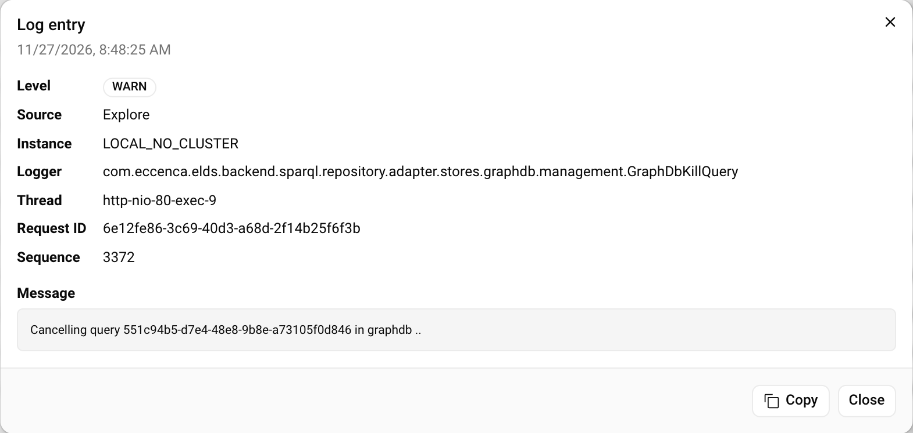
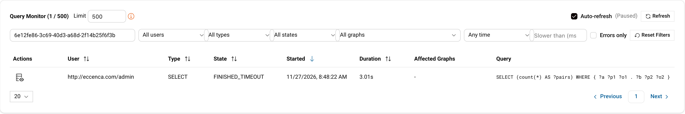
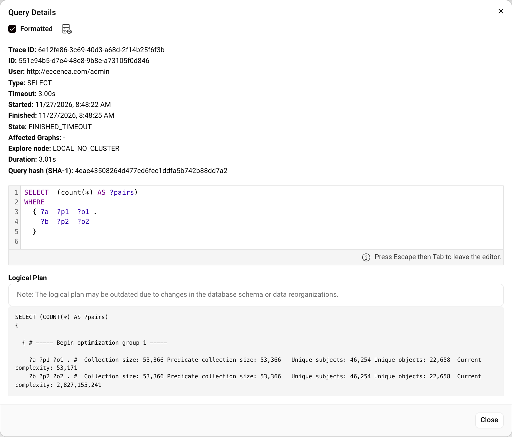

# Troubleshoot a failing request

## Introduction

When a request to eccenca Corporate Memory fails, the log lines and the recent queries of the deployment are available in [Platform management](../index.md), without access to log files.
This how-to follows one failing request from the log line to the query that caused it:

- Find the log line in the **Logs** tab and read its request ID.
- Find the query with this request ID in the **Query Monitor** and see why it failed.
- Open the query in the query editor to correct it.
- Follow the log lines on the command line with cmemc.

The example is a SPARQL query that Explore cancels after its timeout of 3 seconds.
It joins two triple patterns that share no variable, so the triple store has to combine every triple with every other triple:

```sparql
SELECT (COUNT(*) AS ?pairs)
WHERE {
  ?a ?p1 ?o1 .
  ?b ?p2 ?o2 .
}
```

## Prerequisites

- An account with the action `https://vocab.eccenca.com/auth/Action/LogRetrieval`, which shows the **Logs** tab.
    The log lines of Build need the action `https://vocab.eccenca.com/auth/Action/Build` in addition.
- An administrator account for the **Query Monitor** tab, see [Access](../index.md#access).
- For the last step: cmemc v26.3 or later with a connection to the deployment.

The log buffers of Build and Explore are enabled by default.

## 1 Find the log line

1. Open **Platform management** in the **ADMIN** section of the main navigation, and select the **Logs** tab.
2. Select `WARN` under **Level**.
    The list shows lines at the selected level and above.
3. Select `Explore` under **Source**.
4. Enter `Cancelling query` in the search field.
    When Explore cancels a query after its timeout, it logs the message `Cancelling query <query ID> in graphdb ..`.
5. Click the row of the line, for example on its timestamp.
    If several lines match, select the one whose timestamp fits the time of the failure.

The **Log entry** dialog shows the line with its level, source, logger, thread and request ID.

{ class="bordered" width="70%" }

The request ID identifies the request that wrote the line.
Enter it in the **Filter request ID** field of the **Logs** tab to list every line of this request.
Only the lines of Explore carry a request ID.

Click **Copy** to copy the entry as text, for example for a support request.

## 2 Find the query in the Query Monitor

1. Select the **Query Monitor** tab.
2. Enter the request ID in the search field.
    The request ID of the log line is the trace ID of the query.
    The list contains only the most recent queries, as many as **Limit** says, and Explore also runs queries of its own.
    If the search finds nothing, raise **Limit**.

    { class="bordered" }

3. Click the row of the query.
    A request can run several queries, which share its request ID.
    The query that failed has a state other than `FINISHED_SUCCESS`, here `FINISHED_TIMEOUT`.

The **Query Details** dialog shows the state `FINISHED_TIMEOUT`, the timeout and the duration of the query.
The **Logical Plan** shows how the triple store evaluates the query.
In the example, each of the two triple patterns matches every triple of the store, and the complexity of the second pattern is the product of both, which is why the query does not finish within its timeout.

{ class="bordered" width="70%" }

Without a log line, the filters of the **Query Monitor** find a failed or slow query directly:

- **Errors only** lists failed queries, including the queries that ended with a timeout.
- **Slower than (ms)** lists the queries that took longer than the given number of milliseconds.

## 3 Open the query in the query editor

Click :eccenca-application-queries: **Open in Query Editor** in the row of the query or in the **Query Details** dialog.

The [Query module](../../query-module/index.md) opens the query in a new tab of the query editor, reformatted.
Correct it there, for example by connecting the two triple patterns through a shared variable, and run it again.

## 4 Follow the log lines on the command line

The [`admin logs` command group](../../../automate/cmemc-command-line-interface/command-reference/admin/logs/index.md) of cmemc reads the same lines.
To watch new warnings of Explore while a user repeats the failing request, follow the lines:

```shell
cmemc admin logs list --filter job explore --filter level WARN --follow
```

New lines are added as they arrive, for example `Cancelling query 09939bea-c67e-4705-b1de-f510ce6d2ca1 in graphdb ..`.
Press ++ctrl+c++ to stop following.

For queries, `cmemc query status` reads the same information as the **Query Monitor**, for example all queries that ended with a timeout:

```shell
cmemc query status --filter status timeout
```

## Related

- [Platform management](../index.md) describes the **Logs** tab, the **Query Monitor** and their filters.
- [Query module](../../query-module/index.md) describes the query editor.
