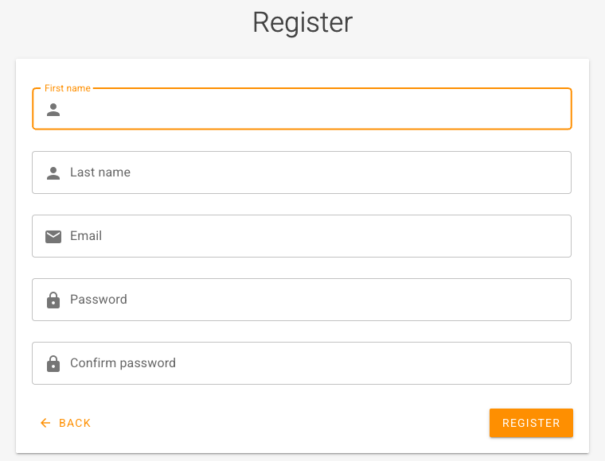
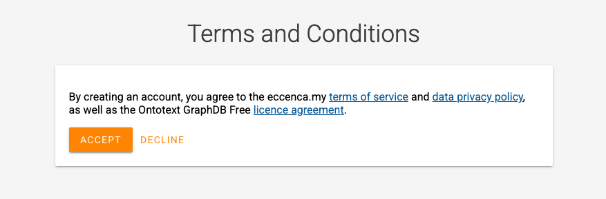
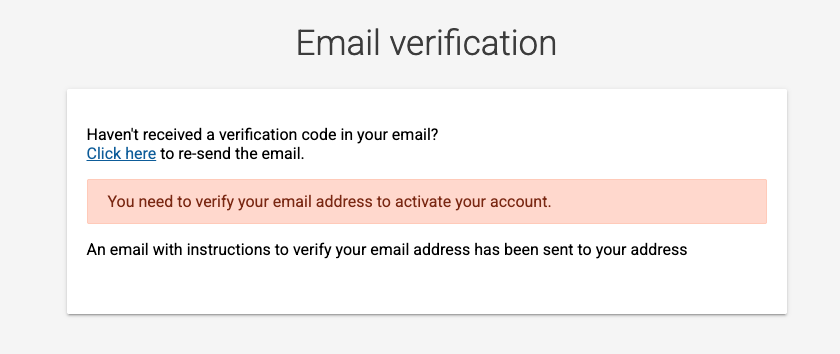
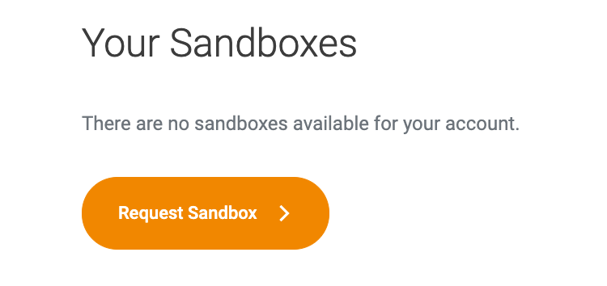

# Get access to the sandbox

## Introduction

The eccenca Corporate Memory sandbox is a free, personal Corporate Memory instance for trying out the product.
It is provided at [eccenca.my](https://eccenca.my/) as the Community Edition sandbox.

The following steps register an account at eccenca.my, request a sandbox and open it.
The result is a running sandbox that serves as the starting point for the tutorials in this documentation.

For the content that a new sandbox includes, and for its limitations, see [Welcome to your eccenca Corporate Memory Sandbox](../with-your-sandbox/index.md).

## Prerequisites

The following items are required:

- An email address that receives the messages from eccenca.my
- A supported web browser, as listed under [Minimal requirements](../index.md#minimal-requirements)

## 1 Register an account

1. Open [https://eccenca.my/](https://eccenca.my/) in a web browser.
2. Click **GET STARTED**.
    The eccenca.my sign-in form opens.
3. Click **Register**.
    The **Register** form opens.
4. Enter the following values:

    - **First name:** the first name of the account holder
    - **Last name:** the last name of the account holder
    - **Email:** the email address that is used to sign in
    - **Password:** a password for the account
    - **Confirm password:** the same password again

    { class="bordered" width="50%" }

5. Click **REGISTER**.
    The **Terms and Conditions** dialog opens.
    It covers the eccenca.my terms of service, the data privacy policy and the Ontotext GraphDB Free license agreement.

    { class="bordered" width="50%" }

6. Click **ACCEPT**.
    The **Email verification** form opens, and eccenca.my sends an email with instructions to verify the email address.

    { class="bordered" width="50%" }

7. Follow the instructions in the email to verify the email address.
    The account is activated, and the **Your Sandboxes** overview opens.

!!! tip "Verification email not received"

    To send the verification email again, click **Click here** in the **Email verification** form.

## 2 Request a sandbox

1. In the **Your Sandboxes** overview, click **Request Sandbox**.

    { class="bordered" width="50%" }

2. Enter a name of choice for the instance in the form.

<!-- [needs-instance] Field label and submit button of the Request Sandbox form are not yet verified. -->

The provisioning of the sandbox takes up to 24 hours.
When the sandbox is ready, eccenca.my sends an email with the link to the sandbox and its credentials.

!!! tip "Return to the sandbox overview"

    To open the **Your Sandboxes** overview later, open [https://eccenca.my/](https://eccenca.my/), click **Login / Register**, enter the **Email** and the **Password** of the account and click **SIGN IN**.

## 3 Open the sandbox

1. Open the link from the email that announces the sandbox.
2. Sign in with the credentials from the same email.

<!-- [needs-instance] Sign-in form of the sandbox (labels, button) is not yet verified. -->

## Next steps

- See it in the product: five features, with the shortest path to each
- Basic: the guided path from a source file to a knowledge graph, about four hours

<!-- TODO: link both guided journeys once they are published. -->
