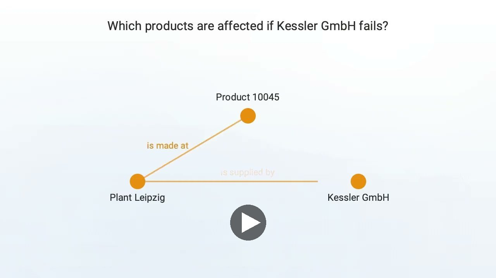
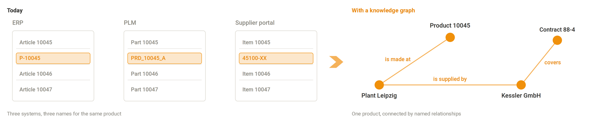
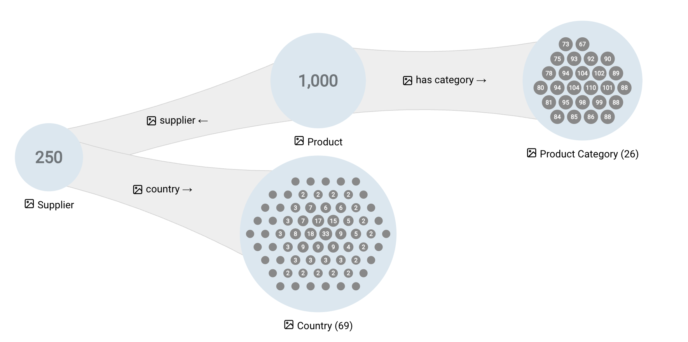

# Welcome to the eccenca Corporate Memory documentation

- :material-home: [Home](#what-is-eccenca-corporate-memory)

    ---

    New to eccenca Corporate Memory? Start here: what the product is for, how it is structured, and how to get access.

- :material-star: [Build](build/index.md)

    ---

    Lift your data by integrating multiple datasets into a Knowledge Graph.

- :material-star: [Explore](explore-and-author/index.md)

    ---

    Explore, author and interact with your Knowledge Graph.

- :material-star: [Consume](consume/index.md)

    ---

    This section outlines how to consume data from the Knowledge Graph.

- :material-star: [Distribution](distribution/index.md)

    ---

    Discover, install and manage ready-made Marketplace Packages.

- :material-star-outline: [Deploy and Configure](deploy-and-configure/index.md)

    ---

    Deploy in your own environment.

- :material-star-outline: [Automate](automate/index.md)

    ---

    Setup processes and automate activities based on and towards your Knowledge Graph.

- :material-star-outline: [Develop](develop/index.md)

    ---

    Extend Corporate Memory with custom plugins and packages, and access it programmatically through the Python, Java and REST APIs.

- :material-calendar: [Release Notes](release-notes/2026/corporate-memory-26-2/index.md)

    ---

    Documentation of changes and enhancements for each version.

- :material-list-status: [Tutorials](tutorials/index.md)

    ---

    Learn by example and step-by-step guidelines to achieve a concrete goal fast.

## What is eccenca Corporate Memory?

Corporate Memory connects data that lives in separate systems into one meaningful whole, a knowledge graph.
It keeps that whole usable as the systems and the business around it change.

Prefer to watch?
The video [eccenca Corporate Memory in 3 minutes](https://www.youtube.com/watch?v=Lb0zpH9oLMM){target=_blank} shows what Corporate Memory is for, without a product demo.

[{ class="bordered off-glb" width="60%" }](https://www.youtube.com/watch?v=Lb0zpH9oLMM){target=_blank}

Reading time: 4 minutes.
No prior knowledge is required.
The following sections explain what the product is for, not how to use it.

### A familiar problem

A supplier has just gone out of business.
Someone in purchasing needs to know which products are affected.

The answer exists.
But the product is called `P-10045` in the ERP system, `PRD_10045_A` in the PLM system and `45100-XX` in the supplier portal.
Each system is right on its own terms, and none of them knows about the others.
So the answer is put together by hand, takes days, and is out of date by the time anyone acts on it.

Most organizations do not have a data shortage.
They have a connection problem.

### What eccenca Corporate Memory does

{ class="bordered" }

Corporate Memory gives the context of the data a place to live.

It reads data from existing systems and expresses it as a knowledge graph: things, and the named relationships between them.
This product is made at this plant.
This plant is supplied by this company.
Each statement is written down explicitly, in a form both people and software can follow.

The three identifiers do not disappear.
They become properties of one product, so any fact can be traced back to the system it came from, and written back to it where that makes sense.

The question from purchasing now has a place to be asked, and an answer that is the same for everyone who asks it.

{ class="bordered" width="60%" }

Around the graph, the platform provides what is needed to keep it alive: building it from real sources, exploring and correcting it, checking that it still meets expectations, and serving it to the people and applications that need answers.

- [What is a knowledge graph?](introduction/what-is-a-knowledge-graph/index.md) explains the idea in more depth.
- [eccenca Corporate Memory at a glance](introduction/corporate-memory-at-a-glance/index.md) shows how the parts of the product fit together.

### Terms used in this documentation

These terms are not needed for this introduction.
They become useful once reading continues into the other sections.

| Term | In one line |
| --- | --- |
| Mapping | How source columns become things and relationships in the graph. |
| Linking | Deciding when two records from different systems mean the same thing. |
| Shapes (SHACL) | Writing down what must be true about the data, and checking it. |
| Vocabulary | The agreed names for the kinds of things and relationships in use. |
| Workflow | Running all of it again whenever the sources change. |
| Marketplace | Ready-made packages to install and adapt. |
| cmemc | Doing the same from the command line, for automation and CI/CD. |

### What it is and what it is not

| Corporate Memory is … | … and it is not |
| --- | --- |
| a layer that connects with existing systems | a replacement for them; the ERP system stays the ERP system |
| built to represent meaning and relationships | a data warehouse or a BI tool for aggregating numbers |
| configured for business users by people who know the data and the domain | a finished application for end users |
| support for modeling decisions | a way to avoid them |

It does not wire the systems to each other either.
Corporate Memory connects with them, brings their data together in one graph, and leaves them running as they are.

The last row matters most.
Deciding what the data means is modeling work.
Corporate Memory supports that work, it does not do it.

### Is it the right tool?

Corporate Memory is likely to add value when most of these questions are answered with yes:

- Do the questions cross system boundaries?
- Is the same real-world thing represented differently in different places?
- Do relationships matter as much as the values themselves?
- Is the structure of the data expected to keep changing?

It is probably not the right tool for a single well-structured source with a stable schema, or for a question that is essentially "sum this column by month".
It is also not the right tool when nobody in the organization is available to decide what the data means.
That last one is the most common reason such projects stall, and no software solves it.

### Who works with it

- __Linked Data Experts and data engineers__

    ---

    Do most of the building: connect sources, model, and keep the graph current.

    [:octicons-arrow-right-24: Build a knowledge graph](build/index.md)

- __Business users__

    ---

    Work with what has been configured for them, usually without seeing the model behind it.

    [:octicons-arrow-right-24: Explore and manage knowledge](explore-and-author/index.md)

- __Developers__

    ---

    Integrate Corporate Memory with other applications and extend it.

    [:octicons-arrow-right-24: Extend Corporate Memory](develop/index.md)

- __Administrators__

    ---

    Install, operate and upgrade it.

    [:octicons-arrow-right-24: Deploy and operate](deploy-and-configure/index.md)

Choosing one of these roles is not required at this point.

### Next

- [What is a knowledge graph?](introduction/what-is-a-knowledge-graph/index.md): the concept, 5 minutes, on the main path
- [Semantic Web basics](introduction/semantic-web-basics/index.md): optional, the terminology, about 35 minutes
- [eccenca Corporate Memory at a glance](introduction/corporate-memory-at-a-glance/index.md): the parts of the product and how they relate
