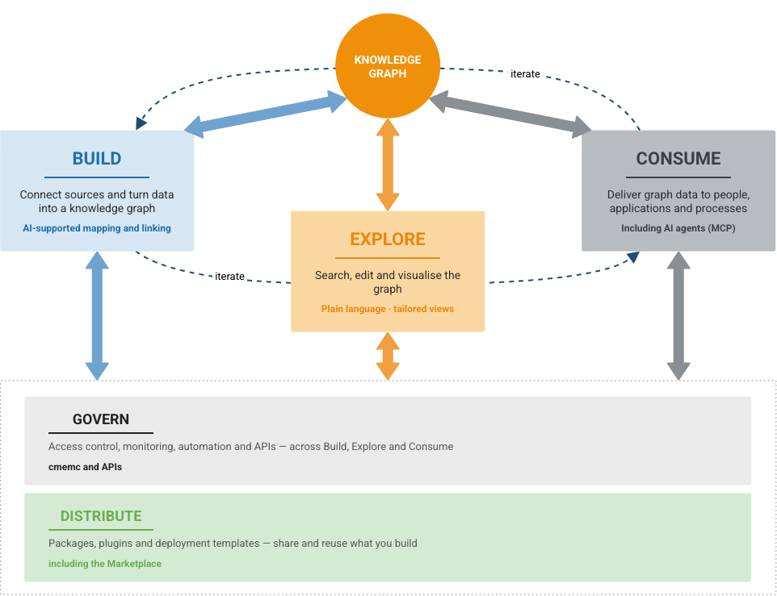

# eccenca Corporate Memory at a glance

[What is a knowledge graph?](../what-is-a-knowledge-graph/index.md) explains the knowledge graph in the middle of the following picture.
The five areas around it are where the work with that graph happens.
Each area is a part of eccenca Corporate Memory, and each has its own section in this documentation.
The following descriptions say what each one is for, in two or three sentences, and nothing about how to use it.

{ width="80%" }

## Build

Build is where data becomes a knowledge graph.
A source is connected: a file, a database, an API.
Its columns are then defined as things and relationships, and the Mapping Creator proposes most of that.
Workflows put the steps in order, so the graph can be rebuilt whenever the sources change.

Mostly used by Linked Data Experts and data engineers.

[:octicons-arrow-right-24: Go to Build](../../build/index.md)

## Explore

Explore is where people work with the graph.
Searching finds a thing, its connections become visible, and what is wrong is corrected in place, without a query language.
Views can be tailored to a task, so a colleague sees their own fields rather than the model behind them.

Used by business users and Linked Data Experts.

[:octicons-arrow-right-24: Go to Explore](../../explore-and-author/index.md)

## Consume

Consume is where other systems take over.
Dashboards, applications, automated processes and AI agents read the same graph through standard interfaces such as SPARQL, SQL and REST.
Everyone then works from the same answer instead of a copy of their own.

Used by developers, analysts and Linked Data Experts.

[:octicons-arrow-right-24: Go to Consume](../../consume/index.md)

## Govern

Govern is what keeps the whole thing dependable.
Access rules decide who sees and changes what, and metrics and logs show whether the system is healthy.
Everything that can be done by hand can also be done from the command line or through an API.
That is what makes automation and continuous delivery possible.

Used by administrators and operations teams.

[:octicons-arrow-right-24: Go to Automate](../../automate/index.md) · [:octicons-arrow-right-24: Go to Deploy and Configure](../../deploy-and-configure/index.md)

## Distribute

Distribute is how work gets reused.
The Marketplace holds ready-made content that can be added to an instance: vocabularies, taxonomies, data graphs, Build projects and query catalogs.
Complete demo and solution setups are included.
Everything arrives as a versioned package, and Corporate Memory puts its contents where they belong.
Solutions built in house can be packaged and shared the same way.

Used by Linked Data Experts and developers.

[:octicons-arrow-right-24: Go to Distribution](../../distribution/index.md)

## What else it can do

The five areas above are where most work happens.
The following capabilities exist alongside them, and are named here so that they are known to exist rather than explained.

| Capability | In one line | Where |
| --- | --- | --- |
| Query and SPARQL | The query language for graphs, and the precise way to ask the data a question nobody planned for. | [Queries](../../explore-and-author/query-module/index.md) |
| Reasoning | Derives the facts that follow from the data and the rules, without anyone stating them. | [Reason](../../build/reference/customtask/cmem_plugin_reason-plugin_reason-ReasonPlugin.md) |
| Shapes (SHACL) | Record what must be true about the data, and check whether it is. | [Building a customized user interface](../../explore-and-author/graph-exploration/building-a-customized-user-interface/index.md) |
| Linking rules | Decide when two records from different systems mean the same real-world thing. | [Link Rules](../../explore-and-author/link-rules/index.md) |
| Link learning | Proposes those rules from examples, instead of requiring them to be written by hand. | [Active Learning](../../build/active-learning/index.md) |
| Python plugins | Add functions that the standard product does not provide. | [Python Plugins](../../develop/python-plugins/index.md) |
| Deployment | The technical operating layer, so Corporate Memory runs in different environments. | [Deploy and Configure](../../deploy-and-configure/index.md) |

## Next

- [Get access](../get-access/index.md): a sandbox or an existing instance
- Basic, the hands-on path to a first knowledge graph in about four hours, is in preparation.
  Until then, the [Tutorials](../../tutorials/index.md) cover the first steps.

<!-- TODO: replace the Basic entry above with a link once the Basic learning path exists. -->
