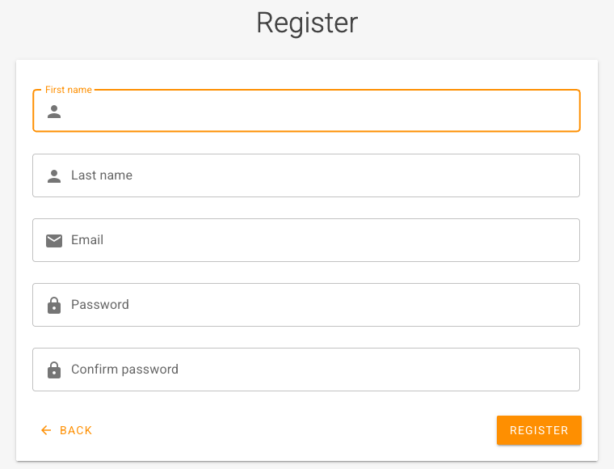
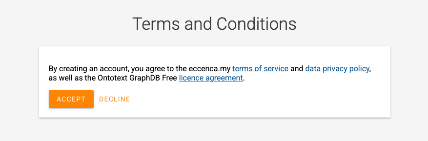
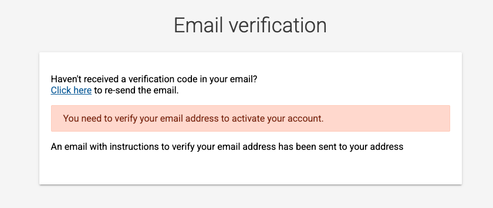
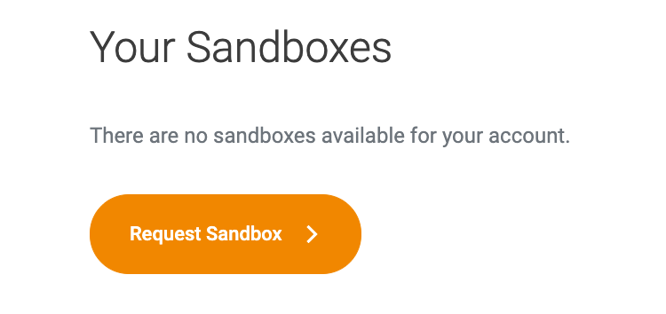

# Get access to the sandbox

The eccenca Corporate Memory sandbox is a free, personal Corporate Memory instance for trying out the product.
It is provided at [eccenca.my](https://eccenca.my/) as the Community Edition sandbox.

The following steps register an account at eccenca.my and sign in to the sandbox.
The result is a running sandbox that serves as the starting point for the tutorials in this documentation.

For the content that a new sandbox includes, and for its limitations, see [Welcome to your eccenca Corporate Memory Sandbox](../../getting-started/with-your-sandbox/index.md).

!!! info "Existing instance"

    With access to an existing Corporate Memory instance, no registration is needed.
    Open the URL of the instance and sign in with the credentials provided by its administrator, as described in [Login and Logout](../../getting-started/index.md#login-and-logout).

## Prerequisites

The following items are required:

- An email address that receives the messages from eccenca.my
- A supported web browser, as listed under [Minimal requirements](../../getting-started/index.md#minimal-requirements)

## Register an account

1. Open [eccenca.my](https://eccenca.my/) in a web browser.
2. Click **GET STARTED**.
   The eccenca.my sign-in form opens.
3. Click **Register**.
   The **Register** form opens.
4. Enter the following values:

    - **First name:** the first name of the account holder
    - **Last name:** the last name of the account holder
    - **Email:** the email address that is used to sign in
    - **Password:** a password for the account
    - **Confirm password:** the same password again

    { class="bordered" width="50%" }

5. Click **REGISTER**.
   The **Terms and Conditions** dialog opens.
   It covers the eccenca.my terms of service, the data privacy policy and the Ontotext GraphDB Free license agreement.

    { class="bordered" width="50%" }

6. Click **ACCEPT**.
   The **Email verification** form opens, and eccenca.my sends an email with instructions to verify the email address.

    { class="bordered" width="50%" }

7. Follow the instructions in the email to verify the email address.
   The account is activated, and the **Your Sandboxes** overview opens.

## Request a sandbox

1. In the **Your Sandboxes** overview, click **Request Sandbox**.

    { class="bordered" width="50%" }

2. Enter a name of choice for the instance in the form.

The provisioning of the sandbox takes up to 24 hours.
When the sandbox is ready, eccenca.my sends an email with the link to the sandbox and its credentials.

## Open the sandbox

1. Open the link from the email that announces the sandbox.
2. Sign in with the credentials from the same email.

## Next

- [See it in the product](../see-it-in-the-product/index.md): five features, with the documentation for each
- Basic, the guided path from a source file to a knowledge graph in about four hours, is in preparation.
  Until then, the [Tutorials](../../tutorials/index.md) cover the first steps.

<!-- TODO: replace the Basic entry above with a link once the Basic learning path exists. -->
