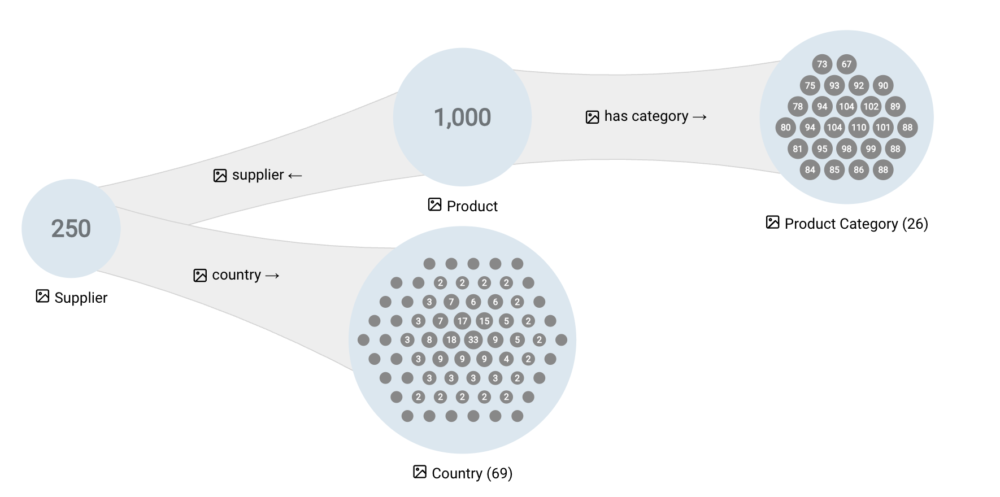
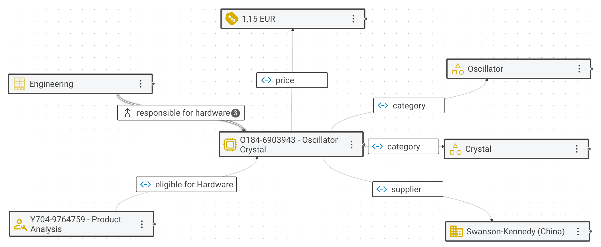
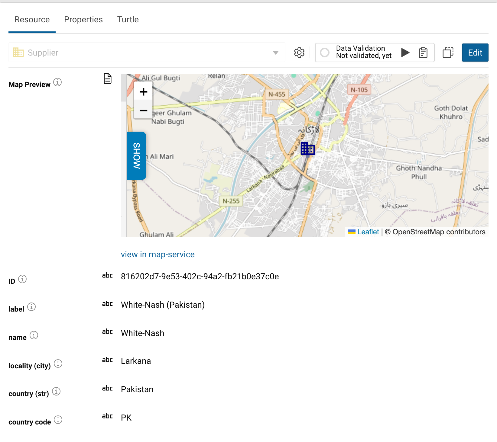
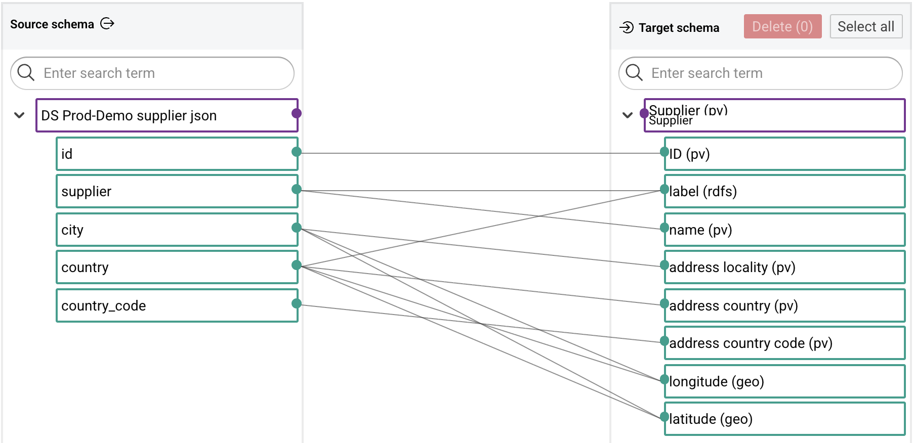
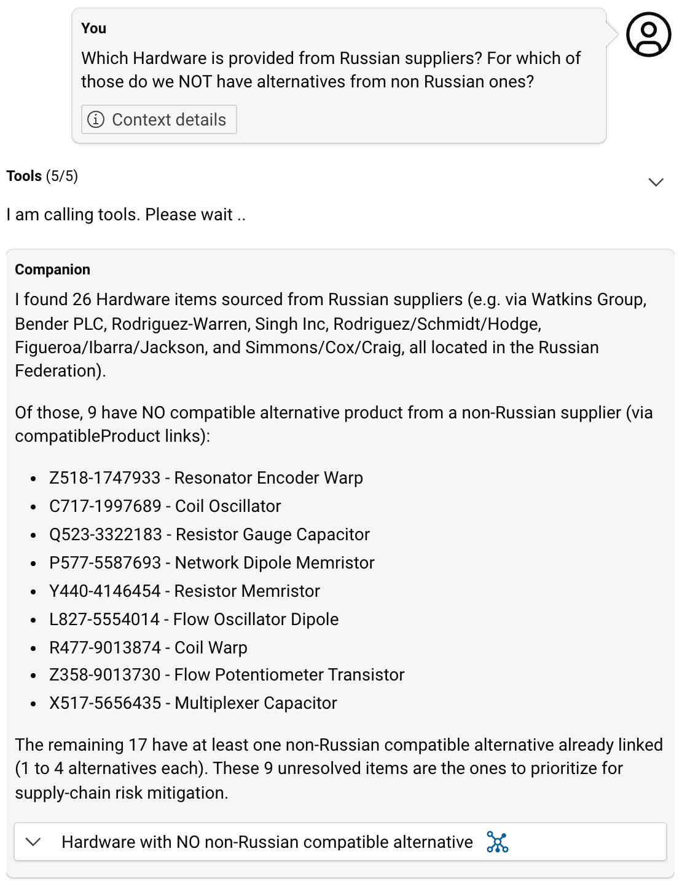

# Highlight features

The five features below are highlighted because they matter in daily work with eccenca Corporate Memory and set it apart.
Each is shown with a link to the documentation that covers it.

Nothing here has to be understood or operated yet.
Looking is enough.

<!-- TODO: embed the video "eccenca Corporate Memory UI Tour, 5 min" here once it exists. -->

<!-- TODO: add "Where to find it" with the shortest click path for each feature below.
The click paths are still placeholders in the Confluence draft and have to be verified against a running instance. -->

## Graph Insights

<!-- "relationships the data actually uses" verified in the sandbox on 8 Oct 2026: expansion menu showed only
classes with counts >= 1, no empty entries.
Confirmed by graph-insights/index.md:15 "Expansions are data-guided to avoid dead ends". -->

Graph Insights shows a knowledge graph as a readable picture: similar things are grouped, and the connections between the groups are summarized.
Each step offers only the relationships the data actually uses, so no path leads to an empty view.
Filters narrow what is shown, and no query is needed.

{ class="bordered" width="60%" }

[:octicons-arrow-right-24: Graph Insights](../../explore-and-author/graph-exploration/graph-insights/index.md)

## Business Knowledge Editor

<!-- "labelled with the names the business uses" confirmed by RP, 20 Oct 2026.
"read and changed" follows the Introduction spec: the feature table says
"knowledge can be viewed and managed in a business-friendly way" - viewing first. -->

The Business Knowledge Editor is where an individual thing in a knowledge graph is read and changed.
It appears as a diagram with its relationships, labeled with the names the business uses.
Both can be added to or edited.
Any changes become part of the graph, so everything built on it sees them.

{ class="bordered" width="60%" }

[:octicons-arrow-right-24: Business Knowledge Editor](../../explore-and-author/bke-module/index.md)

## Shape views

Shape views present graph data in whatever form a task needs: a form with business field labels, a map, a diagram.
The presentation follows the model rather than code, so a change to the model changes every view built on it.

{ class="bordered" width="60%" }

[:octicons-arrow-right-24: Building a customized user interface](../../explore-and-author/graph-exploration/building-a-customized-user-interface/index.md)

## Mapping Creator

The Mapping Creator connects the columns of a source to the things and relationships of the knowledge graph.
The mapping is drawn as lines between source and target, by hand or proposed by artificial intelligence (AI).
Each suggestion is accepted or rejected by a person, individually or in bulk.
The tedious half of the work is proposed, while the decision about what the data means stays with a person.

{ class="bordered" width="60%" }

[:octicons-arrow-right-24: Mapping Creator](../../build/mapping-creator/index.md)

## Companion

Companion is an AI agent built into Corporate Memory.
A question about the data, asked in plain language, is answered from the knowledge graph.
That opens the graph to people who never write a query.
Intentions for a data pipeline, described in plain language, are translated into Build workflows, transformations and other tasks.

{ class="bordered" width="40%" }

[:octicons-arrow-right-24: Companion AI Chat](../../explore-and-author/companion/index.md)

## Next

- Basic, the hands-on path to a first knowledge graph in about four hours, is in preparation.
  Until then, the [Tutorials](../../tutorials/index.md) cover the first steps.

<!-- TODO: link Basic and the video "From CSV to Knowledge Graph" (10 min, the same journey watched instead of done)
once both exist. -->

## Browse all documentation

The complete documentation is organized by module:
[Build](../../build/index.md) ·
[Explore](../../explore-and-author/index.md) ·
[Consume](../../consume/index.md) ·
[Distribution](../../distribution/index.md) ·
[Deploy and Configure](../../deploy-and-configure/index.md) ·
[Automate](../../automate/index.md) ·
[Develop](../../develop/index.md) ·
[Release Notes](../../release-notes/2026/corporate-memory-26-2/index.md) ·
[Tutorials](../../tutorials/index.md)
