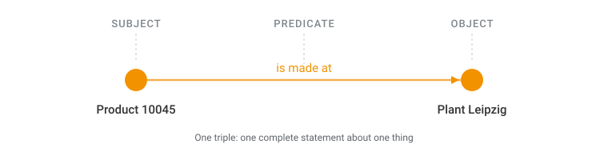
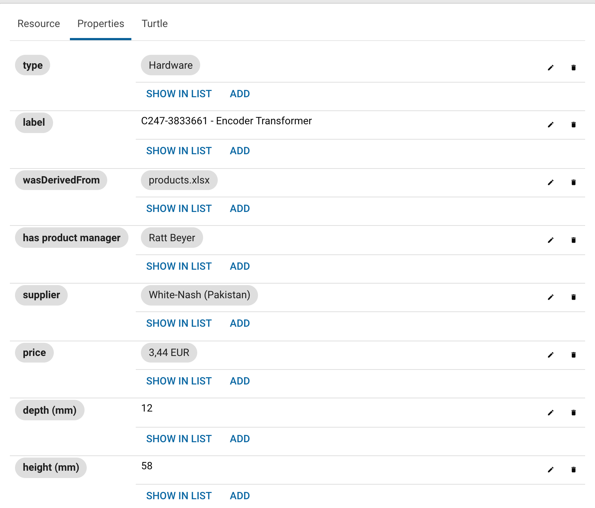
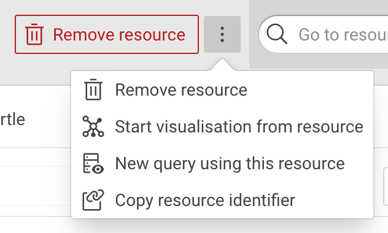

# Semantic Web basics

This is a compact overview of the terms that the rest of this documentation assumes.
Those terms are triple, Internationalized Resource Identifier (IRI), literal, prefix, class, property, vocabulary and graph.
Each term is shown as it appears in eccenca Corporate Memory.

The overview is optional and takes about 35 minutes.
It is a bridge, not a course.
It covers enough to read the documentation and to work with the product, and points to a full course for everything beyond that.

Skip ahead when triple, IRI and vocabulary are familiar terms.
Nothing here is specific to Corporate Memory that does not also appear later.
Read on when Resource Description Framework (RDF) and ontology are words heard but never used.
Either way, the introduction continues with [eccenca Corporate Memory at a glance](../corporate-memory-at-a-glance/index.md).

## Why the meaning has to be written down

Software reads text without understanding it.

"The fisherman went to the bank" is clear to a reader and ambiguous to a machine, which cannot tell a riverbank from a financial institution.
A person resolves this from context.
Software has no context unless the context is recorded.

The same applies to structure.
A column headed `loc` is meaningful to the team that created it and opaque to everyone else, including every program that reads the table later.

The terms are the agreed way of recording what something is and how it relates to other things.
Their purpose is that the meaning travels with the data instead of living in someone's head.

[What is a knowledge graph?](../what-is-a-knowledge-graph/index.md) explains why a graph is the shape that makes this possible.

## The terms

### Triple

A triple is the smallest complete statement: subject, predicate, object.
`Product 10045` — is made at — `Plant Leipzig` is one triple.
A knowledge graph is a large collection of triples.

{ class="bordered" }

In the product: open a resource in Explore and select the **Properties** tab.
The resource is the subject, and each row is one predicate with its object.

{ class="bordered" width="70%" }

### IRI

An IRI identifies a thing, globally and uniquely, and is written like a web address: `https://example.org/product/10045`.
IRI is the internationalized form of Uniform Resource Identifier (URI).

A plain number does not work for this purpose.
The number `10045` means something different in each source system, while an IRI cannot collide with another system's identifier.

In the product: **Copy resource identifier** in the :eccenca-item-moremenu: menu of a resource copies its IRI.

{ class="bordered" width="40%" }

### Literal, datatype and language tag

A literal is a value rather than a thing: a number, a date, a piece of text.
IRIs name the things, literals hold what is known about them.

By default a literal is text.
`"12.3833"` looks like a number but sorts like text, which puts `"02"` before `"100"` before `"11"`.
A datatype fixes this: `"12.3833"^^xsd:decimal` is a number and sorts like one.

A text literal can also carry a language tag, so one thing can have a label in several languages at once: `"Leipzig"@de` and `"Lipsia"@it`.

In the product: the **Properties** tab distinguishes the two.
A value shown as plain text, such as `58` for **height (mm)**, is a literal.
A value shown as a chip, such as **White-Nash (Pakistan)** for **supplier**, is a link to another thing.

### Prefix

A prefix is a shorthand for the long part of an IRI.
Declaring `ex:` for `https://example.org/` shortens the identifier above to `ex:product/10045`.

In the product: prefixes are managed per project and are chosen while a mapping is built, which makes them worth choosing deliberately.

### Class and property

A class is a kind of thing, such as a product, a plant or a supplier.
A property is a kind of statement that can be made about a thing, such as is made at or has article number.

Classes and properties are themselves things with IRIs.
This is what makes a graph self-describing: the description of the data lives in the same graph as the data.

In the product: the class tree in Explore lists the classes, and the rows of a resource view are its properties.

### Vocabulary and ontology

A vocabulary is the agreed set of classes and properties for a domain.
It is the shared answer to what things are called and which statements may be made about them.
Vocabularies exist for many common domains, and reusing one is usually better than inventing another.

In practice the two words are used interchangeably.
Where a distinction is made, ontology implies formal rules about what follows from what.

In the product: the Vocabulary Catalog holds the vocabularies, and a target vocabulary is selected when a mapping is started.

### Graph

A graph is a named container for triples.
Data does not land in one undifferentiated heap.
It goes into a named graph, so that it can be replaced, versioned or kept apart from other data.

In the product: the target graph is selected when a workflow is set up.

## What this looks like written down

A graph has to be written to a file in order to be exchanged, and the common format for that is Turtle.

```turtle
@prefix ex:   <https://example.org/> .
@prefix rdfs: <http://www.w3.org/2000/01/rdf-schema#> .
@prefix xsd:  <http://www.w3.org/2001/XMLSchema#> .

ex:product10045
    a                ex:Product ;
    rdfs:label       "Product 10045"@en ;
    ex:articleNumber "10045" ;
    ex:weight        "4.2"^^xsd:decimal ;
    ex:madeAt        ex:plantLeipzig .
```

Every term above appears in those few lines.
There are three prefixes and their IRIs, a class after `a`, four properties, and literals with a language tag and a datatype.
The keyword `a` states the class of the subject, and is the Turtle shorthand for the property `rdf:type`.
The semicolons group statements that share a subject.

Writing Turtle by hand is not required in order to work with Corporate Memory.
Recognizing it is useful, because an exported graph looks like this.

## What is left out

Three subjects are named in the documentation and deliberately left out here:

- SPARQL is the query language for graphs.
  Much of Explore works without writing any, and the [Queries](../../explore-and-author/query-module/index.md) documentation covers it where it is needed.
- Shapes Constraint Language (SHACL) records what must be true about the data.
  It is used both for validation and for shaping the forms that people see.
- Modeling techniques such as blank nodes and relations between more than two things belong next to the task that needs them, in the [Build](../../build/index.md) documentation.

## Going deeper

The recommended course is [Knowledge Graphs – Foundations and Applications](https://open.hpi.de/courses/knowledgegraphs2023) by Prof. Dr. Harald Sack of FIZ Karlsruhe and Karlsruhe Institute of Technology, hosted on openHPI.
The course consists of six weeks of material and a final exam.
It is held in English, is free of charge, and is available in self-study mode at any time.

Self-study mode leads to a Confirmation of Participation.
Graded certificates require a live course run, so the course page is the place to check for the next one.

The group behind the course publishes further material openly at Information Service Engineering, FIZ Karlsruhe.
<!-- TODO: link "Information Service Engineering, FIZ Karlsruhe" - the target URL is not in the Confluence export. -->

This documentation links to these resources rather than reproducing them.
They are maintained by the people who teach them.

## Next

- [eccenca Corporate Memory at a glance](../corporate-memory-at-a-glance/index.md): the parts of the product and how they relate
