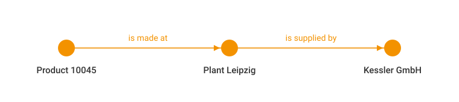
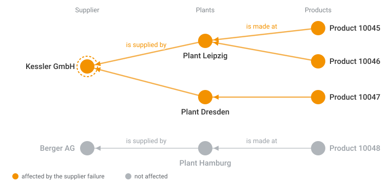
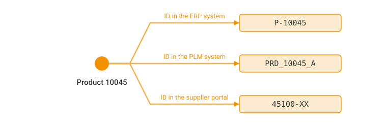

# What is a knowledge graph?

A knowledge graph records things and the named relationships between them, in a form that both people and software can follow.

The documentation uses the term throughout, because it is what eccenca Corporate Memory builds and works with.
The terms that come with it, such as triple, Internationalized Resource Identifier (IRI) and vocabulary, are covered in [Semantic Web basics](../semantic-web-basics/index.md), which is optional.

## Things and relationships

Most business data lives in tables.
A table is a good answer to a question that was known in advance.
Its columns are fixed, and every row answers the same question in the same shape.

The questions that cause trouble are the ones nobody planned for.
Which products are affected if a supplier fails?
The answer usually exists, spread over several systems, each with its own name for the same product.
Producing it means a join that somebody writes and somebody else maintains.

A knowledge graph turns that around.
Instead of rows in fixed columns, it records the things themselves and how they are connected:

- Product 10045: is made at Plant Leipzig
- Plant Leipzig: is supplied by Kessler GmbH

{ class="bordered" }

Each connection carries a name.
"Is made at" is not a column heading that a reader has to interpret, and not a foreign key that only the application understands.
It is a statement, written down, that software can follow as reliably as a person can read it.

## What that changes

Three things follow, and they are the reason the term appears in this documentation at all.

New questions need no new structure.
Anything connected can be followed, in any direction, without that path having been planned.
The question about the failed supplier is answered by walking from the supplier to the plants to the products.
Nobody has to have anticipated it.

{ class="bordered" }

A new source connects instead of becoming another island.
A fourth system attaches to things that already exist.
It does not arrive as another table that nobody has joined yet.

The meaning travels with the data.
A graph records not only that two things are related but what the relation means.
That is what allows a result to be explained, checked and reused, rather than only produced.

## Identifiers do not disappear

A common worry is that connecting systems means overwriting what they contain.

The opposite happens.
The same product may be `P-10045` in one system, `PRD_10045_A` in a second and `45100-XX` in a third.
In a knowledge graph these become properties of one product.
Each fact can be traced back to the system it came from, and written back to it where that makes sense.

{ class="bordered" }

## What a knowledge graph is not

Not a replacement for existing systems.
The source systems keep running and keep their data.
A graph adds the layer where their contents are related to one another.

Not a data warehouse or a reporting tool.
A warehouse is built to aggregate numbers for known reports.
A graph is built to represent meaning and to answer questions that were not foreseen.

Not automatic.
The relationships have to be stated deliberately.
That work is what the [Build](../../build/index.md) part of Corporate Memory is for, and it is the reason the result can be trusted later.

## Where the terminology comes from

Knowledge graphs are built on a set of open standards, usually grouped under the term Semantic Web.
Those standards are why words such as triple, IRI and vocabulary appear in this documentation.

None of them are needed here.
The optional [Semantic Web basics](../semantic-web-basics/index.md) introduce them and show what each one looks like in Corporate Memory.

## Next

- [Semantic Web basics](../semantic-web-basics/index.md): optional, the terminology, about 35 minutes
- [eccenca Corporate Memory at a glance](../corporate-memory-at-a-glance/index.md): the parts of the product and how they relate
