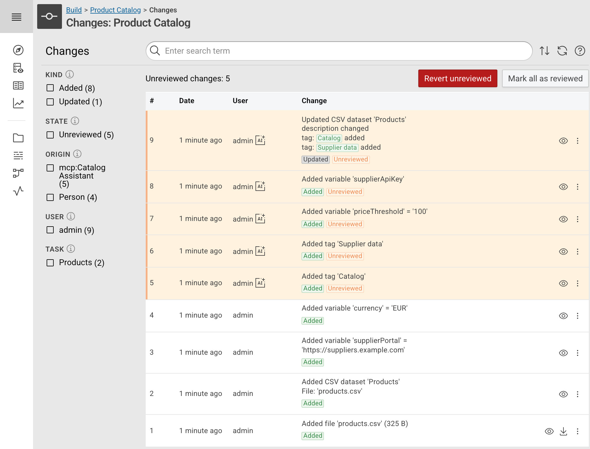
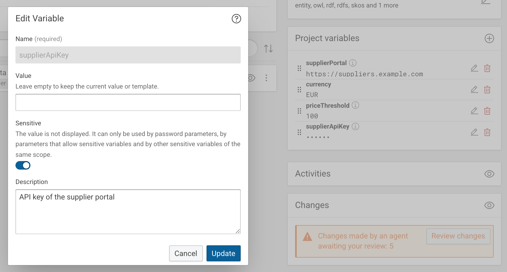
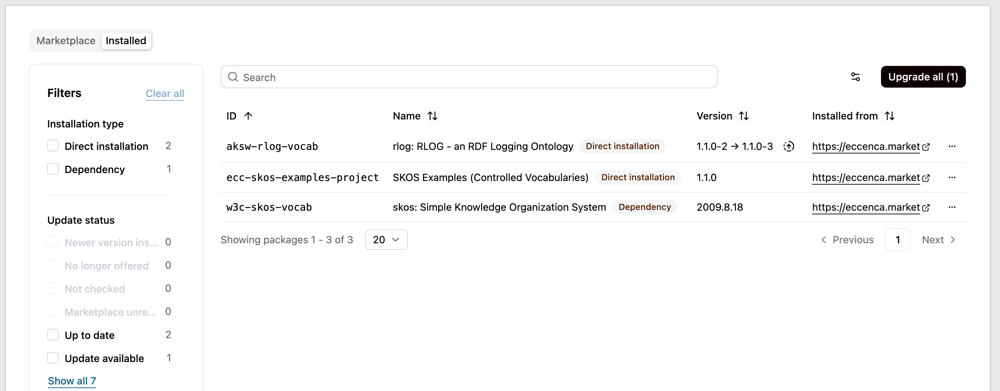
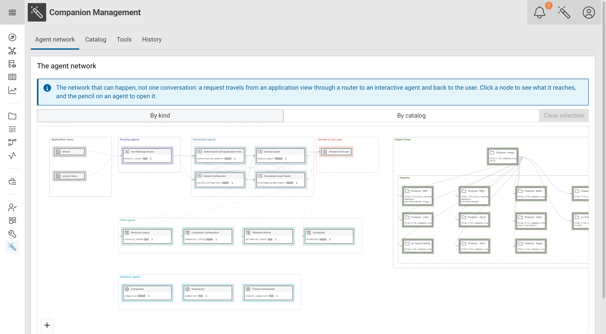
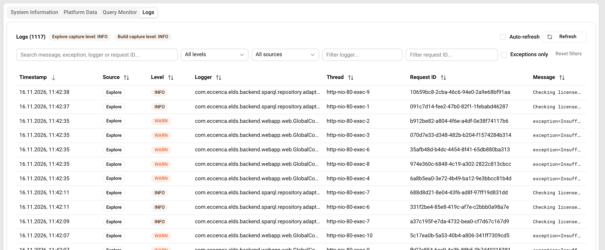

# eccenca Corporate Memory 26.3.0

eccenca Corporate Memory 26.3 is the third major release in 2026.
It introduces a change journal that records, reviews and reverts every change to a Build project, adds sensitive variables, resolves version constraints between Marketplace packages and reports their update status, adds a management module for the agents of Companion, and opens the in-memory logs of the backends to administrators in Explore and cmemc.

The highlights of this release are:

- Build: **Change Journal**
    { class="bordered" width="20%" align=right }
    - Every Build project keeps a history of its changes, made through the user interface, the REST API or the MCP server.
        The new **Changes** view lists, searches and filters them, and reverts a change while the project state still allows it.
        Changes made by an agent count as unreviewed until a user reviews them.

- Build: **Sensitive Variables**
    { class="bordered" width="20%" align=right }
    - Project and execution variables can be marked as sensitive.
        Their values are stored encrypted and are neither displayed nor returned by the API, and cmemc manages execution variables and passes them to a workflow run.
        See [Build Variables](../../../build/variables/index.md).

- Marketplace: **Dependency Versions and Installed Packages**
    { class="bordered" width="20%" align=right }
    - [Marketplace](../../../distribution/marketplace/index.md) packages declare version constraints on their dependencies, which every installation path honors.
        The new **Installed** tab of **Packages** reports where each installed package came from, whether it was installed directly or as a dependency, and whether an update is available, and **Upgrade all** installs the available updates.
        Project packages can ship Explore application views.

- Explore: **Companion Management**
    { class="bordered" width="20%" align=right }
    - The new **Companion management** module configures [Companion](../../../explore-and-author/companion/index.md) in the user interface.
        In the **Catalog** tab, administrators edit the agents, skills and named models of Companion, which are kept in a catalog graph.
        The **Agent network** tab shows how a request travels from an application view through routing, interactive and task agents back to the user.
        **Tools** lists the tools an agent can call, and **History** searches, exports, backs up and restores the conversations of all users.

- Explore and cmemc: **Log Retrieval**
    { class="bordered" width="20%" align=right }
    - Administrators read and filter the most recent log lines of Build and Explore in the **Logs** tab of [Platform management](../../../explore-and-author/platform-management/index.md), with `cmemc admin logs` or through a REST API.
        The lines are kept in an in-memory buffer, so no log file is needed.

    <div style="clear: right"></div>

This release delivers the following component versions:

- [eccenca Corporate Memory 26.3.0](#eccenca-corporate-memory-2630)
    - [eccenca DataIntegration v26.3.0](#eccenca-dataintegration-v2630)
    - [eccenca Explore v26.3.0](#eccenca-explore-v2630)
    - [eccenca Marketplace v26.3.0](#eccenca-marketplace-v2630)
    - [eccenca Corporate Memory Control (cmemc) v26.3.0](#eccenca-corporate-memory-control-cmemc-v2630)
    - eccenca Graph Insights v20.1.0
    - eccenca n8n Community Node v0.4.2
    - [Migration Notes](#migration-notes)
        - [eccenca DataIntegration](#eccenca-dataintegration)
        - [eccenca Explore](#eccenca-explore)
        - [eccenca Marketplace](#eccenca-marketplace)
        - [cmemc](#cmemc)

We tested this release with the following dependency components:

- Ontotext GraphDB v11.5.0
- Keycloak v26.7.3

More detailed information for this release is provided in the next sections.

## eccenca DataIntegration v26.3.0

We are excited to announce the release of DataIntegration v26.3, which introduces a change journal for projects, sensitive variables, a log retrieval API for administrators, new operator options and a wide range of MCP server improvements.

**v26.3.0 of DataIntegration adds the following new features:**

- **Change journal:**
    - Every write a request makes to a project is recorded as a change that knows how to undo itself: task additions, updates and deletions, single mapping rules, project variables, tags and file resources, made through the user interface, the REST API or the MCP server.
        A workflow run is represented by its execution entry.
        The runs of other activities are not recorded yet.
    - Added a **Changes** view per project, reachable from the project view and the project menus.
        It lists the changes newest first, reverts a change while the project state still allows it, and explains the journal in a help dialog.
    - Each change describes what it did: the kind of task, renames, what a mapping rule maps, the values of non-sensitive variables, file sizes and nested rules.
        A new task lists its non-default settings, task and mapping rule updates list the changed parameters or fields with both values, and a workflow or transformation saved as a whole lists its added, removed and changed nodes, connections or rules.
        A workflow run entry links its execution report.
    - The changes can be searched, filtered by kind, state, origin, user and task, and sorted.
        The list is paged on the server.
    - Changes made by an agent through the MCP server count as unreviewed until a user reviews them.
        The **Changes** card on the project view shows how many changes await review.
        The **Changes** view marks them and offers **Revert unreviewed**, **Mark all as reviewed** and marking as reviewed up to a selected change.
    - The `workflow_execute` tool of the MCP server no longer runs a workflow directly: the request is staged as a proposed change and answered with a review link.
        Setting `com.eccenca.di.assistant.McpConfig.reviewGate = false` restores direct runs, for automation without a reviewer.
    - The journal is kept on the file system, so it survives a restart and is included in exports that include user data.
        The export endpoints take an `exportChangeJournal` flag to leave it out.
    - Added a REST API under `/api/workspace/projects/:project/changes`, see the OpenAPI documentation for details.
    - Added the WebSocket endpoint `/api/workspace/projects/:projectId/changes/updatesWebSocket`, which streams journal updates.
        The HTTP and the WebSocket lists both support the `unreviewedOnly` filter.
    - MCP requests can be attributed to a Companion conversation with the `X-CMEM-conversationId` header.
    - Companion integration:
        - Companion shows live counts of the unreviewed changes from the current conversation and from other sources in the open project, together with a review link.
        - A Companion conversation can be opened from its journal entries without reloading the page.
        - Companion links show the unreviewed changes, highlight the related conversation and filter the journal to its changes.
- **Variables:**
    - **Sensitive variables:**
        - Project and execution variables can be marked as sensitive in the variables widget.
            Their values and templates are not displayed or returned by the variables endpoints, and are stored encrypted.
        - A sensitive global variable can be configured encrypted as `PASSWORD_PARAMETER:<encrypted value>`.
        - The content and the HTTP headers of the **Execute REST requests** operator can use sensitive variables.
    - The **Execution variables** widget is now also shown on custom task and dataset views, so parameter templates that reference `{{execution.<name>}}` can be defined there without the API.
        Before, it was only available for workflows, transformations and linking tasks.
    - Added variables API endpoints:
        - `GET /api/core/variableTemplate/allVariables` returns the global variables and the variables of all projects and their tasks in one request.
        - `GET /api/workflow/executionVariables/{project}/{workflow}` lists the execution variables a workflow run needs and marks those which have to be provided when the run is started.
- **Operators and datasets:**
    - Transform task: the new advanced parameter **Input limit** restricts every execution of the task, including workflow executions, to the first N input entities.
    - **Send email** operator: the new advanced parameter **Verify server host name** is enabled by default, see the [Migration Notes](#eccenca-dataintegration).
    - **Combined input hash** transformer: the new optional glue parameter inserts a configurable separator between the combined values.
    - **Filter by regex** transformer: can match a part of the value in addition to the full value, which can be combined with the existing negate option.
    - **Get value by index** transformer: the index may be negative and then counts backward from the end of the sequence.
    - Neo4j dataset: every `rdf:type` value of a written entity is added as a label of its node, in addition to the target entity type of the mapping.
    - RDF file dataset: JSON-LD is offered as a format for reading.
- **User interface:**
    - Project import dialog: a custom project ID can be entered.
    - Mapping Creator:
        - Target elements can be selected with ++ctrl++ + click.
        - **Deselect all** is always offered in addition to **Select all**, and both are shown as icons instead of text buttons.
    - Dialogs carry ARIA attributes and roles.
- **MCP server:**
    - Rule blocks: `task_type_describe("RuleBlock")` documents them, `task_list` filters by them, `transform_list_mappings` shows which rule blocks a rule calls, and `transform_preview(expandRuleBlocks=true)` shows their evaluated operator tree.
        The new `rule_block_evaluate` tool evaluates a rule block on its own.
    - Tags: the tags of a task can be set with `task_put` and the new `task_update_metadata` tool, and `task_list` shows them.
        The new `tag_list`, `tag_create` and `tag_delete` tools manage the tags of a project.
    - The new `workflow_report_list` tool finds past workflow runs.
    - `transform_preview` can return a single operator (`operatorId`).
    - `transform_add_mapping` adds several rules and `resource_upload_url` handles several files in one call.
- **Administration:**
    - Added a log retrieval API for administrators:
        - `GET /api/core/system/logs` returns the most recent log lines of the answering instance, filterable by `level`, `logger` and `contains`.
            Poll for new lines by passing the `lastSequence` of the previous response as `since`.
            A `dropped` value above zero reports lines that were evicted before the client fetched them.
        - `GET /api/core/system/logs/status` reports whether lines are captured and why they might be missing.
        - The lines are kept in a bounded in-memory ring buffer, so no log file is needed and an external Logback configuration keeps working.
            The buffer is enabled by default and requires the `https://vocab.eccenca.com/auth/Action/LogRetrieval` action.
            Each instance answers with its own lines only.

**v26.3.0 of DataIntegration introduces the following changes:**

- **Operators and datasets:**
    - **Evaluate template** operator: a template that uses no input variables and does not forward input attributes has no input port and outputs exactly one entity.
        A previously connected input is no longer read.
    - JSON and XML datasets: the error for a referenced entity that is missing from the output now names the referencing entity and the property, instead of only the missing URI.
- **Task API, also when used through the MCP server:**
    - Only the documented task JSON is accepted.
        Legacy payloads that put the task specification at the top level, or its parameters directly below `data` instead of below `data.parameters`, are rejected with a `400`.
    - Unknown keys are rejected with a `400` instead of being dropped silently: unknown attributes in `data` and `metadata`, and undeclared parameters in `data.parameters`.
        The rejection of an unknown `data` attribute lists the valid ones.
    - An empty description is stored as no description.
    - Clearer error messages for missing tasks, wrong parameter kinds, malformed mapping rules and rule blocks.
    - A duplicate rule ID names the parent rule the existing rule sits under.
        Rule IDs are unique per transformation, not per parent rule.
- **MCP server:**
    - Execution reports: `detail` (`full`, `compact`, `minimal`) replaces `fullReport`, and repeated rule errors are counted instead of listed.
    - `transform_autocomplete` replaces the incomplete value type list of the transform documentation.
        Its completions carry example values, `propertyType` and `range`, and a note when `maxResults` cut off the result.
    - Derivable mapping rule fields such as `sourcePaths` may be omitted, and `transform_preview` documents that it is stricter than an execution.
    - `plugin_list` falls back to matching any search term when none matches all, ranks ID and title matches first and no longer embeds icons.
    - `task_put` keeps the label and description of a task when the payload omits them, and its description documents the dataset-level fields `readOnly` and `uriProperty`.
    - `task_list` rejects unknown task types, and `task_delete` reports cascaded deletions.
    - A tool that fails unexpectedly reports the failure and its causes as a tool error, so the agent can pass it on.
        Before, a protocol error stated only "Internal error while executing tool".
    - More helpful error messages:
        - Invalid identifiers name each offending character by position and Unicode name, so homoglyphs can be spotted.
        - Source path parse errors name the offending character and what was expected there, instead of printing the grammar of the parser.
        - The transform report warning that aggregates the entity validation errors names the worst offending rules with their error counts and points to `ruleResults` for the sample values.
    - The server instructions state that direct RDF graph access (SPARQL, Graph Store) is not part of this server, so an agent asks for the Explore MCP server instead.
- **Companion integration** (configuration under `com.eccenca.di.assistant.CompanionConfig`), see the [Migration Notes](#eccenca-dataintegration):
    - `enabled` defaults to `true`.
        Companion also has to be enabled in Explore, and the user needs the `Explore-Companion-Use` action.
        Set `enabled = false` to disable the integration in DataIntegration separately.
    - `apiBasePath` defaults to `/dataplatform/api/companion/interactive`.
        Journal conversation lookups append `/conversations` to this base path.
- **Workflow execution:**
    - When a workflow is cancelled in local execution, the execution report lists the tasks that were still running and how long the workflow took to stop, for example because a plugin does not react to the cancellation.
    - Activity status messages show runtimes of a minute or more in minutes and hours, for example "Finished in 29min 20s" instead of "Finished in 1760.329s".
- **Platform and dependencies:**
    - Upgraded Apache Spark to 4.3.0.
    - Upgraded the Play Framework to 2.9.12 and Logback to 1.6.6.
    - Upgraded Apache POI to 6.0.0.
        Some transform operators of the **Excel** category return results closer to Excel.
    - The **Send email** operator uses Jakarta Mail instead of JavaMail 1.6, see the [Migration Notes](#eccenca-dataintegration).
    - Upgraded the AWS S3 SDK, the JDBC drivers for PostgreSQL, MariaDB, SQL Server and Snowflake, Saxon-HE and further libraries to their latest versions.
        This fixes known vulnerabilities in Jackson 3, the OpenTelemetry API and lz4.

**v26.3.0 of DataIntegration deprecates the following functionality:**

- The `Simple` and `Velocity` template engines of the SPARQL tasks, deprecated since v26.2.0, will be removed in release 28.1.
    Migrate affected tasks to the `Jinja` template engine.

**v26.3.0 of DataIntegration removes the following functionality:**

- Removed the deprecated Scala script task (**Script (deprecated)**), including its editor and its REST endpoints.
    Script tasks in a project fail to load, see the [Migration Notes](#eccenca-dataintegration).
- Removed the deprecated `GET /workspace/activities/log` endpoint.
    Use `GET /api/core/system/logs?logger=org.silkframework.runtime.activity` instead.
- Removed the `limit` parameter of the **Execute transform** activity.
    Set **Input limit** on the transform task instead, which counts input entities rather than output entities.

**v26.3.0 of DataIntegration ships the following fixes:**

- **Security and authentication:**
    - **OAuth:**
        - Startup now fails if OAuth is enabled but `user.manager.web.plugin` is not set to `oauthUserManager`, instead of leaving WebSocket endpoints reachable without a token, see the [Migration Notes](#eccenca-dataintegration).
        - WebSocket endpoints require authentication when OAuth is enabled.
            Before, they were accessible without a token.
        - A login session whose refresh token has become invalid triggers a new login instead of failing with a server error on every request.
            This also applies to WebSocket connections and to requests that were already running.
        - Requests that send a bearer token use exactly this token for identity, permissions and the access to Explore, instead of mixing it with cached session credentials.
        - A bearer token sent by a logged-in browser no longer switches that login session over to the user of the token.
    - **Project access control:**
        - If setting up the access control groups of a newly created, cloned or imported project fails, the project is removed again instead of remaining accessible to everyone.
        - Projects created or cloned through older APIs receive initial access control groups instead of being accessible to everyone.
            A clone keeps the groups of its source project.
    - **Sensitive variables:**
        - A variable that is not marked as sensitive can no longer be derived from a sensitive variable of the same scope.
        - Updating a variable no longer writes its value to the server log.
        - The **Evaluate template** transformer no longer resolves sensitive global variables when it is used as a filter in a template.
- **Variables:**
    - Editing a sensitive variable in the variables widget keeps its sensitive flag.
    - Variables used in SPARQL Select and SPARQL Update queries are protected from deletion and are copied along with the task.
    - Invalid variable requests are rejected with a clear error instead of failing with a server error.
    - The help in the dialog of the **Execution variables** widget describes execution variables instead of project variables.
- **Workflow execution:**
    - XML, JSON, Excel, text and binary file datasets: a workflow that is cancelled or fails before writing to the dataset no longer wipes the existing file.
    - Activities no longer fail sporadically with `QueryCancelledException` when an unrelated activity is cancelled at the same time, for example when a task is updated while its caches are refreshing.
    - Requests that wait for an activity, for example blocking workflow executions through the API, no longer sporadically leave a concurrent request unanswered.
    - In local execution, a nested workflow no longer continues with its remaining nodes after the enclosing workflow has been cancelled.
    - Cancelling a workflow in local execution while its output datasets are being cleared no longer clears the remaining ones.
    - **Execute REST requests** operator: responses written to a ZIP-based dataset with **Output result as file** enabled are stored directly in the dataset file instead of a nested ZIP file, and entries written for a Multi CSV ZIP dataset carry the `.csv` suffix.
    - Variable workflow execution:
        - Tasks that are re-configured through a config port resolve their parameter templates against their own execution variables, like every other task.
        - The control parameters `output:type` and `config-*` are no longer treated as input, so a request without any input is rejected.
        - An unknown output type is rejected, dataset sink configuration parameters are applied and the response has the content type matching the output type.
        - The result of an asynchronous execution is empty if there is no replaceable output dataset, and an error if the execution was cancelled.
    - Spark execution:
        - Written link tables (linking results) name the target and confidence columns by the `linkTargetUri` and `linkConfidence` property URIs, consistent with local execution.
            The source column is still written as `sourceURI`.
        - Links written to local or in-memory datasets use the configured link type of the linking rule, for example `owl:sameAs`, as property, consistent with local execution.
- **Datasets and queries:**
    - SPARQL Select query: projected variables are no longer missing from the output when they are named like a keyword (for example `?from`), contain non-ASCII letters, or follow a comment or string literal in the query.
    - JSON dataset: a file with an empty key (`"": ...`) no longer breaks the dataset; empty keys are ignored.
    - Knowledge Graph dataset: uploading a file no longer fails if the project files are not stored on the local file system, for example on S3.
    - S3 resource repositories: writing files no longer fails with an upload timeout until the next restart after workflow executions have been cancelled.
- **Tasks and mapping rules:**
    - Deleting a task that another task writes to or calls as a rule block is refused with a `409`, and the rejection lists the affected tasks.
    - Adding a second URI rule to a mapping rule is refused instead of being silently discarded.
    - A `complex` mapping rule with a URI-typed target and a `concat` pattern is no longer rewritten into an object mapping.
    - The mapping rule preview shows the entity URI as a source value for rules reading the empty path.
    - The object rule preview no longer shows an unrelated child value next to the generated URI.
    - Class, property and type suggestions no longer stay empty until a manual cache reload after a task has been saved while other caches were busy.
- **Workflow search:**
    - The workflow search no longer fails with a `500` when a workflow references a missing node, which also broke all `cmemc workflow` commands.
    - The **Output** facet value counts variable output datasets instead of input datasets.
- **Accessibility:**
    - Dialogs that lacked an accessible name now have one.
    - The workflow report selection has an accessible label.
    - The project task tabs are accessible.
    - The workflow report navigation can be used with the keyboard.
    - Menus no longer use menu roles where they do not apply.
    - Multi-select popups have correct semantics and keyboard behavior.

## eccenca Explore v26.3.0

We are pleased to announce the release of Explore v26.3, which adds log reading for administrators to Platform management, chart cloning and badge descriptions, ranks search results, and reworks how SHACL forms save resources and trigger workflows.

**v26.3.0 of Explore adds the following new features:**

- **Charts:**
    - An existing chart can be cloned as a new chart from the chart editor.
- **Workflows:**
    - Saving is blocked in SHACL forms and in the save dialog of the Business Knowledge Editor (BKE) when the user has no access to the workflows that are triggered on save.
- **Badges:**
    - Added a description field to badges.
- **Other:**
    - Added a log retrieval API for administrators, together with a **Logs** tab in **Platform management** that reads and filters the log lines.
    - Added a graph endpoint that returns the triple count of a graph.
    - Search results triggered by the Explore user interface are ranked.
        The ranking can be turned off with `store.searchRanking: false`.

**v26.3.0 of Explore introduces the following changes:**

- **Query Catalog:**
    - The query editor shows the full query label as its title, with breadcrumbs that include the catalog label.
- **SHACL:**
    - Selectable resources keep the `ORDER BY` of the `uiQuery` in all editors.
    - Long Markdown literals are truncated in resource views, preserving their Markdown formatting.
    - The property shapes **EditorialNote**, **ScopeNote** and **HistoryNote** use the path `skos:scopeNote` instead of `skos:note`.
    - Deprecated the SHACL placeholder `shuiMainResource`, see the [Migration Notes](#eccenca-explore):
        - The SHACL save endpoint (`PUT /api/explore/resource`) no longer has a main resource.
        - `{{shuiMainResource}}` in SHUI query templates resolves to the same value as `{{shuiResource}}`, also in value queries and charts of SHACL forms.
        - Versioning writes one change set per top-most resource of a save.
            Sub-resources (`sh:node`) are grouped with their parent.
        - Workflows that are triggered on save with the resource as payload now start for every saved resource, for example for all changed resources in the BKE or for changed sub-resources in SHACL forms.
        - Workflow trigger widgets in sub-shapes still send the resource the form is opened on, not the sub-resource.
        - Only resources with actual changes trigger workflows on save.
            Saving without edits no longer starts them.
- **Other:**
    - Added support for GraphDB 11.5.0.

**v26.3.0 of Explore ships the following fixes:**

- Access condition details and entered values stay visible when saving fails.
- The **Manage graph** dialog uses Uppy for loading files.
- Pagination labels are translated into the selected user interface language.
- Fixed the rewriting of SPARQL queries, which removed group braces under certain conditions.
- The stable export of the graph store failed on graphs that contain a malformed RDF collection.
    The export falls back to a version that tolerates such lists but is not byte-stable.
- The dialog for a new graph no longer closes when the graph URI options are opened.
- Access control: the **Dynamic access condition** field was editable in view mode.
    **Cancel** now discards unsaved changes in the field.

## eccenca Marketplace v26.3.0

We are excited to announce the release of eccenca Marketplace v26.3, which resolves version constraints between packages on publishing and installation, adds a view of the packages installed in Corporate Memory together with their update status, and lets project packages ship Explore application views.
The settings of the service are described in [Marketplace configuration](../../../deploy-and-configure/configuration/marketplace/index.md), and the manifest fields in [Development and Publication of Marketplace Packages](../../../develop/marketplace-packages/development/index.md#manifest).

**v26.3.0 of Marketplace adds the following new features:**

- **Installed packages:**
    - `GET /api/cmem/packages/installed` lists what Corporate Memory has installed, as opposed to what a marketplace offers.
        It answers with the envelope of `GET /api/packages/paginated`: one page of items, `pagination`, the echoed `filters` and `sorting`, and `facets`.
    - Each item carries the catalog fields of the installed manifest, with `package_version` the installed version, plus the installation facts:
        - `build_timestamp`, `installed_at`, `installed_by` and `package_size`
        - `dependency_level` and `is_direct`
        - `origin_type`, `origin_url` and the derived `origin`: the URL of the marketplace the package came from, `local` for the own registry of the instance, or `file` for an uploaded archive
        - `required_by`, the installed packages that depend on it
        - `available_from`, `available_version` and `update_status`, checked against the marketplace the package came from
    - `update_status` is one of `update_available`, `up_to_date`, `newer_installed`, `update_blocked` (the newer version breaks the version constraint of an installed dependant, listed in `update_blocked_by`), `not_offered`, `unreachable` (the marketplace did not answer within 5 seconds) or `unchecked`.
    - The catalog filters, facets and sorting apply.
        `origin` and `update_status` are additional facets and filters, `is_direct` is a filter and a facet, and `installed_at`, `origin`, `update_status`, `is_direct`, `installed_by` and `package_size` are additional sort fields.
    - `GET /api/cmem/packages/installed/updates` lists every installed package with an available update, in the order to install them: dependencies before their dependants.
        Upgrade them one after another with `POST /api/cmem/packages/install/from-marketplace`, with `marketplace_url` set to `available_from` and `replace=true`.
    - `GET /api/cmem/packages/installed/{package_id}` returns one installed package with its installed manifest, read from Corporate Memory, so a package installed from a file or from a marketplace that no longer offers it has details too.
        The images and texts its manifest declares are served from Corporate Memory below `…/installed/{package_id}/files/`.
    - `GET /api/cmem/packages/installed/{package_id}/dependencies` returns the part of the installed dependency tree that one installed package pulls in.
- **Dependency trees:**
    - `GET /api/cmem/packages/dependencies` reports the dependency tree of the packages installed in Corporate Memory, for marketplace packages and Python packages alike.
        Each dependency carries the declared constraint, the installed version and whether it is `satisfied`, `violated` or `missing`, together with the installed packages that depend on it (`required_by`).
        The top-level `violations` list every violated and missing dependency, so an empty list means the installed tree is consistent.
    - The tree comes flat and nested: `roots` names the installed packages nothing else requires, and `tree` expands them, with a dependency cycle pruned as `cycle` and a package expanded earlier marked as `repeated`.
    - `GET /api/packages/{package}/versions/{version}/dependencies/tree` resolves the whole dependency tree of a published package version against the registry.
        Each package gets the version an installation into an empty Corporate Memory would select.
        Every dependency the registry cannot resolve is listed under `problems` as `conflict`, `unsatisfiable`, `unknown` or `depth`, and a Python package is an `external` leaf.
- **Version constraints:**
    - Dependencies in a package manifest can declare a `version_constraint`:
        - A marketplace package dependency accepts `>=x.y.z` (at least), `<=x.y.z` (at most), `^x.y.z` (compatible range, the leftmost non-zero component stays the same) and `*` (no restriction).
        - A Python package dependency accepts `>=`, `<=` and `*` only.
        - Uploading a version whose manifest has a malformed constraint answers `422`, naming the dependency and the constraint, and publishes nothing.
    - Installing a package into Corporate Memory from the web application, the API (`POST /api/cmem/packages/install/from-marketplace`, `…/from-file`) or the MCP tool `package_install` honors the version constraints, like `cmemc package install`:
        - A dependency is installed at the newest version that satisfies all constraints on it, and an installed dependency at a satisfying version is left untouched.
        - An installed dependency at a violating version refuses the installation before anything is changed.
            The new `force_dependencies` flag upgrades or downgrades it instead.
        - Two dependencies that require incompatible versions of the same package always refuse the installation.
        - A package hosted by the instance itself and the dependencies it hosts are read straight from the local storage, with the same dependency resolution as an installation from a marketplace server.
    - Vocabulary packages may declare dependencies on other vocabulary packages, for example a vocabulary that imports and extends another one.
        Python package dependencies are still not allowed for vocabulary packages.
    - `manifest_check`, `POST /api/manifest` and `POST /api/packages/{package}/versions` check a marketplace package dependency against the local registry, if the instance hosts one: the target package must exist, and it must be a vocabulary package if the depending package is one.
        A dependency cycle is allowed to publish if the published version satisfies the constraints of the cycle.
- **Explore application views in packages:**
    - Project packages can ship Explore application views with the manifest file type `view` (`file_type: view`, `view_id` and the `file_path` of a JSON file written by `cmemc admin view export`).
    - The views are accepted by `POST /api/manifest`, `manifest_check`, the published JSON Schema and the package upload, and are listed by `GET /api/packages/{package}/versions/{version}/files`.
    - Installing a package creates the views after the graphs and the projects.
        `replace` overwrites an existing view with the same ID, a plain installation refuses it, and uninstalling removes the views before the projects and the graphs.
    - A package carries at most 20 views of at most 1 MiB each, and the `default` view is reserved.
    - Installing a package that declares a view needs Corporate Memory 26.2 or later and cmemc v26.3.0 or later.
- **Catalog and manifests:**
    - `GET /api/packages/paginated` and the MCP tool `package_list` take `package_license`, `language` and `dependency` filters.
        Their facets cover `package_license`, `package_tags`, `package_languages` and `package_dependencies` next to `package_type`.
    - Listings carry `package_dependencies`, the marketplace packages the latest version depends on.
    - Package manifests may carry a `build_timestamp`, which `cmemc package build` stamps into the archive manifest in UTC when the source manifest has none.
        A manifest without the field is stored and served as before.
- **MCP tools:**
    - The read-only tools `package_list_installed`, `package_info_installed`, `package_list_updates` and `package_dependencies` answer the same as the corresponding API routes and name the deployment in `corporate_memory`.
        With `include_texts`, `package_info_installed` also returns the readme, changelog and license the package was installed with.
    - `package_info` takes `include_dependency_tree` and then returns the resolved dependency tree of the selected version.
- **Web application:**
    - The package details show the `build_timestamp` of a version when its manifest carries one.

**v26.3.0 of Marketplace introduces the following changes:**

- `POST /api/packages/{package}/versions` refuses a version whose dependency tree cannot be resolved against the registry and answers `422` with every problem.
    `manifest_check` and `POST /api/manifest` report the same problems with these codes:
    - `dependency_unsatisfiable`: no published version satisfies the constraint.
    - `dependency_conflict`: the constraints on a package have no version in common.
    - `dependency_not_found`: the registry does not host a package that a dependency further down needs.
    - `dependency_depth`: the chain exceeds the maximum depth of 20.
- A manifest that lists its own `package_id` as a dependency fails the manifest validation, see the [Migration Notes](#eccenca-marketplace).
- Deleting a package or a version stays possible and is not checked against the packages that depend on it.
- Installing or replacing a package at a version that violates the version constraint of an already installed package is refused with `409 Conflict` before anything changes, naming each affected package, its constraint and the version that would break it.
    This also applies with `ignore_dependencies`.
    With `force_dependencies`, the installation proceeds and the response lists every broken package in `broken_dependants`.
    Both install routes therefore answer with an object (`package_id`, `broken_dependants`) instead of the bare package ID, see the [Migration Notes](#eccenca-marketplace).
    Uninstalling is unchanged: a package that others depend on can still be removed, and the gap shows up in the dependency tree as `missing`.
- Bootstrapping from `ECC_MARKETPLACE_BOOTSTRAP_DIR` retries a failed archive after the others until a pass installs nothing more, so the order of the file names no longer matters.
- Every filter of `GET /api/packages/paginated` and of the MCP tool `package_list` narrows the result, within a facet as well as across facets.
    Selecting several `language` values lists only the packages available in all of them, instead of any of them.
    A facet count is the number of packages a client gets by selecting that value.
- The `language` filter of `GET /api/cmem/packages/installed` and of the MCP tool `package_list_installed` takes several languages, like `GET /api/packages/paginated`.
- `GET /api/packages/paginated` sorts text fields case-insensitively and shares its implementation with the MCP tool `package_list`, so it reports tag facets as well.
- Web application: improved the accessibility of the filters, package cards and details, dialogs and the uninstall flow.

**v26.3.0 of Marketplace ships the following fixes:**

- The `language` filter of `GET /api/cmem/packages/installed` and of the MCP tool `package_list_installed` returned no package at all.
- `GET /api/cmem/packages/installed` matched no package when two or more tags were selected.
- A version constraint matched a packaging revision as a prerelease, so `2.0.0-1` was ranked below `2.0.0`.
    A version `X.Y.Z-N` is now a packaging revision of the release `X.Y.Z`, so a constraint applies to the release: with `1.9.0` and `2.0.0-1` published, `^1.0.0` resolves to `1.9.0`, and `2.0.0-1` satisfies `>=2.0.0`.
- A packaging revision now ranks above its release, and revisions rank by their number (`13.0.0 < 13.0.0-1 < 13.0.0-4 < 13.0.1`), wherever the newest version is picked: in version lists, on package cards and badges, for an installation without a version, for dependency constraints and for the update status.
- The upload check accepted any integer suffix as a packaging revision, so `1.0.0-0` and `1.0.0--1` could be published.
    These uploads are refused now, and a version already stored stays readable.
- The latest version of a package was the version uploaded last instead of the newest one, until the next restart.
    The metadata now follows the newest stored version on upload and on delete.
- Replacing a package reinstalled a dependency that only this package held at the latest published version, instead of a version satisfying its constraint.
    The install lock now stays in place for the whole duration of a replacement.
- Installing or uninstalling a package through the own registry of the instance resolves its marketplace package dependencies, including cycles, from the local storage.
    Before, this needed `ECC_MARKETPLACE_PUBLIC_URL`, left an installed dependency behind when its parent was uninstalled, and could fail with "Another process locked the package project" when more than one dependency was involved.
- Uninstalling a package left marketplace package dependencies two or more levels below it behind.
- `GET /api/info` reports the version with its `v` prefix, for example `v26.2.8`, as the home view and the badges show it.
- Web application:
    - The package card and details list all publishers, authors and maintainers, each role under a singular or plural heading.
    - The changelog dialog of a package no longer shows a duplicated **Changelog** title.

## eccenca Corporate Memory Control (cmemc) v26.3.0

We are excited to announce the release of cmemc v26.3, which manages execution variables and passes them to workflow runs, adds command groups for rule blocks and backend logs, backs up the Companion conversation history, and installs packages with version constraints and Explore application views.

**v26.3.0 of cmemc adds the following new features:**

- `admin companion` commands
    - `admin companion export` and `admin companion import` back up and restore the Companion conversation history as a ZIP archive.
- `project variable` command group
    - The command group manages the execution variables of tasks next to project variables.
    - `create --task PROJECT:TASK` creates an execution variable on a task, with tab completion of the tasks of all projects.
    - `get`, `update` and `delete` accept execution variable IDs in the form `PROJECT:TASK:VARIABLE`.
    - `list` shows execution variables with their task and states the scope of every variable.
        It also shows the read-only global variables, with the scope `global` and their name as ID.
    - `list` and `delete` filter variables by `scope` (`project` or `execution`), by `task` (`PROJECT:TASK`) and by `type` (`value` or `template`).
    - `create --sensitive` and `update --sensitive/--no-sensitive` set the sensitive flag of a variable.
        `list` marks sensitive variables, lists them without their value and filters by `sensitive`.
        `get` refuses to read the value or template of a sensitive variable, and `update --no-sensitive` needs a new `--value` or `--template`.
    - When a variable cannot be deleted because it is still used, `delete` names all variables and tasks that use it.
    - `delete` warns when it deletes an execution variable of a workflow that tasks of the workflow still use, since a run then needs the variable as `--parameter`.
    - `delete` skips global variables that `--all` or `--filter` select and reports each as skipped.
    - `list` shows the errors the server reports for single variables, for example a template that cannot be resolved.
    - The commands ask for an upgrade of Corporate Memory, instead of failing with `404 Not Found`, if Build is too old to read all variables.
- `workflow` commands
    - `workflow execute` and `workflow io` run workflows with execution variables:
        - `-p/--parameter NAME VALUE` overrides the default value of an execution variable for this run only, with tab completion of the variables the given workflows need.
        - `--parameter-file` reads the overrides from a JSON file, and a name given with `--parameter` wins.
        - A warning names overrides that a workflow does not use or define.
        - Workflows started by a scheduler cannot take overrides and always use the default values.
    - `workflow variables` lists the execution variables a workflow run needs: whether each is required, its default, and the tasks that use or set it.
- `project rule-block` command group
    - The command group manages reusable transformation rule blocks and needs Corporate Memory 26.2 or later.
    - `list` lists rule blocks with ID, port count and label, and `--filter` supports `project`, `regex`, `tag`, `usage` (used or unused) and `deprecated`.
    - `inspect` shows the complete rule block as a key/value table, and `--key` supports the `a.b[i].c` notation and is shell-completed.
    - `open` opens rule blocks in the rule block editor.
    - `create` creates an empty rule block with ID, label and description.
    - `update` updates any key shown by `inspect`, including port labels and the deprecation state.
    - `export` and `import` round-trip rule blocks as relocatable JSON files, so they can be version controlled and copied between projects.
        `--without-userdata` on `export` excludes creation and modification timestamps and account names.
        `import` skips existing rule blocks unless `--replace` is given, and `--id` imports under a different ID.
    - `usage` lists the tasks that reference a rule block, directly and indirectly.
    - `delete` refuses to delete a rule block that other tasks reference and lists them.
        `--with-dependent-tasks` deletes the rule block together with everything that depends on it.
        A bulk delete checks every selected rule block first and deletes nothing if one of them is used.
    - `eval` evaluates a rule block against the input examples stored with it.
- `admin logs` command group
    - The command group reads the in-memory log buffers of the backends.
    - `admin logs list` outputs the most recent log lines of the `explore` and `build` jobs, merged by time, as a table, as plain log lines (`--plain`) or as JSON (`--raw`).
        - Filters for `level` (the given level and above), `logger` (prefix), `contains` (substring), `job`, `newer-than` and `older-than`.
        - `newer-than` and `older-than` accept a duration (`5m`), a clock time meaning that time today (`09:03:50`) or an ISO 8601 timestamp.
            A value without a time zone is read as local time.
        - A result that is shorter than what the buffers hold says so and names `--limit`.
        - A job that cannot answer is reported with the reason and does not hide the lines of the others.
    - `admin logs list --follow` outputs new log lines as they arrive.
        The table is updated in place on a terminal, and lines are appended when the output is piped or redirected.
        It warns when the answering instance changed or when lines were dropped before they could be read.
    - `admin logs status` shows whether lines are captured, at which level, which time span the buffer covers and which loggers are excluded, for all jobs as one structure keyed by job (`--key build.capacity`).
- `package` commands
    - Solution packages can ship Explore application views:
        - A project package declares a view with a file spec of `file_type` `view`, a `view_id` and the `file_path` of the JSON file that `admin view export --id ID --output-file views/ID.json` writes.
        - `package build` refuses a view file that holds several views or another view than the manifest declares, a package that declares the `default` view, a vocabulary package that declares a view, more than 20 views per package and a view file above 1 MiB.
        - `package install` creates the views after the graphs and the projects of the package, refuses a view that already exists unless `--replace` is given, and leaves no view behind when the installation fails.
        - `package uninstall` removes the views before the projects and the graphs, and `package export` writes each view as it currently stands in Corporate Memory.
        - Installing a package that declares a view needs Corporate Memory 26.2 or later and this cmemc release.
            An older cmemc reports such a package as using an unsupported file type.
    - `package install --skip-installed` skips the installation if the package is already installed in the requested version.
        Combine it with `--replace` to upgrade or downgrade a package that is installed in another version.
    - `package install` enforces the version constraints a package declares on its dependencies:
        - A dependency can declare a `version_constraint`: `>=x.y.z`, `<=x.y.z`, `^x.y.z` (compatible range) or `*` for marketplace packages, and `>=`, `<=` or `*` for Python packages.
        - A dependency that is not installed yet is installed at the newest version that satisfies its constraint, and one that is installed at a satisfying version is left untouched.
        - If an installed dependency violates its constraint, the installation fails before anything is installed and names the dependency, the constraint, the installed version and the `--force-dependencies` option.
        - `--force-dependencies` upgrades or downgrades such a dependency to a satisfying version instead, and warns about installed packages whose own constraint the new version violates.
        - Two dependencies that require incompatible versions of the same package fail the installation, even with `--force-dependencies`.
    - `package dependencies` shows the dependency tree of the installed packages:
        - One tree per installed package that nothing else requires, for marketplace packages and Python packages alike.
        - Each package shows its type (`project`, `vocabulary` or `python`), and each dependency the declared constraint, the installed version and whether it is `satisfied`, `violated` or `missing`.
        - A package shown before is marked `[see above]`, and a dependency cycle ends in `[cycle]`.
        - A `PACKAGE_ID` limits the output to the tree of that package.
        - `--raw` outputs the whole tree as JSON, flat and nested, with a `violations` list of every violated and missing dependency.
- `dataset download` command
    - The new `--filename-template` option builds the output file name from the placeholders `{{file}}`, `{{project}}`, `{{dataset}}`, `{{connection}}` and `{{date}}`, as an alternative to an output path.

**v26.3.0 of cmemc introduces the following changes:**

- `package install` refuses an installation or replacement that would violate the version constraint of an already installed package.
    - The refusal happens before anything is changed and names each affected package, its constraint and the version that would break it.
    - `--force-dependencies` installs anyway and warns about every installed package it broke.
    - Replacing a package reinstalls a dependency that only this package held at a version satisfying its constraint, never at the latest published one.
    - `package uninstall` is unchanged: a package that others depend on can still be removed, and the gap shows up in `package dependencies` as `missing`.
- `package build` stamps a `build_timestamp` (UTC, ISO 8601, second precision) into the archive manifest when the manifest in the package directory carries none.
    An existing value is kept and the source manifest file is never modified.
    `package inspect` lists the field of a stamped archive.
- `project variable delete --all` and `--filter project` also delete the execution variables of the tasks, see the [Migration Notes](#cmemc).
- `workflow execute` and `workflow io` do not start a workflow as long as an execution variable it requires has no value, and name the missing variables instead.

**v26.3.0 of cmemc ships the following fixes:**

- `package install`
    - Tasks that cannot be loaded in the installed projects are reported as warnings, as `project import` does, instead of being installed silently.
        This covers the projects of the package and of every dependency installed or reinstalled along with it.
    - A package directory given as a relative path like `.` with an extracted project directory is installed, instead of failing with `File exists`.
- `workflow io` accepts a workflow of workflows whose variable input or output sits in a nested workflow again, and `workflow list --filter io` lists it.
- `--all` combined with `--filter` or IDs is rejected as a usage error, instead of silently ignoring the filter or IDs and acting on all objects, see the [Migration Notes](#cmemc).
- `dataset download` accepts an omitted output path again, as the command help always stated.
    The file is then saved to the current directory with the name of the remote file resource.
- `project variable get`, `update` and `delete` reject a variable ID with a wrong number of parts and name the accepted forms, instead of ignoring the surplus part.
- `graph import` enumerates all files including the skipped ones, and `--replace` reports `added` instead of `replaced` for graphs that did not exist before.
    Files are imported in alphabetical order, and skipped files are reported as `skipped (graph exists)`.
- A command whose output is piped into a reader that stops reading, such as `head`, no longer reports a broken pipe as an error.
- Shell completion no longer prints a Python traceback when the value of an earlier option is refused.

## Migration Notes

!!! info "Backward and Forward Compatibility"

    We do not guarantee forward compatibility for configuration, data or projects.
    I.e. importing a project created with DataIntegration v26.3.0 into DataIntegration v26.2.0 (or older) might not work.

    Backward compatibility will be ensured or migration paths explained.
    I.e. projects created with DataIntegration v26.2.0 can be imported into DataIntegration v26.3.0.

### eccenca DataIntegration

- **OAuth configuration:** Startup fails if OAuth is enabled but `user.manager.web.plugin` is not set to `oauthUserManager`.
    Installations that enable OAuth without that setting have to add it.
- **Send email operator:** For SSL/TLS connections, the certificate of the SMTP server has to match the configured host name.
    Sending to a server whose certificate does not match fails with a certificate error after the upgrade.
    Either configure the host name the certificate was issued for, or disable the new advanced parameter **Verify server host name** of the operator.
- **Neo4j dataset:** Writing typed entities requires Neo4j 5.24 or newer.
- **Scala script task:** The deprecated **Script (deprecated)** task was removed.
    Projects that contain script tasks fail to load these tasks.
    Use native Python plugins instead.
- **Execute transform activity:** The `limit` parameter was removed.
    Set **Input limit** on the transform task instead, which counts input entities rather than output entities.
- **Task API:** Legacy task payloads and unknown keys are rejected with a `400`.
    Clients that send the task specification at the top level, parameters directly below `data`, or undeclared attributes and parameters need to send the documented task JSON.
- **MCP server:** The `workflow_execute` tool no longer runs a workflow directly, but stages the request as a proposed change to be reviewed in the **Changes** view.
    Set `com.eccenca.di.assistant.McpConfig.reviewGate = false` in the Build configuration to keep running workflows without review.
- **Templating:** The `Simple` and `Velocity` template engines of the SPARQL tasks will be removed in release 28.1.
    Migrate affected tasks to the `Jinja` template engine.

### eccenca Explore

- **SHACL placeholder `shuiMainResource`:** The placeholder is deprecated and resolves to the same value as `{{shuiResource}}`.
    SHUI query templates, value queries and charts that rely on `{{shuiMainResource}}` pointing to the resource the form is opened on need to be checked.
- **Workflows triggered on save:** Workflows that are triggered on save with the resource as payload start once for every saved resource, including changed sub-resources, and no longer start when a resource is saved without edits.
- **SKOS note property shapes:** The property shapes **EditorialNote**, **ScopeNote** and **HistoryNote** use the path `skos:scopeNote` instead of `skos:note`.

### eccenca Marketplace

- **Self-referencing manifests:** A version stored earlier whose manifest lists its own `package_id` as a dependency no longer loads after the upgrade.
    Check the registry before upgrading and remove or republish the versions the following command lists, run in the data directory:

    ```shell-session
    jq -r 'select(.package_id as $p | any(.dependencies[]?; .package_id == $p)) | input_filename' */*-v*.json
    ```

- **Install routes:** `POST /api/cmem/packages/install/from-marketplace` and `…/from-file` answer with an object (`package_id`, `broken_dependants`) instead of the bare package ID.
    Clients that read the package ID from the response need to read `package_id` now.
- **Language filter:** Selecting several `language` values in `GET /api/packages/paginated` lists only the packages available in all of them, instead of any of them.

### cmemc

- `project variable delete --all` and `--filter project` also delete the execution variables of the tasks.
    Use `--filter scope project` to delete project variables only.
- `--all` combined with `--filter` or IDs is rejected as a usage error.
    This affects all `delete` commands as well as `package uninstall`, `package export`, `admin acl export`, `admin view export`, `graph insights update` and `admin migration execute`.
    Scripts that combine these options need to be adjusted.
- `workflow execute` and `workflow io` do not start a workflow as long as an execution variable it requires has no value.
    Scripts that run such workflows need to pass the variables with `--parameter` or `--parameter-file`.
